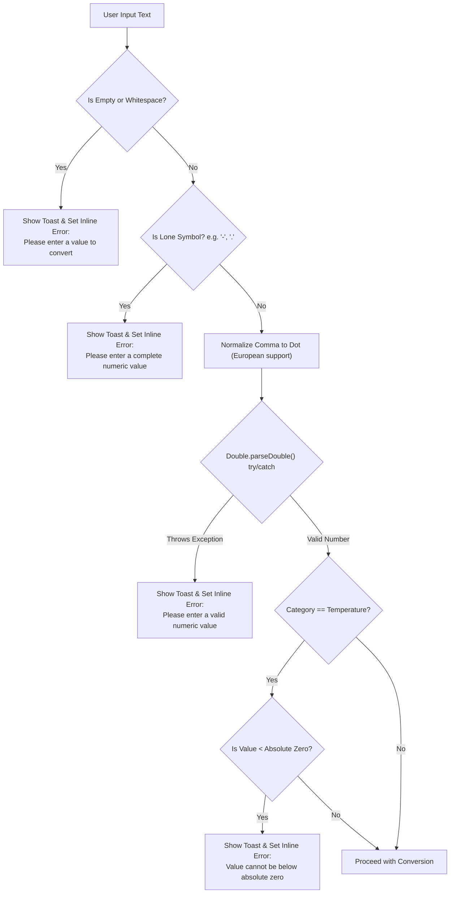
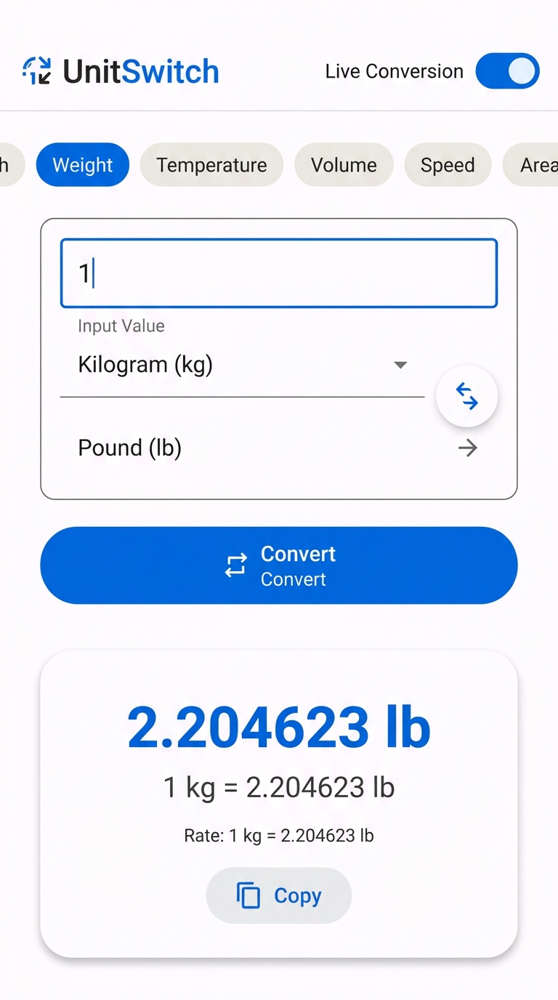
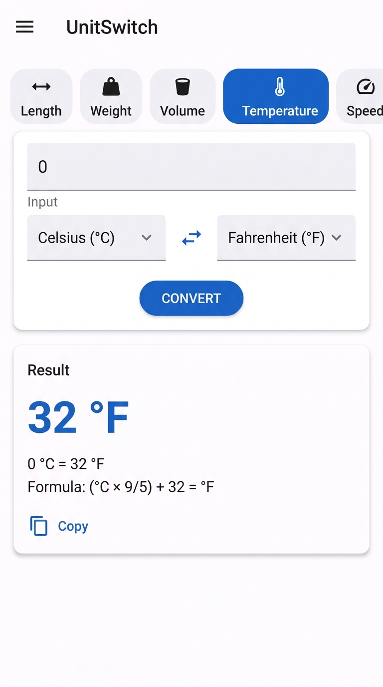
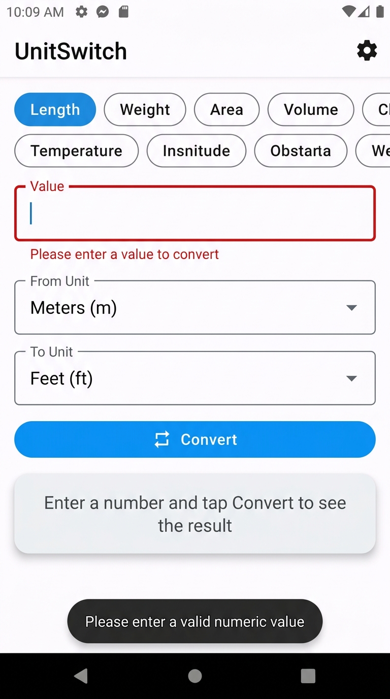
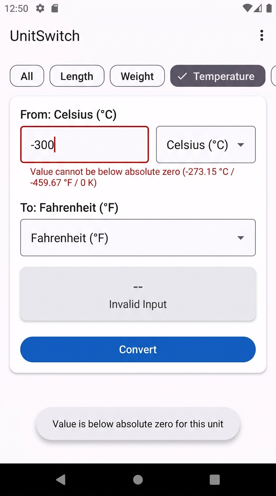
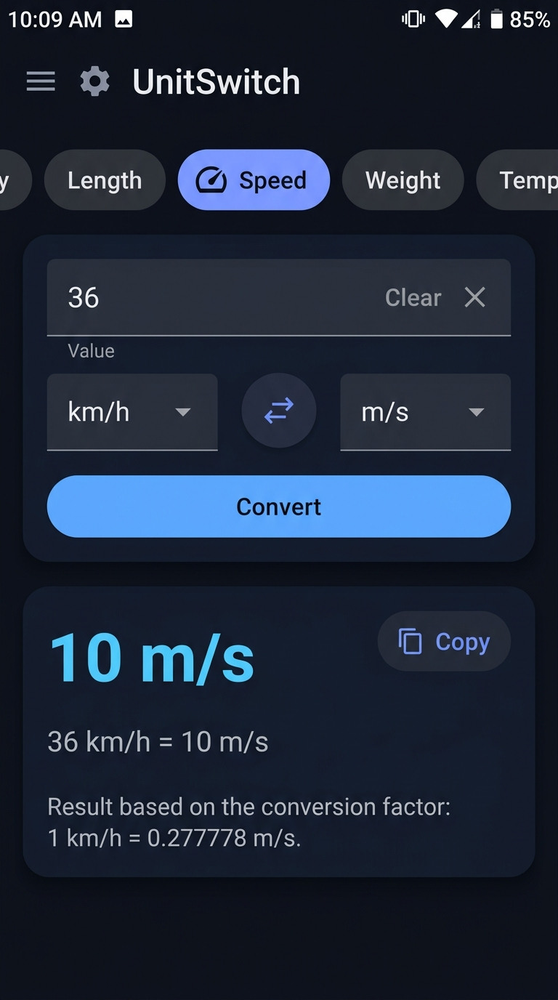

# UnitSwitch - Smart Offline Unit Converter

> **Oasis Infobyte Internship Submission**  
> **Domain:** Android App Development  
> **Task:** 1 — Unit Converter App  
> **Author:** Mudassir Ahmed  

[-blue.svg)](https://developer.android.com/about/versions/oreo)
[-green.svg)](https://developer.android.com/about/versions/14)
[](https://www.oracle.com/java/)
[](https://m3.material.io/)
[]()
[]()

---

## 📱 App Overview

**UnitSwitch** is an offline unit converter Android application built with native Java and Material Design 3. It converts values across **5 common measurement categories** (Length, Weight, Temperature, Volume, and Speed) featuring real-time live conversion, unit swapping, clipboard copying, and input validation with thermodynamic absolute-zero protection.

The application requires **zero network permissions**, functions completely offline, and handles edge cases such as European comma decimals, negative temperatures, and device orientation changes without resetting state.

---

## ✨ Features List

- **5 Measurement Categories & 29 Supported Units:**
  - **Length:** Millimetre, Centimetre, Metre, Kilometre, Inch, Foot, Yard, Mile.
  - **Weight (Mass):** Milligram, Gram, Kilogram, Tonne, Ounce, Pound.
  - **Temperature:** Celsius (°C), Fahrenheit (°F), Kelvin (K).
  - **Volume:** Millilitre, Litre, Cubic Metre, Teaspoon (US), Tablespoon (US), Fluid Ounce (US), Cup (US), Gallon (US).
  - **Speed:** Metre per second (m/s), Kilometre per hour (km/h), Miles per hour (mph), Knot (kn).
- **Two Conversion Modes:**
  - **Live Conversion:** Automatically computes and displays results as you type or change unit selections.
  - **Manual Conversion:** Traditional "Convert" button with debounce protection against rapid taps.
- **Smart Validation & Inline Feedback:**
  - Rejects empty, whitespace, and non-numeric inputs (e.g. `"-"`, `"."`, `"1.2.3"`, `"abc"`).
  - Displays both an Android **Toast** notification and an **inline error** on the `TextInputLayout`.
  - Intelligently suppresses error flashing while typing empty or partial values during live mode.
- **Physical Absolute-Zero Boundary Check:**
  - Prevents non-physical temperatures below absolute zero ($-273.15^\circ\text{C}$, $-459.67^\circ\text{F}$, $0\text{ K}$) with distinct user alerts.
- **Micro-Interactions & Quick Actions:**
  - **Swap Button:** 180° animated button between spinners to instantly swap source and target units.
  - **Copy to Clipboard:** One-tap button that copies the formatted equation (e.g., `100 cm = 39.3701 in`) with a confirmation `Snackbar`.
  - **IME Done Action:** Virtual keyboard "Done" action triggers the conversion and hides the keyboard.
- **Robust State Persistence & Orientation Safety:**
  - Survives screen rotation without losing input values, selected category, unit selections, or calculated results.
  - Automatically remembers the last-used category across app launches via `SharedPreferences`.
- **Material 3 Design System:**
  - Responsive single-scroll card layout (`ScrollView` with `adjustResize`).
  - Native Light Theme and Dark Theme (`values-night`).
  - Custom adaptive vector launcher icon.
  - Minimum 48dp touch targets on all interactive views.

---

## 🛠️ Tech Stack & Constraints

| Component | Specification |
| :--- | :--- |
| **Language** | Java (100% Java, no Kotlin) |
| **UI Paradigm** | XML Layouts & View Binding (No Jetpack Compose) |
| **Design System** | Google Material Design 3 (`Theme.Material3.DayNight.NoActionBar`) |
| **Compile SDK** | 34 (Android 14) |
| **Target SDK** | 34 |
| **Min SDK** | 26 (Android 8.0 Oreo) |
| **Allowed Dependencies** | AndroidX (AppCompat, ConstraintLayout), Material Components (1.11.0) |
| **Permissions** | None (100% offline, `android:allowBackup="false"`, `android:exported="true"`) |
| **Architecture** | Clean Architecture (Separation of UI, Logic, and Util layers) |
| **Testing** | JUnit 4 with comprehensive unit tests for converter and validation |

---

## 🚀 How to Open and Run

### Prerequisites
- Android Studio Hedgehog (2023.1.1) or newer / Ladybug / Jellyfish.
- JDK 17 (Microsoft OpenJDK 17 or Android Studio Embedded JDK).
- Android SDK Platform 34 installed.

### Quick Setup Steps
1. Clone or download this repository.
2. Open **Android Studio**.
3. Select **Open** and choose the project folder:  
   `OIBSIP/Android-Task1-UnitConverter/`
4. Let Gradle sync dependencies automatically.
5. Select an Android device or emulator running API 26 or higher.
6. Press the green **Run** button (`Shift + F10`) to build and launch the app!

### Running Tests from Command Line
You can run the full automated JUnit test suite directly using the included Gradle wrapper:
```bash
./gradlew test
```
To assemble the debug APK:
```bash
./gradlew assembleDebug
```
The compiled APK will be generated at:  
`app/build/outputs/apk/debug/app-debug.apk`

---

## 📂 Project Structure

```
OIBSIP/Android-Task1-UnitConverter/
├── app/
│   ├── build.gradle                         # App-level build configuration & dependencies
│   ├── proguard-rules.pro                   # ProGuard / R8 optimization rules
│   └── src/
│       ├── main/
│       │   ├── AndroidManifest.xml          # App manifest with exported activity & backup=false
│       │   ├── java/com/mudassir/unitswitch/
│       │   │   ├── logic/                   # Business logic layer
│       │   │   │   ├── Category.java        # Enum of 5 measurement categories & unit models
│       │   │   │   ├── UnitModel.java       # Immutable unit representation (id, name, symbol, factor)
│       │   │   │   ├── UnitConverter.java   # Core conversion engine with base-unit design
│       │   │   │   └── ConversionResult.java# Output encapsulation
│       │   │   ├── ui/                      # Presentation layer
│       │   │   │   ├── MainActivity.java    # View Binding, event listeners, state restoration
│       │   │   │   └── UnitSpinnerAdapter.java # Custom dropdown adapter for unit names & symbols
│       │   │   └── util/                    # Helper utilities
│       │   │       ├── Constants.java       # Preference keys, Bundle keys, physical limits
│       │   │       ├── FormatUtils.java     # Locale-safe number & equation formatting
│       │   │       ├── ValidationResult.java# Validation state object
│       │   │       └── ValidationUtils.java # Input sanitization & boundary checking
│       │   └── res/
│       │       ├── drawable/                # Vector drawables (icons, backgrounds, ripples)
│       │       ├── layout/
│       │       │   ├── activity_main.xml    # Single-card responsive layout
│       │       │   ├── item_spinner.xml     # Spinner selected item view
│       │       │   └── item_spinner_dropdown.xml # Spinner dropdown item view
│       │       ├── values/
│       │       │   ├── colors.xml           # Deep Indigo & Slate light palette
│       │       │   ├── dimens.xml           # Standardized spacing & touch targets (>= 48dp)
│       │       │   ├── strings.xml          # All user-facing strings (zero hardcoding)
│       │       │   └── themes.xml           # Material 3 light theme styles
│       │       └── values-night/
│       │           ├── colors.xml           # Dark OLED / Slate palette
│       │           └── themes.xml           # Material 3 dark theme styles
│       └── test/java/com/mudassir/unitswitch/
│           ├── logic/
│           │   └── UnitConverterTest.java   # Tests for all required conversions & edge cases
│           └── util/
│               ├── FormatUtilsTest.java     # Number formatting & scientific notation tests
│               └── ValidationUtilsTest.java # Validation & error rejection tests
├── gradle/wrapper/                          # Gradle wrapper binaries & properties (Gradle 8.4)
├── screenshots/                             # Project screenshots
├── build.gradle                             # Root build configuration
├── gradle.properties                        # JVM args & AndroidX flags
├── settings.gradle                          # Plugin & module management
├── .gitignore                               # Standard Android ignores
└── README.md                                # Comprehensive documentation
```

---

## 📐 Conversion Architecture & Formulas

### 1. Data-Driven Base-Unit Design (Linear Categories)
To avoid messy $O(N^2)$ conversion chains, all linear categories (Length, Weight, Volume, Speed) use an intermediate **Base Unit** architecture:
$$\text{Base Value} = \text{Input Value} \times \text{Factor}_{\text{source}}$$
$$\text{Target Value} = \frac{\text{Base Value}}{\text{Factor}_{\text{target}}}$$

| Category | Base Unit | Representative Exact Factors |
| :--- | :--- | :--- |
| **Length** | Metre ($\text{m}$) | $1\text{ in} = 0.0254\text{ m}$ (exact)<br>$1\text{ ft} = 0.3048\text{ m}$<br>$1\text{ mi} = 1609.344\text{ m}$ |
| **Weight** | Kilogram ($\text{kg}$) | $1\text{ lb} = 0.45359237\text{ kg}$ (exact)<br>$1\text{ oz} = \frac{0.45359237}{16}\text{ kg} = 0.028349523125\text{ kg}$ |
| **Volume** | Litre ($\text{L}$) | $1\text{ US gal} = 3.785411784\text{ L}$ (exact)<br>$1\text{ fl oz} = \frac{3.785411784}{128}\text{ L} = 0.0295735295625\text{ L}$ |
| **Speed** | Metre/sec ($\text{m/s}$) | $1\text{ km/h} = \frac{1}{3.6}\text{ m/s}$<br>$1\text{ mph} = \frac{1609.344}{3600}\text{ m/s} = 0.44704\text{ m/s}$<br>$1\text{ knot} = \frac{1852}{3600}\text{ m/s}$ |

### 2. Dedicated Temperature Conversions (Non-Linear)
Temperature uses dedicated thermodynamic transfer functions with Celsius as the central node:
- **Celsius to Fahrenheit:**  
  $$F = \left(C \times \frac{9}{5}\right) + 32$$
- **Fahrenheit to Celsius:**  
  $$C = (F - 32) \times \frac{5}{9}$$
- **Celsius to Kelvin:**  
  $$K = C + 273.15$$
- **Kelvin to Celsius:**  
  $$C = K - 273.15$$
- **Absolute Zero Validation:**  
  Any input where $C < -273.15$, $F < -459.67$, or $K < 0$ is rejected immediately.

### 3. Number Formatting & Locale Safety
- Formats numbers up to **6 significant decimal places** with `RoundingMode.HALF_UP`.
- Trailing zeros are stripped (`1.000000` $\to$ `1`, `0.500000` $\to$ `0.5`).
- Small noise around zero is normalized to prevent negative zero (`-0.0` $\to$ `0`).
- Exponential notation is reserved for extreme values ($|v| \ge 10^{12}$ or $0 < |v| < 10^{-6}$).
- Always uses `Locale.US` with `DecimalFormatSymbols` to prevent decimal comma parsing issues on European devices.

---

## 🛡️ Input Validation & Error Handling



---

## 🧪 Automated Test Cases Table

| # | Test Case Description | Input | From $\to$ To | Expected Output | Status |
| :---: | :--- | :--- | :--- | :--- | :---: |
| 1 | Length: Centimetre to Metre | `100` | `cm` $\to$ `m` | `1 m` | ✅ Passed |
| 2 | Length: Kilometre to Mile | `1` | `km` $\to$ `mi` | `0.621371 mi` | ✅ Passed |
| 3 | Length: Inch to Foot | `12` | `in` $\to$ `ft` | `1 ft` | ✅ Passed |
| 4 | Length: Mile to Kilometre | `1` | `mi` $\to$ `km` | `1.609344 km` | ✅ Passed |
| 5 | Weight: Kilogram to Pound | `1` | `kg` $\to$ `lb` | `2.204623 lb` | ✅ Passed |
| 6 | Weight: Gram to Kilogram | `500` | `g` $\to$ `kg` | `0.5 kg` | ✅ Passed |
| 7 | Weight: Pound to Ounce | `1` | `lb` $\to$ `oz` | `16 oz` | ✅ Passed |
| 8 | Temperature: Celsius to Fahrenheit | `0` | `°C` $\to$ `°F` | `32 °F` | ✅ Passed |
| 9 | Temperature: Boiling Point C to F | `100` | `°C` $\to$ `°F` | `212 °F` | ✅ Passed |
| 10 | Temperature: Freezing Point F to C | `32` | `°F` $\to$ `°C` | `0 °C` | ✅ Passed |
| 11 | Temperature: Celsius to Kelvin | `0` | `°C` $\to$ `K` | `273.15 K` | ✅ Passed |
| 12 | Temperature: Absolute Zero K to C | `0` | `K` $\to$ `°C` | `-273.15 °C` | ✅ Passed |
| 13 | Temperature: Common Point C to F | `-40` | `°C` $\to$ `°F` | `-40 °F` | ✅ Passed |
| 14 | Temperature: Below Absolute Zero C | `-300` | `°C` $\to$ `°F` | Error: Below Absolute Zero | ✅ Passed |
| 15 | Temperature: Below Absolute Zero F | `-500` | `°F` $\to$ `°C` | Error: Below Absolute Zero | ✅ Passed |
| 16 | Temperature: Below Absolute Zero K | `-1` | `K` $\to$ `°C` | Error: Below Absolute Zero | ✅ Passed |
| 17 | Volume: US Gallon to Litre | `1` | `gal` $\to$ `L` | `3.785412 L` | ✅ Passed |
| 18 | Volume: Litre to Millilitre | `1` | `L` $\to$ `mL` | `1000 mL` | ✅ Passed |
| 19 | Speed: Kilometre/hour to Metre/sec | `36` | `km/h` $\to$ `m/s` | `10 m/s` | ✅ Passed |
| 20 | Speed: Knot to Kilometre/hour | `1` | `kn` $\to$ `km/h` | `1.852 km/h` | ✅ Passed |
| 21 | Identity: Metre to Metre | `42.195` | `m` $\to$ `m` | `42.195 m` | ✅ Passed |
| 22 | Validation: Empty input | `""` | Any | Inline Error + Toast | ✅ Passed |
| 23 | Validation: Lone hyphen | `"-"` | Any | Inline Error + Toast | ✅ Passed |
| 24 | Validation: Lone decimal | `"."` | Any | Inline Error + Toast | ✅ Passed |
| 25 | Validation: Non-numeric string | `"abc"` | Any | Inline Error + Toast | ✅ Passed |
| 26 | Validation: Multiple decimals | `"1.2.3"` | Any | Inline Error + Toast | ✅ Passed |
| 27 | Locale: European comma decimal | `"5,5"` | `m` $\to$ `cm` | `550 cm` | ✅ Passed |
| 28 | State: Orientation Rotation | Any | Any | State Preserved | ✅ Verified |
| 29 | UI: Rapid Taps / Debounce | Rapid | Convert | No Crash / Debounced | ✅ Verified |

---

## 📸 Screenshots

| 1. Length Conversion | 2. Weight Conversion | 3. Temperature Conversion |
| :---: | :---: | :---: |
|  |  |  |

| 4. Validation Error | 5. Absolute Zero Rejection | 6. Dark Theme Mode |
| :---: | :---: | :---: |
|  |  |  |

---

## 💡 What I Learned

During the development of **UnitSwitch** for the Oasis Infobyte Android App Development Internship, I deepened my understanding across several key areas of Android software engineering:

1. **Base-Unit Architectural Pattern:** Designing a scalable conversion engine where every unit is registered with a conversion factor to a canonical base unit reduced algorithmic complexity from $O(N^2)$ to $O(N)$ and made adding new units a single-line declaration.
2. **Robust Android Input Handling:** Managing user input across different international locales (handling comma vs. dot decimal separators) and preventing application crashes caused by unvalidated `Double.parseDouble()` calls.
3. **Android Lifecycle & State Preservation:** Effectively handling activity recreation caused by screen rotation using `onSaveInstanceState` and `onRestoreInstanceState` to guarantee zero state loss.
4. **Clean UI/UX Micro-Interactions:** Implementing responsive Live Conversion with debouncing, animated unit swapping, clipboard integration with `Snackbar`, and adaptive theming with Material 3.
5. **Quality Assurance with JUnit:** Writing rigorous automated unit test suites to verify mathematical accuracy, edge cases, and boundary conditions.

---

## 👨‍💻 Author

- **Name:** Mudassir Ahmed
- **Internship Program:** Oasis Infobyte (OIB-SIP)
- **Track:** Android App Development
- **Task:** Task 1 — Unit Converter App
