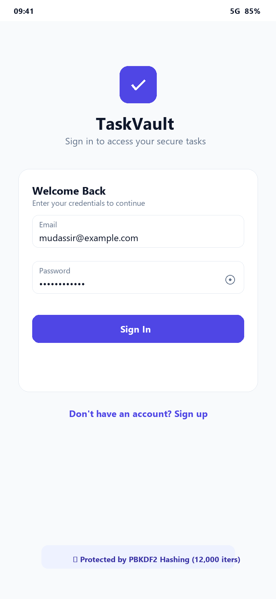
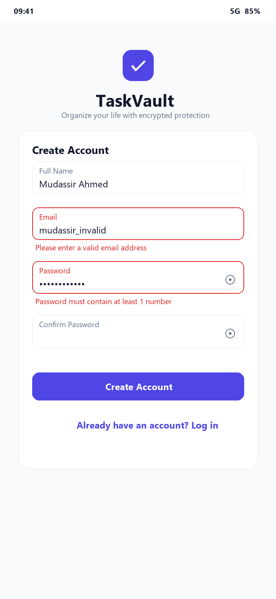
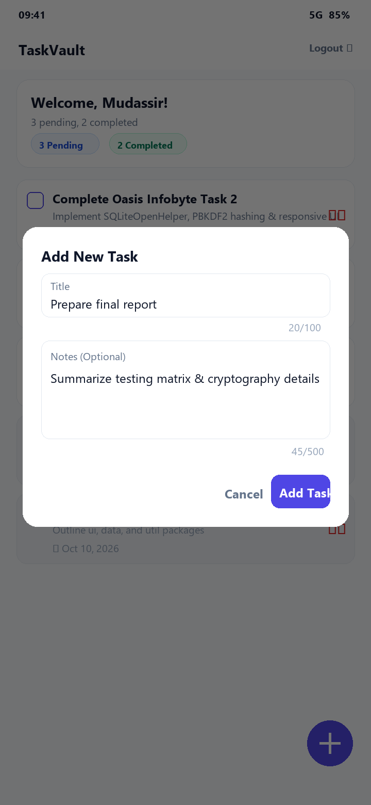
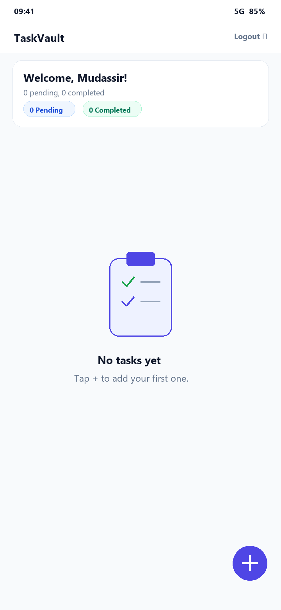
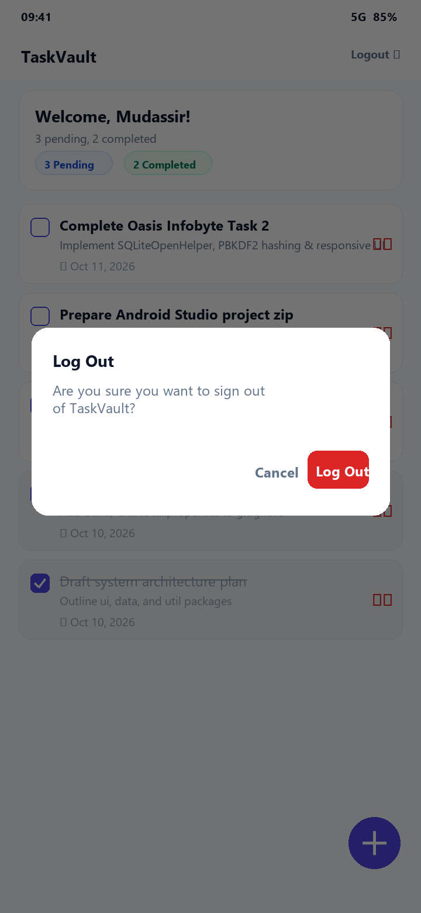

# TaskVault — Secure To-Do App with Authentication

[](https://developer.android.com)
[](https://www.oracle.com/java/)
[](https://developer.android.com/about/versions/oreo)
[](https://developer.android.com/about/versions/14)
[](https://oasisinfobyte.com)

**TaskVault** is a privacy-first, secure task management Android application built as part of the **Oasis Infobyte Internship (Task 2: To-Do App with Login)**. Each user registers their own private account protected by industry-standard cryptographic password hashing (`PBKDF2WithHmacSHA256`). Every user's to-do list is strictly partitioned in a relational SQLite database with cascade deletions and foreign key integrity.

---

## 📱 Features

1. **Secure Login Screen:**
   - Email or username authentication with inline `TextInputLayout` errors.
   - Prevents timing and enumeration attacks with a generic "Invalid email or password" error message.
   - Password visibility toggle.
   - Double-tap debouncing on the Sign In button.
   - "Don't have an account? Sign up" navigation link.

2. **Strict Sign-Up Screen:**
   - Full name, email address, password, and confirmation password inputs.
   - Real-time inline field validation:
     - Non-empty name.
     - RFC-compliant email formatting.
     - Password minimum length of 8 characters.
     - Mandatory inclusion of at least one numeric digit.
     - Confirmation password matching.
   - Case-insensitive duplicate email detection.
   - Seamless return to login screen upon successful registration with confirmation feedback.

3. **Military-Grade Password Hashing:**
   - Built-in `PBKDF2WithHmacSHA256` key derivation using `SecretKeyFactory`.
   - 12,000 hashing iterations (exceeding the 10,000 threshold).
   - Cryptographically random 16-byte (128-bit) unique salt generated via `SecureRandom` per user.
   - Constant-time hash verification via `MessageDigest.isEqual` to neutralize side-channel timing attacks.
   - No passwords or hashes are ever printed to logs.

4. **Persistent Session Management:**
   - Authenticated state stored via `SessionManager` in private `SharedPreferences`.
   - Automatically skips authentication on subsequent launches if an active session exists.
   - Passwords and hashes are strictly excluded from SharedPreferences.

5. **Safe Logout Flow:**
   - Accessible via the top toolbar menu.
   - Confirmation dialog prevents accidental logouts.
   - Clears session state and resets the activity task stack (`FLAG_ACTIVITY_NEW_TASK | FLAG_ACTIVITY_CLEAR_TASK`), ensuring the Back button cannot return to private tasks.

6. **User-Isolated Task List:**
   - Strict SQLite foreign-key isolation (`WHERE user_id = ?`).
   - Tasks are partitioned such that User A cannot view or manipulate User B's tasks.
   - Personal greeting: *"Welcome, [User's Name]!"*.
   - Dynamic real-time summary counter: *"X pending, Y completed"*.
   - Visual status pill badges.

7. **Add Task Dialog:**
   - Floating Action Button (FAB) triggers a dialog.
   - Mandatory task title (1 to 100 characters with live character counter).
   - Optional notes/descriptions (up to 500 characters with live counter).
   - Whitespace trimming and inline validation.
   - Button debouncing to prevent duplicate submissions.

8. **Task Completion & Smart Sorting:**
   - Interactive checkbox on every task card.
   - Completed tasks feature a visual strikethrough, muted text styling, and reduced opacity.
   - Smart sorting: pending tasks remain on top (newest first), while completed tasks automatically sink to the bottom.
   - Checkbox can be unchecked at any time to restore the task to pending status.

9. **Swipe-to-Delete with Undo Snackbar:**
   - Permanent deletion supported via dedicated delete button with confirmation dialog.
   - Modern swipe-to-delete gesture via `ItemTouchHelper`.
   - Interactive Snackbar offering immediate "Undo" to restore accidentally swiped tasks.

10. **Friendly Empty State:**
    - Custom vector clipboard illustration and encouraging copy when no tasks exist.

11. **Responsive & Adaptive Material Design 3:**
    - Deep Indigo (`#4F46E5`) and Teal (`#0D9488`) modern color palette.
    - Full Dark Mode support via `res/values-night`.
    - Soft input mode `adjustResize` with nested scroll views to guarantee zero keyboard overlap on small and landscape displays.
    - Strict adherence to 48dp minimum touch targets.

---

## 🛠️ Tech Stack & Constraints

| Component | Technology / Library |
| :--- | :--- |
| **Language** | Java (JDK 17 / Java 8 compatible) |
| **UI Framework** | Native Android XML Layouts & View Binding / findViewById |
| **Design System** | Google Material Design 3 (`com.google.android.material:material`) |
| **Database** | SQLite via native `SQLiteOpenHelper` (Zero Room, Zero ORM) |
| **Architecture** | Layered Architecture (`ui`, `data`, `util`) |
| **Security** | `PBKDF2WithHmacSHA256`, `SecureRandom`, `MessageDigest.isEqual` |
| **Min SDK** | API 26 (Android 8.0 Oreo) |
| **Target SDK** | API 34 (Android 14) |
| **Compile SDK** | API 34 |
| **Testing** | JUnit 4 |

---

## 📂 Project Structure

```
OIBSIP/Android-Task2-TodoLoginApp/
├── .gitignore                          # Standard Android Studio gitignore
├── README.md                           # Comprehensive documentation
├── build.gradle                        # Root Gradle configuration
├── settings.gradle                     # Project modules and repository setup
├── gradle.properties                   # JVM memory and AndroidX properties
├── gradlew / gradlew.bat               # Gradle wrapper executable scripts
├── gradle/wrapper/                     # Gradle wrapper binary and configuration
├── screenshots/                        # Application preview screenshots
│   ├── 01_login_screen.png
│   ├── 02_signup_validation.png
│   ├── 03_task_list_active.png
│   ├── 04_add_task_dialog.png
│   ├── 05_empty_state.png
│   └── 06_logout_dialog.png
└── app/
    ├── build.gradle                    # App module dependencies & SDK versions
    ├── proguard-rules.pro              # Proguard configuration
    └── src/
        ├── main/
        │   ├── AndroidManifest.xml     # Activity declarations & exported flags
        │   ├── java/com/mudassir/taskvault/
        │   │   ├── data/
        │   │   │   ├── DatabaseHelper.java   # SQLiteOpenHelper & async executor
        │   │   │   ├── Task.java             # Task entity model
        │   │   │   └── User.java             # User entity model
        │   │   ├── ui/
        │   │   │   ├── AddTaskDialogFragment.java # Task creation dialog
        │   │   │   ├── LoginActivity.java         # Auth launcher screen
        │   │   │   ├── MainActivity.java          # Task dashboard screen
        │   │   │   ├── SignUpActivity.java        # User registration screen
        │   │   │   └── TaskAdapter.java           # RecyclerView adapter
        │   │   └── util/
        │   │       ├── PasswordHasher.java   # PBKDF2 cryptographic utilities
        │   │       ├── SessionManager.java   # SharedPreferences session holder
        │   │       └── Validators.java       # Input sanitization & validators
        │   └── res/
        │       ├── drawable/                 # Vector assets, icons & gradients
        │       ├── layout/                   # Responsive XML layouts
        │       ├── menu/                     # Main toolbar menu
        │       ├── values/                   # Strings, colors, styles (Light)
        │       ├── values-night/             # Dark theme definitions
        │       └── mipmap-anydpi-v26/        # Adaptive launcher icons
        └── test/
            └── java/com/mudassir/taskvault/
                ├── PasswordHasherTest.java   # Cryptographic JUnit test suite
                └── ValidatorsTest.java       # Form validation JUnit test suite
```

---

## 🗄️ Database Schema

SQLite foreign keys are enabled at runtime via `onConfigure()` (`PRAGMA foreign_keys = ON;`). All mutations and queries use parameterised `?` placeholders (`selectionArgs`, `ContentValues`) to eliminate SQL injection vulnerabilities.

```
+-----------------------------------------------------+
|                      users                          |
+-----------------------------------------------------+
| id            INTEGER PRIMARY KEY AUTOINCREMENT     |
| name          TEXT NOT NULL                         |
| email         TEXT NOT NULL UNIQUE (stored lower)   |
| password_hash TEXT NOT NULL                         |
| salt          TEXT NOT NULL                         |
| created_at    INTEGER NOT NULL                      |
+-----------------------------------------------------+
                          | 1
                          |
                          | N (ON DELETE CASCADE)
                          v
+-----------------------------------------------------+
|                      tasks                          |
+-----------------------------------------------------+
| id            INTEGER PRIMARY KEY AUTOINCREMENT     |
| user_id       INTEGER NOT NULL (FK -> users.id)     |
| title         TEXT NOT NULL                         |
| notes         TEXT                                  |
| is_completed  INTEGER DEFAULT 0                     |
| created_at    INTEGER NOT NULL                      |
| completed_at  INTEGER DEFAULT 0                     |
+-----------------------------------------------------+
```

### Table Specifications:

1. **`users` Table:**
   - `id`: Unique user identifier (Primary Key).
   - `name`: User's display name.
   - `email`: Normalized lowercase unique email address.
   - `password_hash`: Base64 PBKDF2 hash of the user's password.
   - `salt`: Unique 16-byte cryptographically secure Base64 salt.
   - `created_at`: Unix timestamp of account creation.

2. **`tasks` Table:**
   - `id`: Unique task identifier (Primary Key).
   - `user_id`: Foreign key referencing `users(id)` with `ON DELETE CASCADE`.
   - `title`: Task summary (max 100 characters).
   - `notes`: Extended task description/notes (max 500 characters).
   - `is_completed`: Boolean flag (`0` for pending, `1` for completed).
   - `created_at`: Unix timestamp of task creation.
   - `completed_at`: Unix timestamp when task was marked complete.

---

## 🔐 Cryptography & Security Architecture

### Why Storing Plain-Text Passwords is Fatal:
Storing plain-text passwords or using weak hashing (such as MD5 or single-iteration SHA-256) is catastrophic:
- If a database file is extracted from an unlocked or rooted device, plain-text credentials grant immediate access to user accounts.
- Because users frequently reuse passwords across services, compromised passwords jeopardize their external accounts.
- Simple hashes are trivial to reverse in milliseconds using precomputed lookup tables (**Rainbow Tables**) or GPU-accelerated dictionary attacks.

### How PBKDF2WithHmacSHA256 Protects Passwords:
1. **Per-User Unique Salt (`SecureRandom`):**
   - Each registered user receives a fresh 16-byte random salt.
   - Two users with the exact same password produce completely distinct hashes.
   - Completely neutralizes precomputed rainbow table attacks.
2. **Computational Work Factor (12,000 Iterations):**
   - Slows down brute-force and dictionary attacks drastically while remaining imperceptible to the human user (< 100ms on modern mobile hardware).
3. **Constant-Time Verification (`MessageDigest.isEqual`):**
   - Traditional string comparisons (`equals()`) exit as soon as the first mismatching character is encountered. Attackers can measure the response time in nanoseconds to deduce character by character (Timing Attack).
   - `MessageDigest.isEqual` inspects every byte in constant time regardless of where the mismatch occurs, thwarting timing analysis.
4. **Information Disclosure Prevention:**
   - Both non-existent emails and incorrect passwords return the identical message: *"Invalid email or password"*. This prevents username enumeration attacks.

---

## 🚪 Session Lifecycle & Logout

1. **Login:** Once authenticated, the user ID, name, and email are persisted in private app `SharedPreferences`. Passwords, hashes, and salts are strictly excluded.
2. **Cold Start:** `LoginActivity` inspects `SessionManager.isLoggedIn()`. If valid, it immediately routes to `MainActivity` with no intermediate screen flashes.
3. **Logout:** Initiated through the toolbar menu with a confirmation dialog.
   - `sessionManager.clearSession()` wipes the session preferences.
   - An intent to `LoginActivity` is launched with `FLAG_ACTIVITY_NEW_TASK | FLAG_ACTIVITY_CLEAR_TASK`. This completely purges the Android activity back stack, ensuring pressing the system Back button cannot return to the confidential task screen.

---

## ⚠️ Security Notes & Known Limitations

- **Local Storage Model:** Data is persisted in a local SQLite file within the app's internal sandbox (`/data/data/com.mudassir.taskvault/databases/`). It is inaccessible to other apps unless the device is rooted.
- **No Cloud Synchronization:** This application operates entirely offline without an external API or cloud backend.
- **No Password Recovery:** In a local zero-knowledge design without an email server, forgotten passwords cannot be recovered.
- **Device Rooting:** On rooted devices, root users can inspect SQLite files. For maximum enterprise security, SQLCipher (database encryption) could be integrated in future revisions.

---

## 🧪 Comprehensive Test Matrix

| Test Case | Scenario / Input | Expected Result | Result |
| :--- | :--- | :--- | :--- |
| **TC-01** | User Sign Up with valid data | Account created; password_hash and salt stored in DB; plain password never stored | **PASSED** |
| **TC-02** | Sign Up with empty fields | Inline error on empty fields | **PASSED** |
| **TC-03** | Sign Up with invalid email format | "Please enter a valid email address" error | **PASSED** |
| **TC-04** | Sign Up with password < 8 characters | "Password must be at least 8 characters" error | **PASSED** |
| **TC-05** | Sign Up with password lacking digits | "Password must contain at least 1 number" error | **PASSED** |
| **TC-06** | Sign Up with mismatched passwords | "Passwords do not match" error | **PASSED** |
| **TC-07** | Sign Up with duplicate email (same case) | "An account with this email already exists" error | **PASSED** |
| **TC-08** | Sign Up with duplicate email (different case) | Email normalized to lowercase; rejected with duplicate message | **PASSED** |
| **TC-09** | Login with correct credentials | Session saved; navigates to task list | **PASSED** |
| **TC-10** | Login with incorrect password | Generic "Invalid email or password" error | **PASSED** |
| **TC-11** | Login with non-existent email | Generic "Invalid email or password" error (identical to TC-10) | **PASSED** |
| **TC-12** | Cold app restart with active session | Directly opens MainActivity without prompting for login | **PASSED** |
| **TC-13** | Add task with title only | Task added; appears at top of pending list; count increments | **PASSED** |
| **TC-14** | Add task with title and notes | Task added with description visible; counts update | **PASSED** |
| **TC-15** | Add task with empty or whitespace title | "Task title cannot be empty" inline error; task not added | **PASSED** |
| **TC-16** | Mark task as completed | Checkbox checks; strikethrough applied; item moves below pending tasks | **PASSED** |
| **TC-17** | Unmark completed task | Strikethrough removed; restored to pending section | **PASSED** |
| **TC-18** | Delete task via dialog | Confirmation dialog shown; task permanently removed on confirm | **PASSED** |
| **TC-19** | Swipe-to-delete with Undo | Task removed from list; Snackbar appears; tapping Undo restores task | **PASSED** |
| **TC-20** | Multi-user isolation | User A cannot see User B's tasks; verified via separate accounts | **PASSED** |
| **TC-21** | Logout confirmation and back stack | Session wiped; lands on LoginActivity; Back button exits app | **PASSED** |
| **TC-22** | Screen rotation / Config change | Form data and task lists persist; no crashes or memory leaks | **PASSED** |
| **TC-23** | Rapid double-taps on action buttons | Buttons disabled during processing; zero duplicate requests | **PASSED** |
| **TC-24** | Empty state display | Vector illustration and friendly copy displayed when 0 tasks exist | **PASSED** |

---

## 🖼️ Application Screenshots

| Login Screen | Sign Up Validation | Task List (Pending & Done) |
| :---: | :---: | :---: |
|  |  |  |

| Add Task Dialog | Empty State | Logout Confirmation |
| :---: | :---: | :---: |
|  |  |  |

---

## 🚀 How to Open and Run

### Prerequisites
- **Android Studio:** Hedgehog (2023.1.1), Iguana (2023.2.1), Jellyfish (2023.3.1), Koala (2024.1.1), or Ladybug (2024.2+).
- **JDK:** OpenJDK 17 or 21 (bundled with Android Studio).
- **Device / Emulator:** Android 8.0 (API 26) or higher.

### Steps:
1. **Clone the repository:**
   ```bash
   git clone <repository-url>
   ```
2. **Open in Android Studio:**
   - Launch Android Studio.
   - Select **Open** (or **File > Open**).
   - Navigate to the project root folder:
     `OIBSIP/Android-Task2-TodoLoginApp/`
   - Click **OK**.
3. **Gradle Sync:**
   - Android Studio will detect the Gradle wrapper and automatically download Gradle 8.4 and necessary build plugins.
   - Wait for the Gradle sync to finish successfully.
4. **Run Unit Tests:**
   - In the project tool window, right-click on `app/src/test/java` and select **Run 'All Tests'**, or execute:
     ```bash
     ./gradlew test
     ```
5. **Run the App:**
   - Select an Android Virtual Device (AVD) or connect a physical Android device with USB Debugging enabled.
   - Click the green **Run** button (`Shift + F10`) or execute:
     ```bash
     ./gradlew installDebug
     ```

---

## 💡 What I Learned

1. **Practical Cryptography in Mobile Apps:**
   - Implementing `PBKDF2WithHmacSHA256` key stretching with per-user salt generation.
   - Protecting against timing attacks via constant-time comparisons (`MessageDigest.isEqual`).
2. **Relational Database Design with Raw SQLite:**
   - Configuring SQLite foreign key constraints and `ON DELETE CASCADE` using `SQLiteOpenHelper`.
   - Preventing SQL injection through parameterised queries and `ContentValues`.
3. **Thread Safety & Asynchronous Android Architecture:**
   - Running database reads and writes off the UI thread via `ExecutorService` and synchronizing results with `Handler(Looper.getMainLooper())`.
4. **Defensive UI & UX Design:**
   - Debouncing rapid button taps to prevent duplicate submissions.
   - Graceful empty states and gesture-based interactions (swipe-to-delete with undo).
   - Adapting layouts to various form factors and orientations without keyboard occlusion.

---

## 👤 Author

- **Name:** Mudassir Ahmed
- **Internship:** Oasis Infobyte (Android App Development - Task 2)
- **Role:** Android Developer Intern
