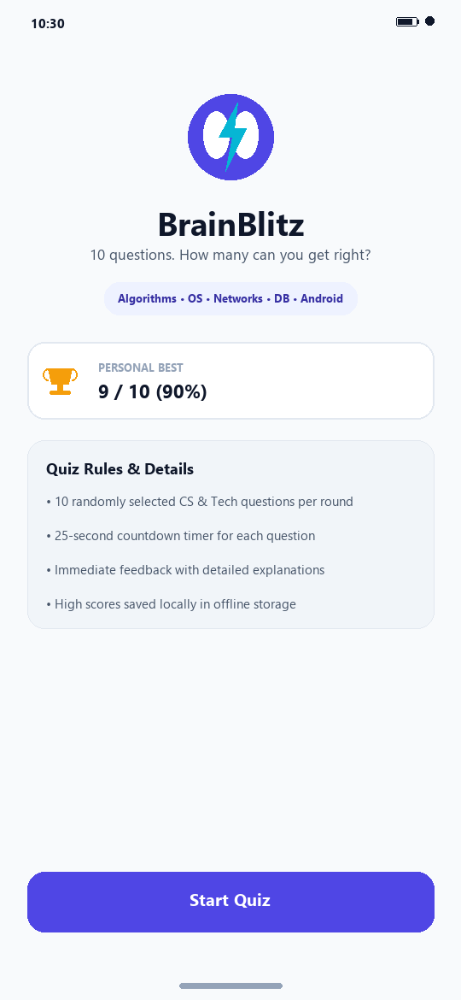
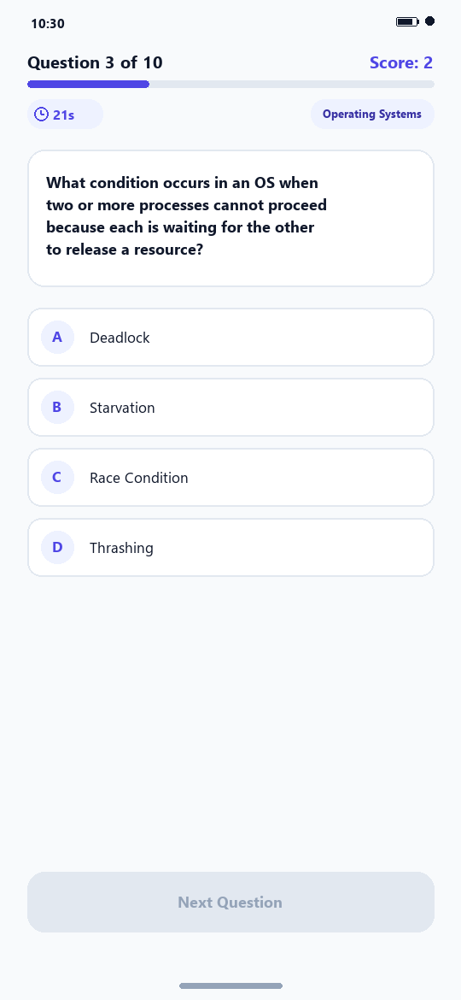
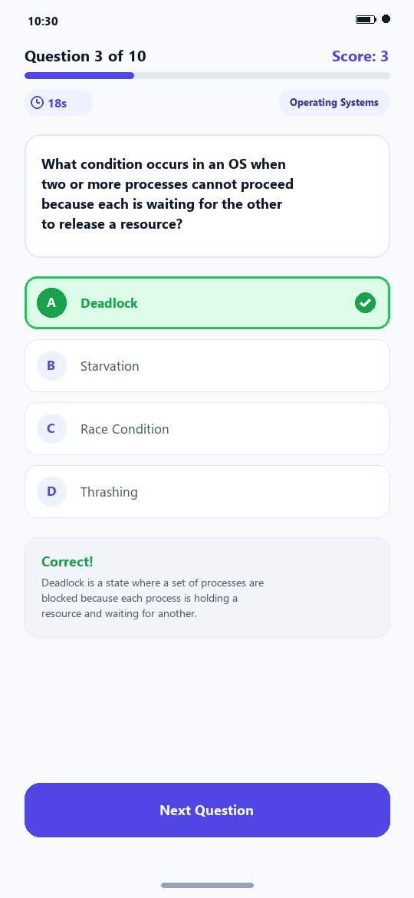
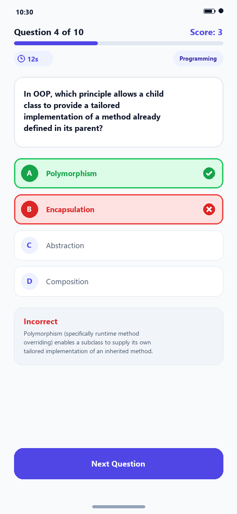
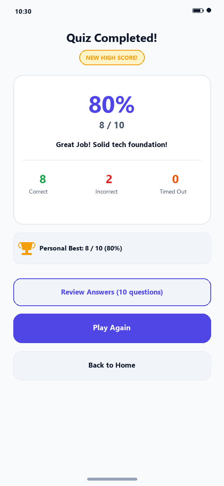
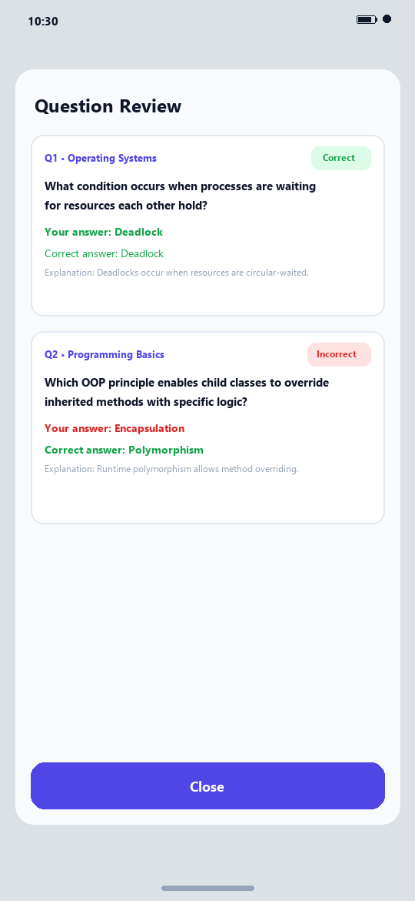

# BrainBlitz - Computer Science & Tech Quiz Application

[](https://developer.android.com)
[](https://www.oracle.com/java/)
[](https://developer.android.com/about/versions/14)
[](https://m3.material.io/)
[](LICENSE)

**BrainBlitz** is a modern, responsive, and feature-rich native Android multiple-choice quiz application developed as part of the **Oasis Infobyte Internship Program (Android App Development, Task 4)**. The application challenges users across core domains of Computer Science and Technology including Algorithms, Data Structures, Operating Systems, Networking, Databases, Web Development, Object-Oriented Programming, and Tech History.

Developed by **Mudassir Ahmed**.

---

## 📱 Features

### Core Required Features
1. **Welcome Screen (`WelcomeActivity`)**:
   - Modern brand identity with custom vector adaptive logo and typography.
   - Tagline and round rules ("10 questions. How many can you get right?").
   - Live Personal Best high score indicator (`X / 10 (Y%)`) persisted across app restarts.
   - Interactive category pills showcasing covered topics.
   - Prominent, ripple-animated **Start Quiz** button.

2. **Quiz Gameplay (`QuizActivity`)**:
   - Clean, full-width Material 3 option cards with minimum 48dp touch targets.
   - Dynamic round progress tracker (`LinearProgressIndicator`) that advances smoothly.
   - Live score indicator (`Score: X`) in the header.
   - Question counter (`Question X of 10`).
   - Category tags identifying the subject of each question.
   - Scrollable viewport (`ScrollView`) preventing clipped text on small screens or in landscape orientation.

3. **Curated Offline Question Pool (`res/raw/questions.json`)**:
   - Offline-first architecture: zero external network dependencies, no 3rd party APIs.
   - Local pool of 25 comprehensive, fact-checked Computer Science & Tech questions.
   - Robust parsing via built-in `org.json` within `QuestionRepository` with defensive `try/catch` handlers and fallback pools to guarantee zero crashes on corrupted data.

4. **Two-Stage Randomization & Shuffling**:
   - **Round Shuffling**: Each round randomly selects 10 distinct questions without replacement from the master pool.
   - **Option Shuffling**: The 4 answer choices for each question are shuffled randomly, dynamically remapping `correctOptionIndex` so correct answers never stay in fixed positions.

5. **Instant Feedback & Accessibility**:
   - Immediate color-coded feedback upon option tap (Green for correct, Red for incorrect with the correct answer highlighted in Green).
   - High-contrast vector icons (`ic_check_circle`, `ic_close_circle`) accompanying color states to support color-blind and visually impaired users.
   - Automatic locking of all options immediately upon the first tap to eliminate rapid double-tap scoring glitches.
   - Educational explanation card revealing context and underlying computer science principles.

6. **Controlled Flow Navigation**:
   - "Next" button remains disabled until an answer is submitted or time expires.
   - Dynamically morphs label to **"See Results"** on the 10th (final) question.

7. **Results Screen (`ResultActivity`)**:
   - Total score fraction (e.g. `8 / 10`) and percentage accuracy (e.g. `80%`).
   - Granular breakdown statistics: Number of correct answers, incorrect answers, and timeouts.
   - Dynamic performance feedback ratings (e.g. *"Outstanding! Tech Mastermind!"*, *"Great Job!"*, *"Keep Practicing!"*).
   - **Play Again** button: seamlessly begins a fresh round with new questions and randomized order.
   - **Back to Home** button: returns to the launcher welcome screen.
   - Clean Activity lifecycle flags ensuring Back press from Results navigates to Welcome rather than into the finished quiz.

### Polish & Extra Features
- **High Score System**: High scores and accuracy percentages saved in `SharedPreferences` via `ScoreManager`. A glowing `"★ NEW HIGH SCORE! ★"` badge is displayed when a personal best is broken.
- **Per-Question Countdown Timer**: A 25-second countdown timer (`CountDownTimer`) with visual urgency color changes (Indigo &rarr; Amber &rarr; Red). Times out cleanly, reveals the correct answer, and counts as incorrect without memory leaks (`onPause`/`onDestroy` cancellation).
- **In-Depth Question Review**: An interactive dialog on the Results screen detailing each question from the completed round, displaying the user's answer, correct answer, status, and full explanation.
- **Back-Press Protection**: Confirmation dialog (`MaterialAlertDialogBuilder`) preventing accidental quiz exits mid-round.
- **Configuration Change Resilience**: Screen rotation mid-quiz retains the active question, option positions, answered states, current score, and timer via AndroidX `QuizViewModel`.
- **Subtle Micro-Animations**: Smooth alpha fade transitions between questions and Material ripple click feedback.
- **Dark Mode Support**: Full Day/Night support via `values` and `values-night` semantic color palettes.

---

## 🛠 Tech Stack & Strict Constraints

| Attribute | Specification |
| :--- | :--- |
| **Language** | Java (17 LTS) - 100% Java, no Kotlin |
| **UI Framework** | Native Android XML Layouts (No Jetpack Compose) |
| **Design System** | Google Material Design 3 (`Theme.Material3.DayNight.NoActionBar`) |
| **Minimum SDK** | API 26 (Android 8.0 Oreo) |
| **Target / Compile SDK**| API 34 (Android 14) |
| **Dependencies** | AndroidX (AppCompat, ConstraintLayout, CardView, Lifecycle ViewModel) & Material Components only |
| **JSON Parser** | Built-in platform `org.json` |
| **Networking** | 100% Offline (No Retrofit, OkHttp, Volley, or Firebase) |
| **Testing** | JUnit 4 unit testing suite for quiz logic |

---

## 📂 Project Structure

```
OIBSIP/Android-Task4-QuizApp/
├── app/
│   ├── build.gradle                          # App module dependencies & SDK configs
│   ├── proguard-rules.pro                   # ProGuard rules
│   └── src/
│       ├── main/
│       │   ├── AndroidManifest.xml          # App manifest with exported activities
│       │   ├── java/com/mudassir/brainblitz/
│       │   │   ├── data/
│       │   │   │   ├── Question.java         # Data model with copy & shuffle logic
│       │   │   │   ├── QuestionReview.java   # Round review model
│       │   │   │   └── QuestionRepository.java # JSON parser with fallback guards
│       │   │   ├── logic/
│       │   │   │   └── QuizManager.java      # Pure Java core quiz business logic
│       │   │   ├── ui/
│       │   │   │   ├── WelcomeActivity.java  # Launcher welcome screen
│       │   │   │   ├── QuizActivity.java     # Quiz screen with timer & feedback
│       │   │   │   ├── ResultActivity.java   # Results screen with review dialog
│       │   │   │   └── QuizViewModel.java    # AndroidX ViewModel for rotation survival
│       │   │   └── util/
│       │   │       ├── Constants.java        # Centralized constants and bundle keys
│       │   │       └── ScoreManager.java     # SharedPreferences high-score manager
│       │   └── res/
│       │       ├── drawable/                 # Vectors, ripples, option backgrounds
│       │       ├── layout/                   # activity_welcome, activity_quiz, activity_result, etc.
│       │       ├── mipmap-anydpi-v26/        # Adaptive vector launcher icons
│       │       ├── raw/
│       │       │   └── questions.json        # 25 curated CS/Tech questions pool
│       │       ├── values/                   # colors.xml, strings.xml, themes.xml
│       │       └── values-night/             # Dark mode colors.xml, themes.xml
│       └── test/java/com/mudassir/brainblitz/
│           └── QuizLogicTest.java            # Comprehensive JUnit test suite
├── gradle/wrapper/                           # Gradle 8.4 wrapper files
├── build.gradle                              # Root build file
├── settings.gradle                           # Project settings
├── gradle.properties                         # JVM & AndroidX properties
├── .gitignore                                # Android standard ignore rules
├── screenshots/                              # Visual documentation
└── README.md                                 # Complete documentation
```

---

## ⚙️ How to Open and Run

### Prerequisites
- **Android Studio**: Android Studio Hedgehog (2023.1.1), Iguana, Jellyfish, Koala, or Ladybug.
- **JDK**: Java 17 (bundled automatically with modern Android Studio).
- **Android SDK**: Android API 34 platform and build tools.

### Running in Android Studio
1. Clone or download the repository to your local machine.
2. Open **Android Studio**.
3. Click **Open** (or **File > Open**) and select the directory:
   ```
   OIBSIP/Android-Task4-QuizApp
   ```
4. Allow Android Studio and Gradle to synchronize project dependencies.
5. Select an Android Emulator (API 26+) or a physical device with USB debugging enabled.
6. Click the green **Run ▶** button (or press `Shift + F10`).

### Running via Command Line
Open a terminal in `OIBSIP/Android-Task4-QuizApp/`:

- **Run all unit tests**:
  ```bash
  # Windows
  .\gradlew.bat test

  # macOS / Linux
  ./gradlew test
  ```

- **Assemble Debug APK**:
  ```bash
  # Windows
  .\gradlew.bat assembleDebug

  # macOS / Linux
  ./gradlew assembleDebug
  ```
  The generated APK will be located at:
  `app/build/outputs/apk/debug/app-debug.apk`

---

## 🧩 Question JSON Schema & Adding New Questions

Questions are stored locally in `app/src/main/res/raw/questions.json`. Each entry adheres to the following JSON schema:

```json
{
  "id": 26,
  "category": "Computer Networks",
  "question": "What is the primary function of the ARP protocol in IPv4 networks?",
  "options": [
    "Resolving an IP address to a physical MAC address",
    "Translating domain names to IP addresses",
    "Encrypting web packets with TLS",
    "Assigning dynamic IP addresses automatically"
  ],
  "correctIndex": 0,
  "explanation": "Address Resolution Protocol (ARP) maps an IPv4 address to a physical machine address (MAC address) on a local network segment."
}
```

### Adding New Questions:
1. Open `app/src/main/res/raw/questions.json`.
2. Append a new JSON object following the format above.
3. Ensure:
   - Exactly 4 options are provided in the `options` array.
   - `correctIndex` is between `0` and `3` inclusive (indexing the correct option).
   - An informative `explanation` is included.
4. Save the file. The app will automatically include your new questions in its randomized pool during the next round!

---

## 🔀 How Shuffling & Randomization Works

BrainBlitz enforces fairness and replayability through a two-step shuffling algorithm:

1. **Question Selection (`QuizManager.initRound`)**:
   ```java
   List<Question> poolCopy = new ArrayList<>(masterPool);
   Collections.shuffle(poolCopy);
   int countToPick = Math.min(roundSize, poolCopy.size());
   for (int i = 0; i < countToPick; i++) {
       roundQuestions.add(poolCopy.get(i).createShuffledCopy());
   }
   ```
   This guarantees that 10 distinct questions are picked with uniform randomness and no duplicates.

2. **Option Shuffling & Correct Index Remapping (`Question.createShuffledCopy`)**:
   ```java
   String correctText = getCorrectOptionText();
   List<String> shuffledOptions = new ArrayList<>(this.options);
   Collections.shuffle(shuffledOptions);
   int newCorrectIndex = shuffledOptions.indexOf(correctText);
   return new Question(this.id, this.category, this.questionText, shuffledOptions, newCorrectIndex, this.explanation);
   ```
   By tracking the *content* of the correct option rather than an arbitrary index, the answer choices are randomized while the correct answer pointer is accurately updated.

---

## 🔄 Inter-Activity Navigation & State Passing

Data is transferred between activities using clean Android `Intent` extras with centralized constants defined in `Constants.java`:

- `WelcomeActivity` &rarr; `QuizActivity`: standard explicit Intent.
- `QuizActivity` &rarr; `ResultActivity`: passes `EXTRA_SCORE`, `EXTRA_TOTAL_QUESTIONS`, `EXTRA_CORRECT_COUNT`, `EXTRA_INCORRECT_COUNT`, `EXTRA_TIMED_OUT_COUNT`, and serialized `EXTRA_REVIEW_LIST`.
- `QuizActivity` invokes `finish()` upon navigating to `ResultActivity`, preventing the back button from returning into an expired quiz.
- Pressing Back on `ResultActivity` directs back to `WelcomeActivity` with `FLAG_ACTIVITY_CLEAR_TOP`, updating the latest high score.

---

## 🧪 Automated Test Suite

A comprehensive test suite is implemented in [`QuizLogicTest.java`](file:///c:/Users/DELL/Desktop/AD%20Task%204/OIBSIP/Android-Task4-QuizApp/app/src/test/java/com/mudassir/brainblitz/QuizLogicTest.java):

| Test Case | Method | Purpose | Result |
| :--- | :--- | :--- | :---: |
| 1 | `testSelect10QuestionsFromPool` | Verifies exactly 10 questions are chosen from the pool | **PASSED** |
| 2 | `testNoDuplicateQuestionsInRound` | Ensures zero duplicate questions in any round | **PASSED** |
| 3 | `testPoolSmallerThanRequestedCount` | Verifies graceful fallback if pool has < 10 questions | **PASSED** |
| 4 | `testEmptyPoolHandling` | Ensures empty pools do not crash the app | **PASSED** |
| 5 | `testOptionShufflingAndCorrectIndexRemapping` | Verifies options shuffle and correct index remaps accurately | **PASSED** |
| 6 | `testCorrectAnswerCheckingAndScoring` | Verifies correct answer increments score and reviews | **PASSED** |
| 7 | `testIncorrectAnswerCheckingAndScoring`| Verifies incorrect answer increments error count | **PASSED** |
| 8 | `testTimeoutHandling` | Verifies timer expiration records timeout and error | **PASSED** |
| 9 | `testRapidDoubleTapLock` | Verifies rapid successive taps do not double-score | **PASSED** |
| 10 | `testPercentageCalculation` | Tests accurate mathematical rounding of percentage | **PASSED** |
| 11 | `testPerformanceRatingTiers` | Verifies Outstanding, Great, Good, Keep Practicing tiers | **PASSED** |
| 12 | `testQuestionRepositoryJsonParsing` | Verifies JSON parsing from string | **PASSED** |
| 13 | `testCorruptedJsonDoesNotCrash` | Verifies malformed JSON triggers fallbacks safely | **PASSED** |

---

## 📷 Screenshots

| Welcome Screen | Question Screen | Answer Feedback (Correct) |
| :---: | :---: | :---: |
|  |  |  |

| Answer Feedback (Incorrect) | Results & High Score | Question Review Dialog |
| :---: | :---: | :---: |
|  |  |  |

---

## 💡 Key Learnings & Engineering Insights

1. **Separation of Concerns**: Decoupling the quiz business logic (`QuizManager`) from the Android lifecycle (`QuizActivity`) allows the entire game mechanics to be verified via pure JVM unit tests without needing Robolectric or slow device instrumentations.
2. **Accessible UI Design**: Never relying on color alone for states. Pairing green and red feedback with checkmark and cross vector icons ensures compliance with standard accessibility guidelines.
3. **Lifecycle & Configuration Survival**: Using `ViewModel` to retain the in-flight state of the quiz prevents data loss or question resets when the user rotates the device or receives a phone call.
4. **Defensive Resource Parsing**: File reading and JSON parsing are wrapped with fallback algorithms so that unexpected malformed syntax never terminates the application process.

---

## 👤 Author

- **Name**: Mudassir Ahmed
- **Internship**: Oasis Infobyte (Android App Development)
- **Task**: Task 4 - Quiz Application ("BrainBlitz")
