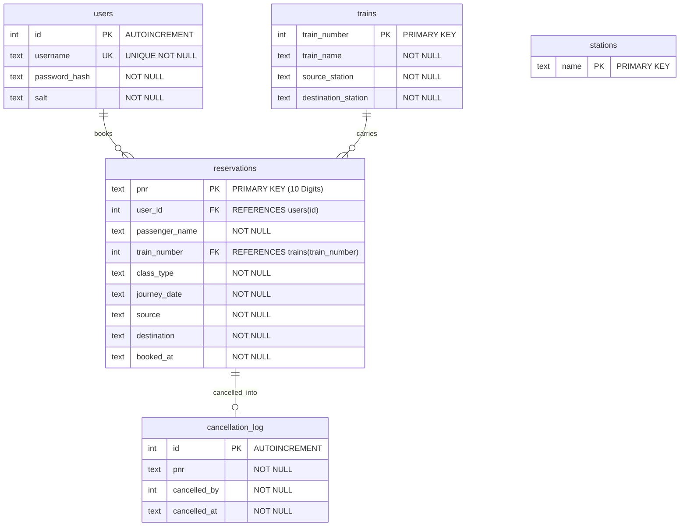
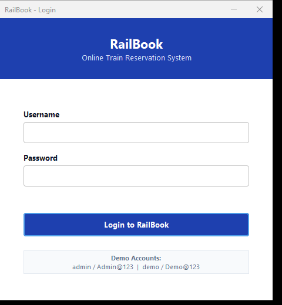
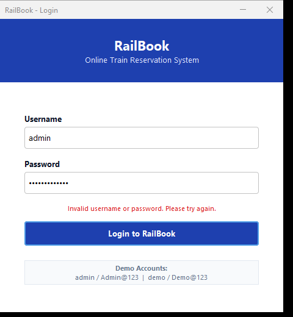
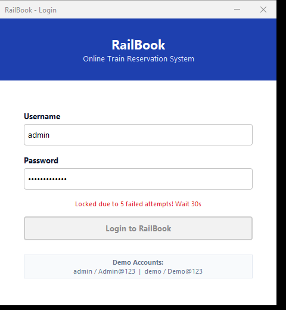
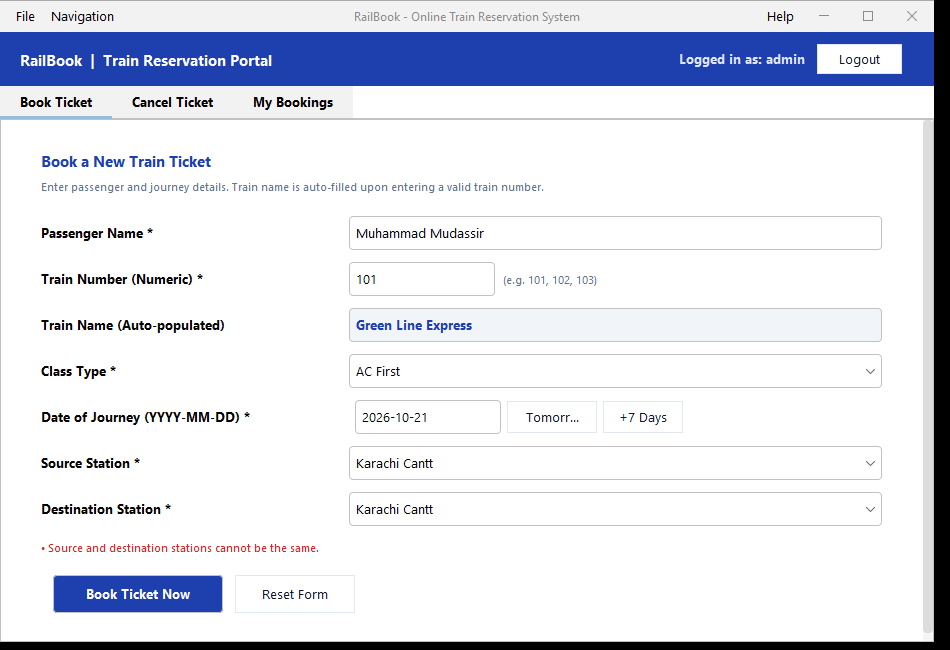
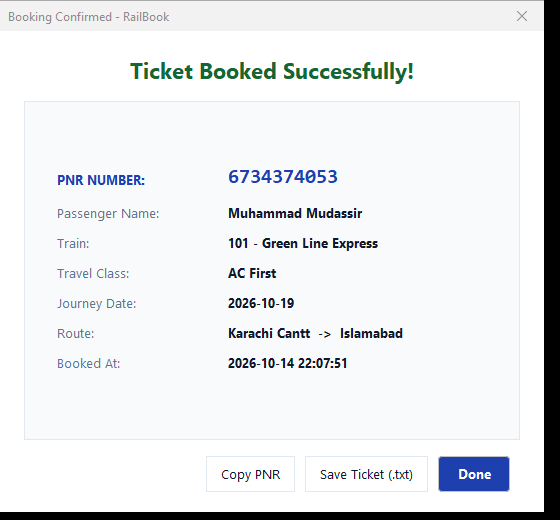
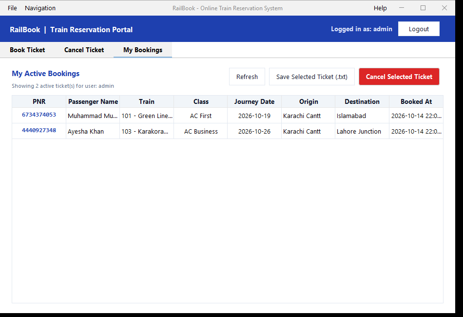
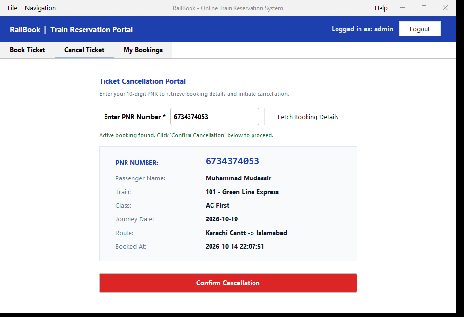
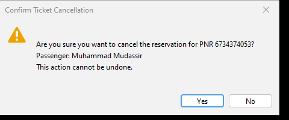
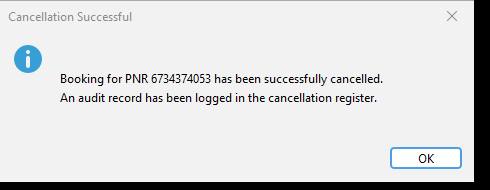

# RailBook - Online Train Reservation System

> **Oasis Infobyte Internship - Java Development - Task 1**  
> **Author:** Mudassir Ahmed  
> **Repository:** `OIBSIP/Java-Task1-OnlineReservationSystem`

---

## 📌 Executive Summary

**RailBook** is a desktop GUI train reservation system built using **Java 17**, **Swing**, **SQLite**, and **FlatLaf**. It allows passengers to authenticate securely, search trains, book reservations with auto-generated unique 10-digit PNR codes, manage their travel itineraries, and cancel bookings through an audited transaction workflow.

All interactions adhere to clean software architecture principles, strict separation of concerns, defensive programming, parameterized queries, and responsive Swing background threading.

---

## 🚀 Key Features

1. **Secure Authentication & Brute-Force Defense:**
   - Pre-seeded accounts (`admin` and `demo`).
   - Passwords secured with **PBKDF2WithHmacSHA256**, 65,536 iterations, and per-user cryptographically random 16-byte salts.
   - Constant-time verification (`MessageDigest.isEqual`) preventing timing attacks.
   - Generic error messages ("Invalid username or password") to prevent user enumeration.
   - Automatic **30-second form lockout** after 5 failed login attempts with a live countdown timer.

2. **Train Reservation Portal:**
   - Real-time train number lookup: entering a valid train number automatically populates the train name and route.
   - Comprehensive journey class selection (`AC First`, `AC Business`, `Economy`, `Sleeper`).
   - Dynamic calendar date validation ensuring real dates (e.g. rejects impossible dates like `2026-02-30`) between today and 120 days in advance.
   - Auto-generated **10-digit unique PNR** with automated collision retry logic.
   - Double-click prevention: disables booking buttons while async database transactions execute.

3. **Booking Confirmation & Ticket Export:**
   - Elegant modal confirmation card summarizing all ticket attributes.
   - One-click **Copy PNR** button to system clipboard.
   - **Save Ticket (.txt)** functionality generating formatted, printable electronic reservation slips.

4. **Audited Cancellation Portal:**
   - PNR retrieval showing read-only details before cancellation.
   - Friendly handling for non-existent or previously cancelled PNRs.
   - Mandatory **"Are you sure?" confirmation dialog** preventing accidental cancellations.
   - **ACID Transaction**: removes the record from `reservations` and writes an audit log row to `cancellation_log`.

5. **"My Bookings" Management Hub:**
   - Interactive `JTable` displaying all active bookings for the logged-in user.
   - Real-time table refresh upon new booking or cancellation.
   - Direct ticket export and cancellation shortcuts for selected rows.

---

## 🛠️ Technology Stack

| Layer | Technology | Details |
| :--- | :--- | :--- |
| **Language** | Java 17 (LTS) | Modern Java APIs (`java.time`, `HexFormat`, `Records/POJOs`) |
| **GUI Framework** | Java Swing | Native lightweight Swing components with `GridBagLayout` |
| **Look & Feel** | FlatLaf 3.4.1 | Clean, modern desktop design with graceful fallback to system L&F |
| **Database** | SQLite 3 (`sqlite-jdbc 3.45.2.0`) | Embedded zero-configuration database with `PRAGMA foreign_keys = ON` |
| **Build & Packaging**| Apache Maven & Maven Shade Plugin | Produces executable fat JAR (`target/railbook.jar`) |
| **Testing** | JUnit 5 (`junit-jupiter 5.10.2`) | Automated unit, DAO, and security test suite |
| **Logging** | `java.util.logging` | Structured application logs without sensitive credentials |

---

## 📋 Prerequisites

- **Java Development Kit (JDK):** Version 17 or higher (`java -version`)
- **Apache Maven:** Version 3.8+ (`mvn -version`)

---

## ⚙️ How to Build and Run

### 1. Build Executable Fat JAR
Open a terminal in the project root directory (`OIBSIP/Java-Task1-OnlineReservationSystem/`):
```bash
mvn clean package
```
This runs all unit tests, compiles the application, and bundles all runtime dependencies (SQLite driver, FlatLaf) into `target/railbook.jar`.

### 2. Run the Application
Execute the fat JAR directly:
```bash
java -jar target/railbook.jar
```

### 3. Run Automated Tests
```bash
mvn test
```

### 4. Running from an IDE (IntelliJ IDEA / Eclipse / VS Code)
1. Open the folder `OIBSIP/Java-Task1-OnlineReservationSystem` as a Maven project.
2. Locate the main class: `com.mudassir.railbook.Main`.
3. Right-click and choose **Run 'Main.main()'**.

---

## 🔑 Demo Login Credentials

The application automatically seeds two test accounts upon its first launch:

| Username | Password | Role | Description |
| :--- | :--- | :--- | :--- |
| `admin` | `Admin@123` | Administrator | Full booking, cancellation, and viewing capabilities |
| `demo` | `Demo@123` | Standard User | Demonstration account for testing isolation |

> **Note:** Passwords are case-sensitive. All passwords in the database are stored as salted PBKDF2 hashes.

---

## 📂 Project Architecture

```
OIBSIP/Java-Task1-OnlineReservationSystem/
├── pom.xml                                   # Maven build file with Shade plugin configuration
├── .gitignore                                # Git ignore rules (target/, *.db, IDE files)
├── README.md                                 # Complete documentation
├── data/                                     # Auto-created directory for SQLite database
│   └── railbook.db                           # Local SQLite database file
├── screenshots/                              # Captured screenshots of all screens
│   ├── 01_login.png
│   ├── 02_failed_login.png
│   ├── 03_login_lockout.png
│   ├── 04_reservation_form.png
│   ├── 05_validation_error.png
│   ├── 06_confirmation_dialog.png
│   ├── 07_my_bookings.png
│   ├── 08_cancellation_fetch.png
│   ├── 09_confirm_cancellation_dialog.png
│   └── 10_cancellation_success.png
└── src/
    ├── main/java/com/mudassir/railbook/
    │   ├── Main.java                         # Application entrypoint & EDT launcher
    │   ├── config/
    │   │   └── Constants.java                # Global constants (tables, formats, limits)
    │   ├── model/
    │   │   ├── User.java                     # User POJO
    │   │   ├── Train.java                    # Train route POJO
    │   │   ├── Reservation.java              # Reservation POJO
    │   │   └── CancellationAudit.java        # Audit record POJO
    │   ├── db/
    │   │   ├── DatabaseManager.java          # JDBC connection & auto-schema/seed
    │   │   ├── UserDao.java                  # User DAO (parameterized SQL)
    │   │   ├── TrainDao.java                 # Train and Station DAO
    │   │   └── ReservationDao.java           # Reservation & transactional cancellation DAO
    │   ├── service/
    │   │   ├── AuthService.java              # Login, lockout tracking, session
    │   │   ├── PasswordUtil.java             # PBKDF2 hashing, salt generation, constant-time verify
    │   │   ├── ReservationService.java       # Booking, cancellation, PNR generation, file export
    │   │   ├── ValidationUtil.java           # Strict input format & bounds validation
    │   │   ├── ValidationResult.java         # Encapsulated validation feedback
    │   │   ├── ValidationException.java      # Domain validation exception
    │   │   ├── AuthenticationException.java  # Auth failure exception
    │   │   └── AccountLockedException.java   # Rate-limiting lockout exception
    │   └── ui/
    │       ├── ThemeManager.java             # FlatLaf styling, color palette, buttons
    │       ├── LoginFrame.java               # Login view with countdown timer
    │       ├── MainFrame.java                # Tabbed desktop interface with user banner
    │       ├── ReservationPanel.java         # Booking form with instant train lookup
    │       ├── CancellationPanel.java        # Cancellation form with confirmation dialog
    │       ├── BookingsPanel.java            # JTable of active bookings & export
    │       └── ConfirmationDialog.java       # Modal ticket summary dialog
    └── test/java/com/mudassir/railbook/
        ├── service/
        │   ├── PasswordUtilTest.java         # Tests for PBKDF2 hashing & verification
        │   ├── ValidationUtilTest.java       # Tests for dates, names, bounds, PNR format
        │   ├── AuthServiceTest.java          # Tests for login, lockout, registration
        │   └── ReservationServiceTest.java   # Tests for booking, cancellation, PNR uniqueness
        ├── security/
        │   └── SqlInjectionTest.java         # SQL injection resistance tests
        └── ui/
            └── ScreenshotGenerator.java      # Offscreen headless UI renderer for screenshots
```

---

## 🗄️ Database Schema & ER Diagram



### Seeded Sample Timetables & Stations
*Note: Schedules are realistic Pakistan Railways demonstration samples for internship evaluation and not real-time live timetables.*
- **Sample Trains (10 routes):**
  - `101` - Green Line Express (Karachi Cantt -> Islamabad)
  - `102` - Tezgam Express (Karachi Cantt -> Rawalpindi)
  - `103` - Karakoram Express (Karachi Cantt -> Lahore Junction)
  - `104` - Awam Express (Karachi Cantt -> Peshawar Cantt)
  - `105` - Jaffar Express (Quetta -> Peshawar Cantt)
  - `106` - Pak Business Express (Karachi Cantt -> Lahore Junction)
  - `107` - Subak Raftar (Lahore Junction -> Rawalpindi)
  - `108` - Bolan Mail (Karachi Cantt -> Quetta)
  - `109` - Millat Express (Karachi Cantt -> Faisalabad)
  - `110` - Rehman Baba Express (Karachi Cantt -> Peshawar Cantt)
- **Sample Stations (12 stations):** Karachi Cantt, Lahore Junction, Rawalpindi, Islamabad, Peshawar Cantt, Quetta, Multan Cantt, Faisalabad, Bahawalpur, Hyderabad Junction, Rohri Junction, Sialkot Junction.

---

## 🔒 Security Architecture

### 1. Cryptographic Password Hashing
- Plain text passwords are **never** stored or written to logs.
- Uses **PBKDF2WithHmacSHA256** with 65,536 iterations and 256-bit derived key length.
- Each user gets a unique 16-byte cryptographically secure random salt (`SecureRandom`).
- Password comparison uses `MessageDigest.isEqual` to execute in constant time, neutralizing side-channel timing attacks.

### 2. SQL Injection Prevention
- **100% of SQL queries** utilize `PreparedStatement` with bound positional parameters (`?`).
- String concatenation is strictly prohibited in SQL execution.
- Tested and verified against injection strings including `' OR '1'='1` and `admin' --`.

### 3. Brute-Force Rate Limiting
- Failed attempts are tracked both per-account and globally.
- After 5 consecutive failed login attempts, the login form is automatically disabled for 30 seconds.
- A live countdown timer updates the user on remaining lockout time.

---

## 🎲 PNR Generation & Uniqueness Guarantee

1. **Algorithm:**
   - Generated using cryptographically strong `SecureRandom`.
   - Constrained to exactly 10 digits (`1000000000` to `9999999999`).
2. **Collision Prevention:**
   - The database enforces a `PRIMARY KEY` / `UNIQUE` constraint on `reservations.pnr`.
   - `ReservationService` queries `reservationDao.isPnrExists(pnr)` before insert.
   - If a collision occurs, the generator retries with a new PNR (up to 5 attempts).
   - Automated unit tests verify zero duplicate collisions across 1,000 generated PNRs.

---

## 🛡️ Input Validation Rules

| Field | Rule / Format | Error Behavior |
| :--- | :--- | :--- |
| **Username & Password** | Non-empty, trimmed | Blocks submission with error |
| **Passenger Name** | Letters, spaces, dots, hyphens only (`^[A-Za-z .'-]+$`), 2 to 60 characters | Informative inline & dialog message |
| **Train Number** | Numeric, positive integer; must exist in `trains` table | Auto-populates train name or shows "(Train not found)" |
| **Class Type** | One of `AC First`, `AC Business`, `Economy`, `Sleeper` | Dropdown validation |
| **Date of Journey** | Strict `YYYY-MM-DD` (ISO), rejects invalid calendar dates (e.g. `2026-02-30`), must not be in past, max 120 days ahead | Detailed error message |
| **Source & Destination**| Must not be empty, and Source != Destination | Explicitly rejects matching stations |
| **PNR Number** | Exactly 10 numeric digits (`^[0-9]{10}$`) | Rejects non-10 digit inputs |

---

## 📸 Screenshots

| Screen | Description | Preview |
| :--- | :--- | :--- |
| **Login Form** | Clean login window with demo accounts badge |  |
| **Failed Login** | Generic error message ("Invalid username or password") |  |
| **Account Lockout** | Form locked for 30 seconds after 5 failed attempts |  |
| **Reservation Form** | Train name auto-populated upon entering train number |  |
| **Validation Error** | Inline feedback for invalid input (e.g. same origin & destination) |  |
| **Booking Confirmation** | Modal card with PNR, Copy button, and Save Ticket |  |
| **My Bookings Tab** | Live table of active reservations for the user |  |
| **Cancellation Fetch** | Read-only ticket details retrieved via PNR |  |
| **Confirm Cancellation** | "Are you sure?" confirmation dialog |  |
| **Cancellation Success** | Transactional deletion and audit log confirmation |  |

---

## 🧪 Test Suite Summary

The automated JUnit 5 test suite contains **26 comprehensive test cases** covering every layer:

| Test Class | Focus Areas | Tests Run | Result |
| :--- | :--- | :---: | :---: |
| `PasswordUtilTest` | Salt generation uniqueness, PBKDF2 hashing, constant-time verification | 3 | Passed |
| `ValidationUtilTest` | Passenger names, train numbers, calendar dates (leap year, invalid dates), station distinction, PNR format | 6 | Passed |
| `AuthServiceTest` | Demo logins, invalid credentials, generic messages, 5-attempt 30s lockout, user registration | 6 | Passed |
| `ReservationServiceTest`| 1,000 PNR uniqueness check, booking persistence, fetch by PNR, transactional cancellation, audit logging, ticket file export | 7 | Passed |
| `SqlInjectionTest` | SQL injection attempts in username, password, PNR, and cancellation queries | 4 | Passed |
| **Total** | **All Layers Tested** | **26** | **100% Passed** |

---

## ⚠️ Known Limitations

1. **Embedded Desktop Storage:** RailBook uses local SQLite. While ideal for desktop apps without server overhead, multi-computer real-time synchronization requires a client-server database (e.g. PostgreSQL).
2. **Single Currency / Payment Simulation:** Ticket payment is simulated as pre-authorized demo payments for demonstration purposes.

---

## 💡 What I Learned

- Designing and packaging standalone Java applications using Maven and the Shade plugin.
- Implementing cryptographic best practices in Java (PBKDF2WithHmacSHA256, cryptographically secure random salts, constant-time equality comparison).
- Managing multi-threaded Swing applications properly: keeping long-running database operations off the Event Dispatch Thread (EDT) using `SwingWorker` while keeping the UI responsive.
- Building strict, atomic ACID transactions in SQLite with `connection.setAutoCommit(false)`, `commit()`, and `rollback()` handling.
- Writing unit and security tests using in-memory and isolated test databases.

---

## 👤 Author

- **Name:** Mudassir Ahmed
- **Internship:** Oasis Infobyte - Java Development
- **Task:** Task 1 - Online Reservation System
