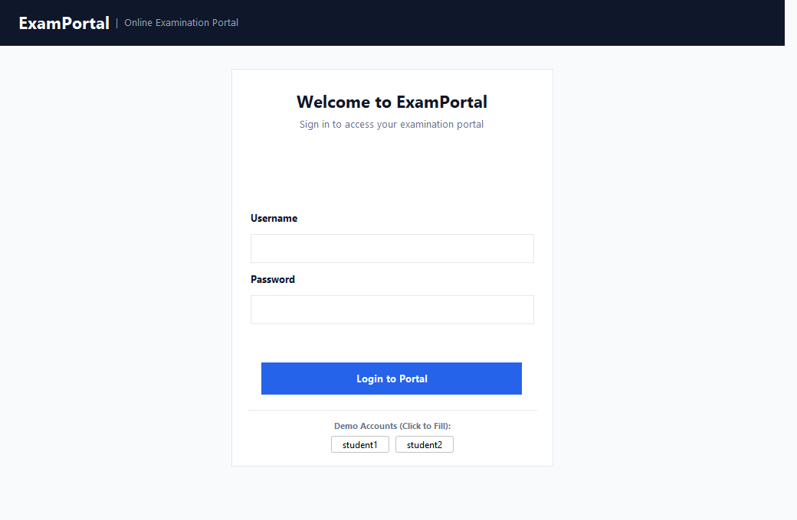
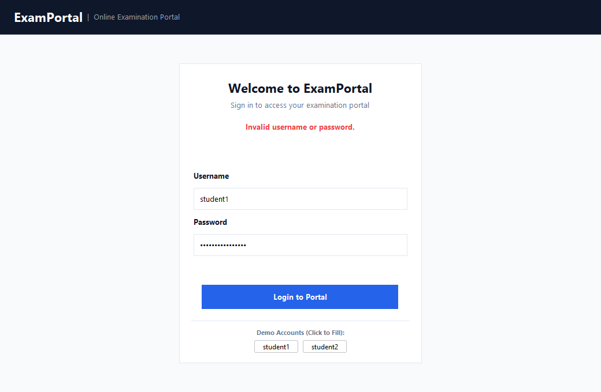
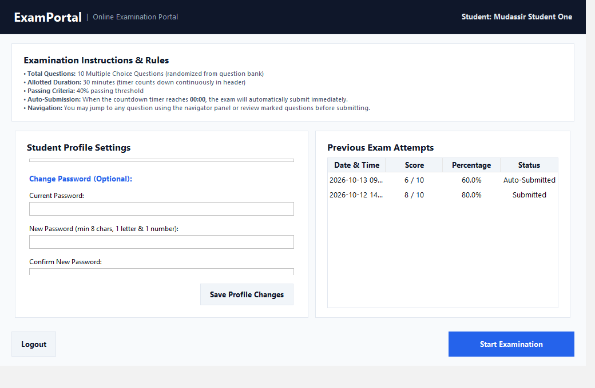
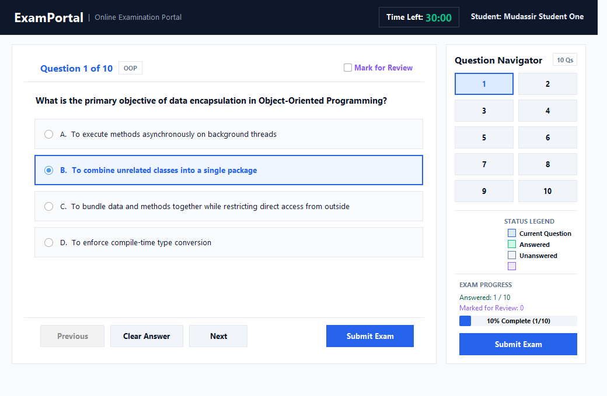
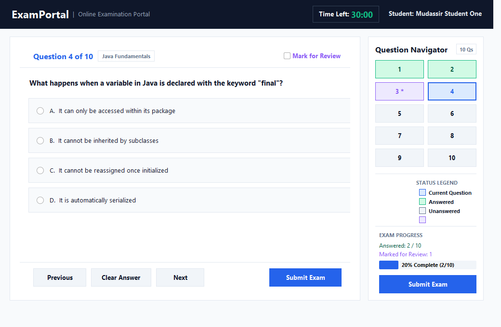
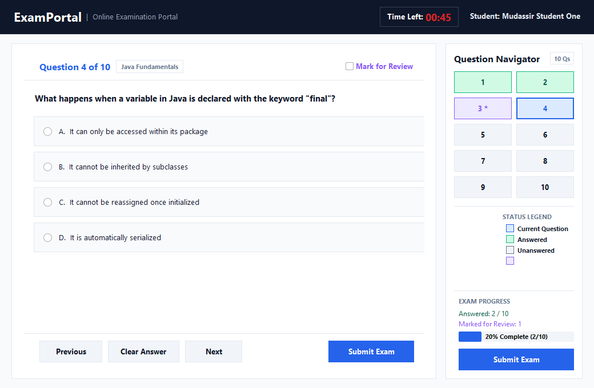
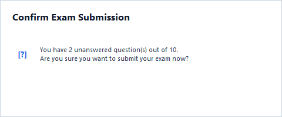
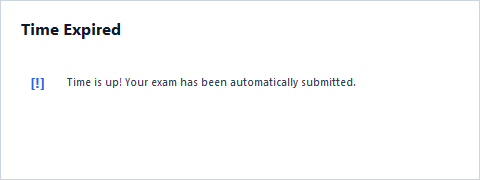
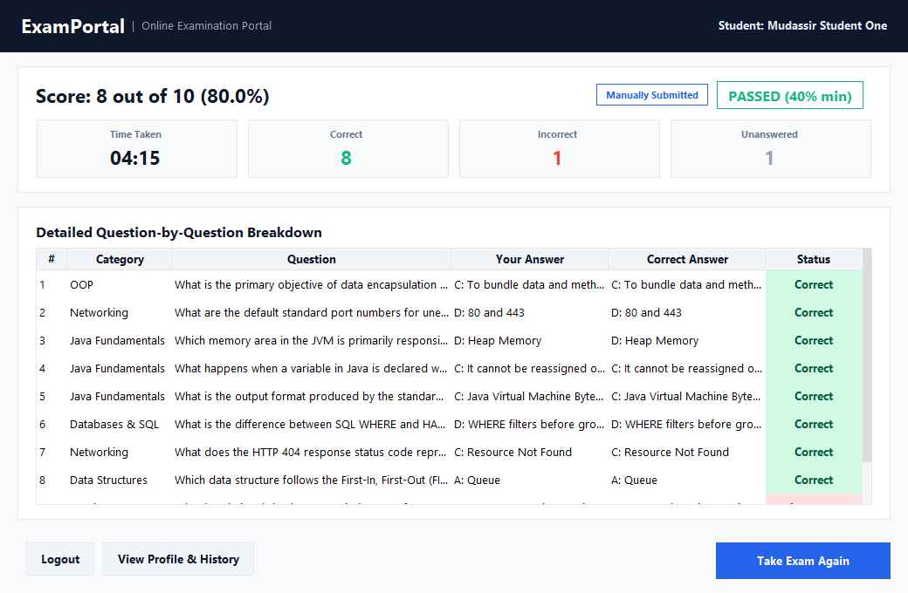
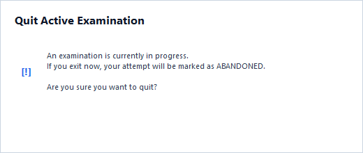

# ExamPortal - Desktop Online Examination System
**Oasis Infobyte Internship — Java Development — Task 4**

[](https://www.oracle.com/java/technologies/javase/jdk17-archive-downloads.html)
[](https://docs.oracle.com/javase/tutorial/uiswing/)
[](https://www.sqlite.org/)
[](https://maven.apache.org/)
[]()
[]()

---

## 📌 Table of Contents
1. [Project Overview](#-project-overview)
2. [Key Features](#-key-features)
3. [Technology Stack](#-technology-stack)
4. [Prerequisites & Requirements](#-prerequisites--requirements)
5. [How to Build and Run](#-how-to-build-and-run)
6. [Demo Student Credentials](#-demo-student-credentials)
7. [System Architecture & Project Structure](#-system-architecture--project-structure)
8. [Database Schema & Seed Data](#-database-schema--seed-data)
9. [Detailed Examination Workflow](#-detailed-examination-workflow)
10. [Core Technical Implementations](#-core-technical-implementations)
    - [Drift-Free Countdown Timer](#1-drift-free-countdown-timer)
    - [Cryptographic Password Security](#2-cryptographic-password-security)
    - [SQL Injection Prevention](#3-sql-injection-prevention)
    - [Question Selection & Option Shuffling](#4-question-selection--option-shuffling)
    - [Session-Safe Window Management](#5-session-safe-window-management)
11. [Adding New Questions](#-adding-new-questions)
12. [Input Validation Rules](#-input-validation-rules)
13. [Visual Screenshots & User Interface](#-visual-screenshots--user-interface)
14. [Automated Test Cases Table](#-automated-test-cases-table)
15. [Known Limitations](#-known-limitations)
16. [What I Learned](#-what-i-learned)
17. [Author & Contact](#-author--contact)

---

## 📖 Project Overview
**ExamPortal** is a secure, responsive, modern desktop examination application built in Java 17 using Swing. Developed as part of the Oasis Infobyte Java Development Internship (Task 4), it delivers an end-to-end computer-based test (CBT) environment.

Students authenticate securely with salted PBKDF2 hashed credentials, manage their profile and passwords with validation checks, review previous exam attempts, read instructions, and take randomized, timed multiple-choice examinations. The system automatically monitors progress, tracks answer persistence across questions, highlights marked questions, enforces strict time limits without tick-drift, auto-submits upon time expiry, and presents immediate, rich post-exam analytics and question reviews.

---

## ⭐ Key Features

| Feature | Description |
| :--- | :--- |
| **Secure Authentication** | Form-based login with PBKDF2 password hashing, per-user salt, constant-time comparison, and automatic 30-second lockout after 5 consecutive failed attempts. |
| **Profile Management** | Update display name and password with validation. Shows historical attempts table and allows starting an exam with or without saving edits (with unsaved changes prompt). |
| **MCQ Question Engine** | Dynamic question loading with wrapped, responsive text and 4 custom-styled radio buttons. Selected answers are preserved across navigation. |
| **Smart Navigator Panel** | Color-coded grid showing Current (blue), Answered (green), Unanswered (neutral), and Marked for Review (*) states with click-to-jump navigation. |
| **Drift-Free Timer** | `javax.swing.Timer` computing remaining duration from fixed end timestamps (`Instant`), dynamically shifting from normal green to amber (<= 5 min) and bold red (<= 1 min). |
| **Atomic Auto-Submission** | Idempotent submission trigger at zero seconds that stops the timer, warns the student, and locks the exam attempt. Cannot be submitted twice. |
| **Manual Submission** | Warns student of unanswered questions before final confirmation. |
| **Comprehensive Results** | Displays score (X / Y), percentage, pass/fail status (40% threshold), time taken (MM:SS), metric cards, and a detailed question-by-question review table. |
| **Session-Safe Window Closing** | Window closing intercepted via `DO_NOTHING_ON_CLOSE`. Confirms exit and records attempt as `ABANDONED` if closed mid-exam. |
| **Multi-Attempt Support** | "Take Exam Again" generates a fresh, randomized 10-question set from the 25-question bank. |

---

## 🛠 Technology Stack
- **Language:** Java 17 (LTS)
- **GUI Framework:** Java Swing (`javax.swing`, `java.awt`) with FlatLaf modern Look-and-Feel (and automatic fallback to OS native Look-and-Feel)
- **Database:** SQLite 3 via JDBC (`org.xerial:sqlite-jdbc:3.45.2.0`)
- **Build Tool:** Apache Maven 3 (`maven-shade-plugin` producing a single standalone fat JAR)
- **Testing:** JUnit 5 (`org.junit.jupiter:5.10.2`) with 31 comprehensive automated tests
- **Logging:** Java standard `java.util.logging` (zero plain-text password logging)

---

## 📋 Prerequisites & Requirements
- **Java Development Kit (JDK):** Version 17 or higher (`javac -version` and `java -version`)
- **Apache Maven:** Version 3.8+ (`mvn -version`)
- **Operating System:** Cross-platform (Windows 10/11, macOS, Linux)

---

## 🚀 How to Build and Run

### 1. Build Fat JAR via Maven
Open a terminal in `OIBSIP/Java-Task4-OnlineExaminationSystem/` and execute:
```bash
mvn clean package
```
This runs the full test suite (31 tests) and produces the standalone runnable fat JAR at `target/examportal.jar`.

### 2. Run the Application
Launch the fat JAR with default settings (30 minutes exam duration):
```bash
java -jar target/examportal.jar
```

### 3. Fast Demo Mode (Shortened Exam Timer)
To demonstrate the amber/red timer color transitions and auto-submission at zero quickly, override the exam duration via the system property `-Dexam.duration.seconds`:
```bash
# Set exam duration to 45 seconds to observe amber/red alerts and auto-submit
java -Dexam.duration.seconds=45 -jar target/examportal.jar
```

### 4. Running from Source or IDE (IntelliJ IDEA / Eclipse / VS Code)
- Open `OIBSIP/Java-Task4-OnlineExaminationSystem/` as a Maven project.
- Locate the main class: `com.mudassir.examportal.Main`.
- Right-click and choose **Run 'Main.main()'**.
- VM Options can be added in the Run Configuration (e.g. `-Dexam.duration.seconds=60`).

---

## 🔑 Demo Student Credentials
The application automatically seeds two test student accounts on first launch if the database is unpopulated:

| Username | Password | Display Name | Role |
| :--- | :--- | :--- | :--- |
| `student1` | `Student@123` | Mudassir Student One | Student Demo Account 1 |
| `student2` | `Student@456` | Amina Student Two | Student Demo Account 2 |

*Note: For testing convenience, the login screen includes one-click buttons to auto-populate either demo account.*

---

## 📂 System Architecture & Project Structure

The project strictly decouples presentation, business services, data access, and models:

```
OIBSIP/Java-Task4-OnlineExaminationSystem/
├── pom.xml                               # Maven project descriptor with Shade fat JAR plugin
├── README.md                             # Comprehensive project documentation
├── .gitignore                            # Git ignore configuration
├── screenshots/                          # 11 application state screenshots
│   ├── 01_login_screen.png
│   ├── 02_failed_login_screen.png
│   ├── 03_profile_screen.png
│   ├── 04_exam_question_screen.png
│   ├── 05_navigator_mixed_states.png
│   ├── 06_timer_amber_warning.png
│   ├── 06_timer_red_critical.png
│   ├── 07_submit_confirmation_dialog.png
│   ├── 08_auto_submit_dialog.png
│   ├── 09_result_breakdown_screen.png
│   └── 10_quit_confirmation_dialog.png
├── data/                                 # Auto-created SQLite database directory
│   └── examportal.db
├── src/
│   ├── main/
│   │   ├── java/com/mudassir/examportal/
│   │   │   ├── Main.java                 # Application entrypoint (EDT & LookAndFeel)
│   │   │   ├── config/
│   │   │   │   └── AppConfig.java        # Constants, thresholds, system property lookups
│   │   │   ├── model/
│   │   │   │   ├── User.java             # Student POJO
│   │   │   │   ├── Question.java         # MCQ Question POJO with option helpers
│   │   │   │   ├── ExamStatus.java       # SUBMITTED, AUTO_SUBMITTED, ABANDONED enum
│   │   │   │   ├── ExamAttempt.java      # Historical attempt POJO
│   │   │   │   └── ExamResult.java       # Evaluated score & review item details
│   │   │   ├── db/
│   │   │   │   ├── DatabaseManager.java  # Connection factory, schema and seed runner
│   │   │   │   ├── UserDao.java          # Parameterized queries for user entities
│   │   │   │   ├── QuestionDao.java      # Parameterized queries for questions
│   │   │   │   └── AttemptDao.java       # Parameterized queries for exam attempts
│   │   │   ├── service/
│   │   │   │   ├── PasswordUtil.java     # PBKDF2 hashing, salt generation, constant-time verify
│   │   │   │   ├── ValidationUtil.java   # Regex validators for names and passwords
│   │   │   │   ├── AuthService.java      # Credential verification & 30s lockout limiter
│   │   │   │   ├── ProfileService.java   # Profile updates & password modification
│   │   │   │   ├── ExamService.java      # Question bank selection & option shuffling
│   │   │   │   └── ExamSession.java      # Decoupled exam state, scoring & clock injection
│   │   │   └── ui/
│   │   │       ├── UITheme.java          # Design tokens, typography & button factories
│   │   │       ├── MainFrame.java        # Single JFrame managing CardLayout navigation
│   │   │       ├── HeaderPanel.java      # Brand, student greeting & countdown timer
│   │   │       ├── LoginPanel.java       # Secure authentication & demo account triggers
│   │   │       ├── ProfilePanel.java     # Profile editor, exam rules & attempt table
│   │   │       ├── QuestionNavigatorPanel.java # Color-coded navigation grid (1..10)
│   │   │       ├── ExamPanel.java        # MCQ presentation & submission handlers
│   │   │       ├── ResultPanel.java      # Outcome hero, metrics & question review table
│   │   │       └── TimerLabel.java       # Drift-free JLabel countdown component
│   │   └── resources/
│   │       ├── schema.sql                # DDL script creating users, questions, attempts
│   │       └── seed_questions.sql        # 25 verified questions across 6 CS categories
│   └── test/
│       └── java/com/mudassir/examportal/
│           ├── PasswordUtilTest.java     # PBKDF2 & salt uniqueness tests
│           ├── ValidationUtilTest.java   # Display name & password complexity tests
│           ├── DatabaseManagerTest.java  # Schema, PRAGMA foreign_keys & seed tests
│           ├── AuthServiceTest.java      # Login, failure, rate-limiting & SQL-injection
│           ├── ProfileServiceTest.java   # Profile changes & validation rules
│           ├── ExamServiceTest.java      # Question selection, shuffling & attempt persistence
│           ├── ExamSessionTest.java      # Scoring, answer persistence, clock injection
│           └── ScreenshotGenerator.java  # Off-screen component renderer producing screenshots
```

---

## 🗄 Database Schema & Seed Data

The application stores data in SQLite at `./data/examportal.db` (auto-created on first run). All queries execute with `PRAGMA foreign_keys = ON;`.

### 1. `users` Table
```sql
CREATE TABLE IF NOT EXISTS users (
    id INTEGER PRIMARY KEY AUTOINCREMENT,
    username TEXT UNIQUE NOT NULL,
    display_name TEXT NOT NULL,
    password_hash TEXT NOT NULL,
    salt TEXT NOT NULL
);
```

### 2. `questions` Table
```sql
CREATE TABLE IF NOT EXISTS questions (
    id INTEGER PRIMARY KEY AUTOINCREMENT,
    category TEXT NOT NULL,
    question_text TEXT NOT NULL,
    option_a TEXT NOT NULL,
    option_b TEXT NOT NULL,
    option_c TEXT NOT NULL,
    option_d TEXT NOT NULL,
    correct_option TEXT NOT NULL -- 'A', 'B', 'C', or 'D'
);
```

### 3. `exam_attempts` Table
```sql
CREATE TABLE IF NOT EXISTS exam_attempts (
    id INTEGER PRIMARY KEY AUTOINCREMENT,
    user_id INTEGER NOT NULL,
    started_at TEXT NOT NULL,
    ended_at TEXT NOT NULL,
    score INTEGER NOT NULL,
    total_questions INTEGER NOT NULL,
    status TEXT NOT NULL, -- 'SUBMITTED', 'AUTO_SUBMITTED', 'ABANDONED'
    FOREIGN KEY(user_id) REFERENCES users(id) ON DELETE CASCADE
);
```

---

## 🔄 Detailed Examination Workflow

```
+---------------+     Login Valid      +-------------------+
|  Login Screen | -------------------> |   Profile Screen  |
+---------------+                      +-------------------+
        ^                                        |
        | Logout                                 | Start Exam
        |                                        v
+---------------+     Submit / Auto    +-------------------+
| Result Screen | <------------------- |    Exam Screen    |
+---------------+                      +-------------------+
        |
        +-----> "Take Exam Again" (Starts fresh randomized session)
```

1. **Login:** Student submits credentials. If 5 failed attempts occur, form locks for 30s. On success, transitions to Profile.
2. **Profile & Instructions:** Pre-fills current display name. Student can modify display name or change password. Review previous attempts history table and instructions. If student edits fields without saving, a prompt asks before starting exam.
3. **Examination:** 10 questions randomly chosen and shuffled. Header displays active countdown timer. Student answers questions, moves Next/Previous, clears answers, or marks for review.
4. **Submission:**
   - **Manual:** Prompts student with unanswered question count. On "Yes", submits.
   - **Auto:** Triggered exactly once when timer reaches `00:00`. Shows alert and submits.
5. **Results & Breakdown:** Displays score, percentage, pass/fail status, time taken, and itemized table with user answer vs correct answer.
6. **Next Action:** Student can click "Take Exam Again", "View Profile & History", or "Logout".

---

## ⚙ Core Technical Implementations

### 1. Drift-Free Countdown Timer
Counting timer ticks with `ticks++` causes progressive timing drift due to thread scheduling latency and garbage collection pauses.
To eliminate drift:
- When the exam starts, `targetEndInstant = Instant.now().plusSeconds(durationSeconds)`.
- A `javax.swing.Timer` fires every 500 ms and re-calculates remaining time from:
  $$\text{remainingSeconds} = \text{Duration.between}(\text{Instant.now()}, \text{targetEndInstant}).\text{getSeconds}()$$
- Threshold changes:
  - **Normal:** > 5 minutes (Green)
  - **Amber warning:** $\le$ 5 minutes and > 1 minute
  - **Red warning:** $\le$ 1 minute
- When remaining seconds reach $\le 0$, the timer stops and triggers auto-submission using an `AtomicBoolean` to prevent race conditions or duplicate submissions.

### 2. Cryptographic Password Security
- Passwords are never stored in plain text.
- Generated using `PBKDF2WithHmacSHA256` with 65,536 iterations, a 256-bit key length, and a 16-byte cryptographically secure per-user random salt (`SecureRandom`).
- Verification uses `MessageDigest.isEqual()` to compare byte arrays in constant time, preventing side-channel timing attacks.

### 3. SQL Injection Prevention
- All database queries without exception use `PreparedStatement` with parameter binding (`?`).
- User input is never concatenated into SQL strings.
- Verified by automated tests attempting SQL injection payloads (`' OR '1'='1`).

### 4. Question Selection & Option Shuffling
- 10 questions are sampled randomly without replacement from the 25-question bank.
- For each question, the 4 option strings are shuffled using `Collections.shuffle(optionsList)`.
- The correct option letter ('A', 'B', 'C', 'D') is dynamically re-mapped to match where the correct text ended up.
- Result: Every exam attempt presents both questions and options in unpredictable order while preserving 100% correct answer verification.

### 5. Session-Safe Window Management
- `JFrame.setDefaultCloseOperation(DO_NOTHING_ON_CLOSE)`.
- A `WindowListener` intercepts the window close (`X`) button:
  - If an exam is active: Prompts student that exiting now will record the attempt as `ABANDONED`. On confirmation, marks attempt as `ABANDONED`, saves to SQLite, stops the timer, and disposes.
  - On non-exam screens: Prompts for general confirmation before exit.

---

## ➕ Adding New Questions
To expand the question bank:
1. Open `src/main/resources/seed_questions.sql`.
2. Append a tuple following this format:
   ```sql
   ('Category Name', 'Your question text goes here?', 'Option A text', 'Option B text', 'Option C text', 'Option D text', 'B'),
   ```
3. Delete `./data/examportal.db` to re-trigger automatic database seeding on next application startup, or insert questions programmatically via `QuestionDao.insert()`.

---

## 🛡 Input Validation Rules

| Field | Rule | Error Message |
| :--- | :--- | :--- |
| **Username** | Cannot be empty or whitespace | `"Please enter both username and password."` |
| **Password (Login)** | Cannot be empty or whitespace | `"Please enter both username and password."` |
| **Failed Logins** | 5 consecutive failures | `"Account temporarily locked due to 5 failed attempts. Please wait X second(s)..."` |
| **Display Name** | 2 to 40 characters, letters, spaces, dots, and hyphens (`^[a-zA-Z\s.-]{2,40}$`) | `"Display name must be between 2 and 40 characters and contain only letters, spaces, dots, and hyphens."` |
| **Current Password** | Must match user's stored PBKDF2 hash | `"Current password is incorrect."` |
| **New Password** | Minimum 8 characters, at least 1 letter and 1 number (`^(?=.*[A-Za-z])(?=.*\d).{8,}$`) | `"New password must be at least 8 characters long and contain at least one letter and one number."` |
| **Confirm Password** | Must match new password exactly | `"New password and confirmation password do not match."` |

---

## 📸 Visual Screenshots & User Interface

All high-resolution application screenshots are stored in the `/screenshots` folder:

### 1. Login Screen

*Modern card design, input fields, Enter key submission, and one-click demo credentials.*

### 2. Failed Login Screen & Rate Limiter

*Generic security error preventing username enumeration, and automatic 30-second lockout after 5 failed attempts.*

### 3. Student Profile & Attempt History Screen

*Display name management, password change form, exam instructions, and historical exam attempts table.*

### 4. Active Examination Screen

*Clean MCQ layout with wrapped text, 4 styled option cards, category badge, and active countdown timer.*

### 5. Color-Coded Question Navigator

*Navigator grid displaying Current (blue), Answered (green), Unanswered (neutral), and Marked for Review (*).*

### 6. Dynamic Timer Threshold Warnings
| 5-Minute Amber Warning | 1-Minute Red Critical Warning |
| :---: | :---: |
|  |  |

### 7. Submission Confirmations
| Manual Submit Unanswered Check | Auto-Submit Time Expiration |
| :---: | :---: |
|  |  |

### 8. Comprehensive Result Screen & Question Breakdown

*Score hero, PASSED badge (40% threshold), elapsed time, metric cards, and full review table.*

### 9. Window Exit Confirmation During Active Exam

*Prevents accidental data loss by prompting the student and recording unsubmitted attempts as ABANDONED.*

---

## 🧪 Automated Test Cases Table

The project features a JUnit 5 test suite with 31 automated tests executing in under 12 seconds:

| Test Class | Tests Run | Scenarios Covered | Status |
| :--- | :---: | :--- | :---: |
| `PasswordUtilTest` | 3 | PBKDF2 hashing, unique 16-byte salts, constant-time verification | ✅ Passed |
| `ValidationUtilTest` | 2 | Display name regex (2-40 chars), password complexity (8+ chars, letter + number) | ✅ Passed |
| `DatabaseManagerTest` | 3 | Schema creation, `PRAGMA foreign_keys = ON`, automatic demo seeding | ✅ Passed |
| `AuthServiceTest` | 6 | Successful login, invalid credentials, SQL injection safe rejection, rate limiting 30s lockout | ✅ Passed |
| `ProfileServiceTest` | 6 | Display name update, password update, wrong current password rejection, weak password rejection | ✅ Passed |
| `ExamServiceTest` | 3 | 10 unique questions selected, option shuffling with correct answer preservation, attempt persistence | ✅ Passed |
| `ExamSessionTest` | 8 | Answer persistence during navigation, mark-for-review toggle, clock injection drift check, 100% pass scoring, 0% fail scoring, partial scoring, submission idempotence, time taken calculation | ✅ Passed |
| **Total** | **31** | **Comprehensive end-to-end unit and integration coverage** | **✅ 100% Passed** |

---

## ⚠️ Known Limitations
1. **Single Machine SQLite Storage:** SQLite is ideal for desktop applications and embedded use. A networked classroom setup would transition `DatabaseManager` to PostgreSQL or MySQL.
2. **Fixed MCQ Options:** The current engine is designed for 4-option multiple choice questions. Multi-select checkboxes or essay questions are not supported in this version.
3. **Session Per Process:** One student session per running JVM instance.

---

## 💡 What I Learned
- **Swing Architectural Discipline:** Separating presentation from business logic using `CardLayout` and keeping the models completely independent of UI classes enabled comprehensive unit testing without instantiating GUI components.
- **Clock Drift Mitigation:** Relying on tick counts in background timers causes progressive lag; anchoring all time calculations to a fixed target `Instant` guarantees precision.
- **Defensive Cryptography:** Implementing salted PBKDF2 and constant-time comparison guards against rainbow table and timing attack vectors.
- **SQLite Concurrency & Foreign Keys:** SQLite requires explicit `PRAGMA foreign_keys = ON;` on every connection to maintain relational integrity.
- **Idempotent State Machines:** Using `AtomicBoolean` for session submission prevents double submissions whether invoked by user action, auto-timer, or window close events.

---

## 👤 Author & Contact
- **Developer:** Mudassir Ahmed
- **Internship:** Oasis Infobyte — Java Development Internship (Task 4)
- **Project:** ExamPortal — Online Examination System
