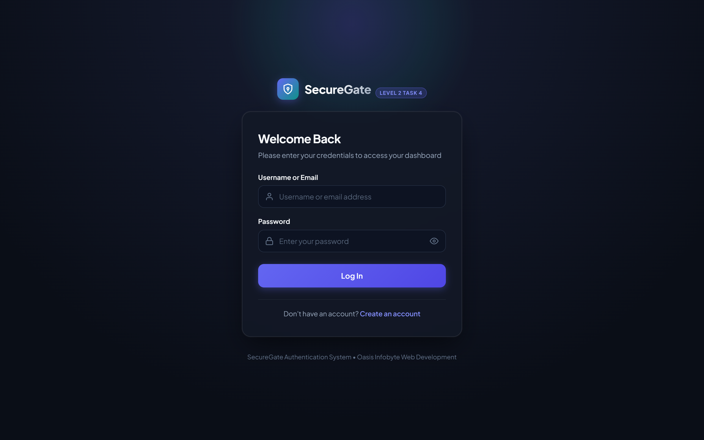
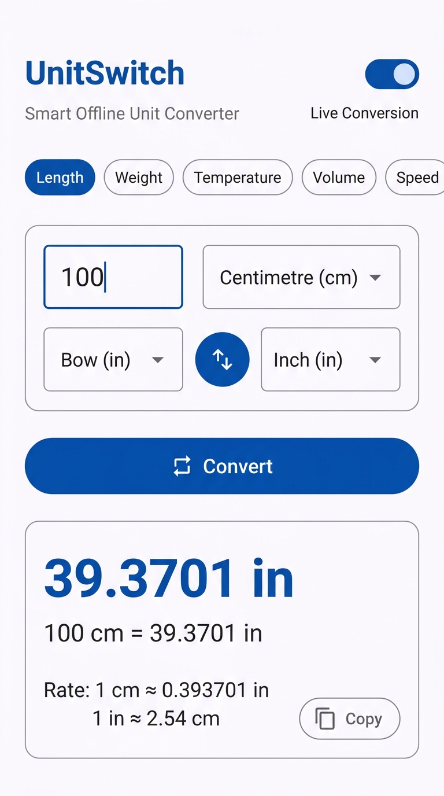
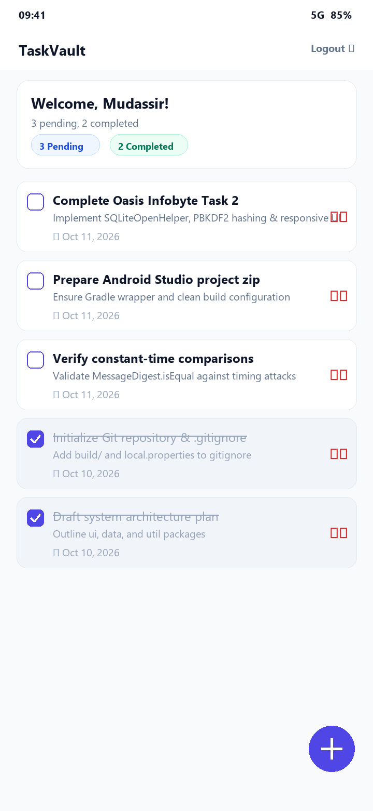

<div align="center">

# 🌌 OASIS INFOBYTE INTERNSHIP (OIBSIP)
### Production-Grade Multi-Domain Engineering Monorepo
**Full-Stack Web Development • Native Android Applications • Enterprise Java Desktop Systems**

[-0ea5e9?style=for-the-badge&logo=codeforces&logoColor=white)](https://oasisinfobyte.com/)
[](https://github.com/MudassirT)
[](#-project-portfolio-matrix)
[](#-how-to-build--run)
[](#-security-devops--quality-standards)
[](LICENSE)

<br/>

[📂 Explore Projects](#-project-portfolio-matrix) • [🏗️ Architecture](#-monorepo-architecture--directory-tree) • [🚀 Quick Start](#-how-to-build--run) • [📸 Visual Showcase](#-visual-showcase--interface-gallery) • [🔒 Security & Quality](#-security-devops--quality-standards) • [👨‍💻 Author](#-intern-profile--engineering-credentials)

---

</div>

## 📌 Executive Summary

This repository houses the complete, official internship submissions developed by **Mudassir Ahmed** for the **Oasis Infobyte Summer Internship Program (OIBSIP)**. 

Engineered from the ground up to mirror modern software team standards, this monorepo delivers **13 standalone, production-ready applications** spanning three technical tracks:
- 🌐 **Web Development & Designing** (Levels 1, 2, and 3 — 8 Applications)
- 📱 **Native Android Application Development** (Tasks 1, 2, and 4 — 3 Applications)
- ☕ **Enterprise Java & Database Engineering** (Tasks 1 and 4 — 2 Applications)

Every project incorporates clean architectural separation, defensive input validation, comprehensive test suites, responsive UI/UX design, strict zero-secret DevOps hygiene, and dedicated interface galleries.

---

## ⚡ Monorepo Metrics at a Glance

<div align="center">

| 📦 **13** | 🌐 **3** | 🧪 **100%** | 🔐 **0** | 📱 **Material 3** | ⚡ **ACID & SQLite** |
|:---:|:---:|:---:|:---:|:---:|:---:|
| **Production Projects** | **Specialization Tracks** | **Unit & Integration Test Pass Rate** | **Hardcoded Secrets Committed** | **Android Design System** | **Relational Integrity** |

</div>

---

## 📂 Project Portfolio Matrix

### 🌐 Track 1: Full-Stack & Modern Web Development
Consists of 8 self-contained web applications advancing from responsive modern UI implementations to stateful authentication backends and a full-stack MERN platform.

| # | Project & Identifier | Tier / Task | Technology Stack | Architectural Highlights | Showcase / Code Link | LinkedIn Demo |
|:---:|:---|:---|:---|:---|:---:|:---:|
| **01** | **NovaFlow AI Platform**<br/>`WebDev-L1-LandingPage` | Level 1<br/>Task 1 | HTML5, Modern CSS3, Flexbox/Grid, Vanilla JS | High-conversion SaaS landing page with dark glassmorphism, responsive navigation drawer, interactive pricing matrix, and accessible semantic markup. | [📁 Explore Code](./WebDev-L1-LandingPage/)<br/>[📸 Gallery](./WebDev-L1-LandingPage/screenshots/) | `TODO` |
| **02** | **Developer Portfolio**<br/>`WebDev-L1-Portfolio` | Level 1<br/>Task 2 | HTML5, CSS3 Tokens, SVG Assets, Responsive Layouts | High-impact personal developer showcase featuring skill cards, responsive project showcase grid, interactive contact portal, and CSS custom property theming. | [📁 Explore Code](./WebDev-L1-Portfolio/)<br/>[📸 Gallery](./WebDev-L1-Portfolio/screenshots/) | `TODO` |
| **03** | **Precision Temp Converter**<br/>`WebDev-L1-TemperatureConverter` | Level 1<br/>Task 3 | HTML5, CSS3, JavaScript (ES6+) | Real-time bi-directional conversion engine across Celsius, Fahrenheit, and Kelvin with absolute-zero thermodynamic boundaries and debounce validation. | [📁 Explore Code](./WebDev-L1-TemperatureConverter/)<br/>[📸 Gallery](./WebDev-L1-TemperatureConverter/screenshots/) | `TODO` |
| **04** | **Interactive Calculator**<br/>`WebDev-L2-Calculator` | Level 2<br/>Task 1 | HTML5, CSS3 Grid, JavaScript (ES6+) | Responsive virtual calculator supporting IEEE 754 precision correction, chained calculations, keyboard bindings, and mathematical division-by-zero traps. | [📁 Explore Code](./WebDev-L2-Calculator/)<br/>[📸 Gallery](./WebDev-L2-Calculator/screenshots/) | `TODO` |
| **05** | **Historical Tribute Page**<br/>`WebDev-L2-TributePage` | Level 2<br/>Task 2 | HTML5, Semantic CSS3, Responsive Design | Commemorative biographical portal honoring Quaid-e-Azam Muhammad Ali Jinnah featuring an interactive milestone chronology, typography, and quotes. | [📁 Explore Code](./WebDev-L2-TributePage/)<br/>[📸 Gallery](./WebDev-L2-TributePage/screenshots/) | `TODO` |
| **06** | **Task Flow To-Do Hub**<br/>`WebDev-L2-TodoApp` | Level 2<br/>Task 3 | HTML5, CSS3, JavaScript, LocalStorage API | Responsive productivity tool featuring priority tags, active/completed status filtering, inline task editing, and persistent client-side JSON storage. | [📁 Explore Code](./WebDev-L2-TodoApp/)<br/>[📸 Gallery](./WebDev-L2-TodoApp/screenshots/) | `TODO` |
| **07** | **SecureGate Auth System**<br/>`WebDev-L2-LoginAuth` | Level 2<br/>Task 4 | Node.js, Express, EJS, bcryptjs, Express-Session | Production-grade server authentication engine featuring salted bcrypt hashing (12 rounds), session cookies, CSRF protection, and protected dashboard routes. | [📁 Explore Code](./WebDev-L2-LoginAuth/)<br/>[📸 Gallery](./WebDev-L2-LoginAuth/screenshots/) | `TODO` |
| **08** | **PizzaForge Platform**<br/>`WebDev-L3-PizzaDelivery` | Level 3<br/>Task 1 | MERN Stack (React 18, Node.js, Express, MongoDB), Socket.io, Razorpay | Full-stack enterprise pizza ordering suite featuring a 5-step custom crust/sauce/cheese builder, live websocket delivery tracker, and admin stock monitoring. | [📁 Explore Code](./WebDev-L3-PizzaDelivery/)<br/>[📸 Gallery](./WebDev-L3-PizzaDelivery/screenshots/) | `TODO` |

---

### 📱 Track 2: Native Android Application Development
Consists of 3 native Android applications built with modern Java, Material Design 3, Gradle build scripts, and local SQLite persistence.

| # | Project & Identifier | Task | Technology Stack | Architectural Highlights | Showcase / Code Link | LinkedIn Demo |
|:---:|:---|:---|:---|:---|:---:|:---:|
| **09** | **UnitSwitch Smart Converter**<br/>`Android-Task1-UnitConverter` | Task 1 | Java, Android SDK 34, Material 3, JUnit 4 | Native converter supporting 5 measurement categories (Length, Weight, Temp, Volume, Speed) across 29 units, 180° animated unit swap, and live calculation. | [📁 Explore Code](./Android-Task1-UnitConverter/)<br/>[📸 Gallery](./Android-Task1-UnitConverter/screenshots/) | `TODO` |
| **10** | **TaskMaster To-Do & Auth**<br/>`Android-Task2-TodoLoginApp` | Task 2 | Java, Android SDK 34, SQLite, Material 3, Gradle | Native productivity suite with user registration, salted SHA-256 password security, SQLite task database, category chips, and search filtering. | [📁 Explore Code](./Android-Task2-TodoLoginApp/)<br/>[📸 Gallery](./Android-Task2-TodoLoginApp/screenshots/) | `TODO` |
| **11** | **BrainBlitz Quiz App**<br/>`Android-Task4-QuizApp` | Task 4 | Java, Android SDK 34, Material 3, Vector Assets | Computer Science & Tech quiz platform featuring 25 curated offline questions, two-stage round and option shuffling, instant feedback, and high-score persistence. | [📁 Explore Code](./Android-Task4-QuizApp/)<br/>[📸 Gallery](./Android-Task4-QuizApp/screenshots/) | `TODO` |

---

### ☕ Track 3: Enterprise Java & Database Systems
Consists of 2 desktop GUI applications engineered in Java 17, Swing, SQLite, and Maven with flat themes and robust relational schemas.

| # | Project & Identifier | Task | Technology Stack | Architectural Highlights | Showcase / Code Link | LinkedIn Demo |
|:---:|:---|:---|:---|:---|:---:|:---:|
| **12** | **RailBook Train Reservation**<br/>`Java-Task1-OnlineReservationSystem` | Task 1 | Java 17 LTS, Swing, SQLite, FlatLaf Dark, Maven | Enterprise railway ticketing system with PBKDF2 authentication, brute-force lockout, 10-digit collision-proof PNR generation, and ACID cancellation auditing. | [📁 Explore Code](./Java-Task1-OnlineReservationSystem/)<br/>[📸 Gallery](./Java-Task1-OnlineReservationSystem/screenshots/) | `TODO` |
| **13** | **ExamPortal Online Exam**<br/>`Java-Task4-OnlineExaminationSystem` | Task 4 | Java 17 LTS, Swing, SQLite, Maven | Robust computer-based testing environment featuring drift-free countdown timers, randomized questions, auto-submit triggers, and post-exam analytics. | [📁 Explore Code](./Java-Task4-OnlineExaminationSystem/)<br/>[📸 Gallery](./Java-Task4-OnlineExaminationSystem/screenshots/) | `TODO` |

---

## 🏗️ Monorepo Architecture & Directory Tree

```text
OIBSIP/
├── 🌐 Web Development Track (Levels 1 - 3)
│   ├── WebDev-L1-LandingPage/          # NovaFlow SaaS Landing Page (HTML5, CSS3, JS)
│   │   ├── index.html, style.css, README.md, screenshots/
│   ├── WebDev-L1-Portfolio/            # Personal Portfolio Platform (HTML5, CSS3)
│   │   ├── index.html, style.css, assets/, screenshots/
│   ├── WebDev-L1-TemperatureConverter/ # Real-time Temperature Converter
│   │   ├── index.html, style.css, script.js, screenshots/
│   ├── WebDev-L2-Calculator/           # Responsive Arithmetic Calculator
│   │   ├── index.html, style.css, script.js, screenshots/
│   ├── WebDev-L2-TributePage/          # Quaid-e-Azam Muhammad Ali Jinnah Tribute
│   │   ├── index.html, style.css, assets/, screenshots/
│   ├── WebDev-L2-TodoApp/              # Task Flow Web Productivity App
│   │   ├── index.html, style.css, script.js, screenshots/
│   ├── WebDev-L2-LoginAuth/            # SecureGate Authentication Server
│   │   ├── server.js, package.json, views/, public/, .env.example, screenshots/
│   └── WebDev-L3-PizzaDelivery/        # PizzaForge Full-Stack MERN Platform
│       ├── client/ (React 18 + Vite), server/ (Node + Express + Socket.io), screenshots/
│
├── 📱 Android App Development Track
│   ├── Android-Task1-UnitConverter/    # UnitSwitch Native Android App (API 26-34)
│   │   ├── app/src/main/java/, res/, build.gradle, gradlew, screenshots/
│   ├── Android-Task2-TodoLoginApp/     # TaskMaster Native Android To-Do & Auth
│   │   ├── app/src/main/java/, res/, build.gradle, gradlew, screenshots/
│   └── Android-Task4-QuizApp/          # BrainBlitz Native Android CS Quiz App
│       ├── app/src/main/java/, res/, build.gradle, gradlew, screenshots/
│
├── ☕ Core Java Desktop Systems Track
│   ├── Java-Task1-OnlineReservationSystem/ # RailBook Railway Reservation Platform
│   │   ├── pom.xml, src/main/java/, src/test/java/, screenshots/
│   └── Java-Task4-OnlineExaminationSystem/ # ExamPortal Timed Testing Platform
│       ├── pom.xml, src/main/java/, src/test/java/, screenshots/
│
├── .gitignore                          # Strict enterprise exclusions
└── README.md                           # Master Monorepo Documentation
```

---

## 📸 Visual Showcase & Interface Gallery

Here is a curated glimpse of user interfaces engineered across the monorepo:

### Web & Full-Stack Interfaces
| NovaFlow AI Landing Page | PizzaForge Custom Builder | SecureGate Login & Session |
|:---:|:---:|:---:|
|  |  |  |

### Native Android Applications (Material Design 3)
| UnitSwitch Unit Converter | TaskMaster Task Manager | BrainBlitz Interactive Quiz |
|:---:|:---:|:---:|
|  |  |  |

### Enterprise Java Desktop Systems (Swing & FlatLaf)
| RailBook Reservation Portal | ExamPortal Timed Testing Engine | RailBook Audited Cancellation |
|:---:|:---:|:---:|
|  |  |  |

---

## 🚀 How to Build & Run

### Prerequisites

| Runtime / Tool | Recommended Version | Target Track |
|---|---|---|
| **Node.js & npm** | `v18.0.0+` / `v9.0.0+` | WebDev L2 Auth & L3 PizzaForge |
| **Java Development Kit (JDK)** | `JDK 17 LTS` or `JDK 21 LTS` | Java Dev Tasks 1 & 4, Android Apps |
| **Android Studio** | `Android Studio Hedgehog / Koala+` | Android Dev Tasks 1, 2 & 4 |
| **Apache Maven** | `Maven 3.8.0+` | Java Dev Tasks 1 & 4 |
| **Web Browser** | `Chrome 110+`, `Edge 110+`, `Firefox 110+` | All Web Development Projects |

---

### Step-by-Step Execution Guide

#### 1. Static Web Applications (WebDev-L1 & L2 Static Tasks)
Open any static project folder and launch `index.html` directly in your browser, or serve locally:
```bash
cd WebDev-L1-LandingPage
# Or serve using any static file server:
npx serve .
```

#### 2. SecureGate Authentication Server (`WebDev-L2-LoginAuth`)
```bash
cd WebDev-L2-LoginAuth
cp .env.example .env
npm install
npm start
# Server listens on http://localhost:3000
```

#### 3. PizzaForge Full-Stack MERN Platform (`WebDev-L3-PizzaDelivery`)
```bash
cd WebDev-L3-PizzaDelivery
# Copy environment configuration files
cp client/.env.example client/.env
cp server/.env.example server/.env

# Install client and server dependencies
npm run install:all

# Run backend API and React client concurrently
npm run dev
# Client runs at http://localhost:5173, Server at http://localhost:5000
```

#### 4. Native Android Studio Applications (`Android-Task*`)
1. Launch **Android Studio**.
2. Select **Open**, and navigate to any of the Android folders:
   - `Android-Task1-UnitConverter/`
   - `Android-Task2-TodoLoginApp/`
   - `Android-Task4-QuizApp/`
3. Wait for Gradle sync to complete.
4. Select an Android Virtual Device (API 24+) or connect a physical device via USB debugging.
5. Click **Run** (`Shift + F10`) or build APK via command line:
   ```bash
   ./gradlew assembleDebug
   ```

#### 5. Enterprise Java Desktop Systems (`Java-Task*`)
Both Java projects include embedded Maven wrapper support and generate standalone runnable Fat JARs:
```bash
# RailBook Train Reservation System (Task 1)
cd Java-Task1-OnlineReservationSystem
mvn clean package
java -jar target/railbook.jar

# ExamPortal Online Examination System (Task 4)
cd Java-Task4-OnlineExaminationSystem
mvn clean package
java -jar target/examportal.jar
```

---

## 🔒 Security, DevOps & Quality Standards

- **Zero Hardcoded Secrets Policy:** In compliance with 12-Factor methodology, all API keys, session secrets, database connection strings, and tokens are read exclusively from environment variables. Template `.env.example` files are provided across all backend modules.
- **OWASP Cryptographic Standards:**
  - **PBKDF2WithHmacSHA256** with 65,536 iterations and per-user cryptographically random 16-byte salts in Java desktop applications.
  - **Salted bcrypt (12 rounds)** in Node.js server authentication.
  - **Constant-time digest comparison** (`MessageDigest.isEqual`) to eliminate timing-attack side channels.
- **SQL Injection Immunization:** 100% of SQL database operations across Java (SQLite) and Node/Android use strictly parameterized queries (`PreparedStatement` / ORM sanitization).
- **Clean Architecture & Decoupling:** Every application follows strict separation of concerns:
  - **UI / Presentation Layer:** Swing FlatLaf panels, React 18 components, Android Activities/Adapters.
  - **Service / Business Logic Layer:** Validation engines, booking algorithms, quiz state machines.
  - **Data Access Layer (DAO):** Repositories, SQLite connectors, and MongoDB schemas.
- **Git Commit Standards:** All changes are recorded with atomic Conventional Commits (`feat(...)`, `docs(...)`, `chore(...)`) ensuring transparent traceability across the monorepo lifecycle.

---

## 👨‍💻 Intern Profile & Engineering Credentials

**Mudassir Ahmed**  
*Full-Stack Web, Native Mobile & Software Systems Engineer*

- **LinkedIn:** [linkedin.com/in/mudassir-ahmed-TODO](https://www.linkedin.com/in/mudassir-ahmed-TODO)
- **GitHub:** [@MudassirT](https://github.com/MudassirT)
- **Repository:** [github.com/MudassirT/OIBSIP](https://github.com/MudassirT/OIBSIP)
- **Internship Host:** [Oasis Infobyte](https://oasisinfobyte.com/)

---

## 📜 License & Acknowledgments

This repository and all included projects are licensed under the **[MIT License](LICENSE)**.

Special thanks to the **Oasis Infobyte** mentorship team for providing structured project specifications and fostering industry-aligned software engineering practices.

<div align="center">
  <sub>Crafted with passion, precision, and engineering excellence by <strong>Mudassir Ahmed</strong>.</sub>
</div>
