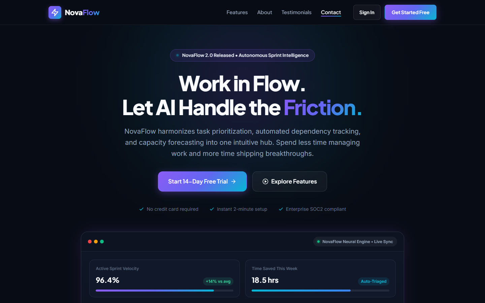
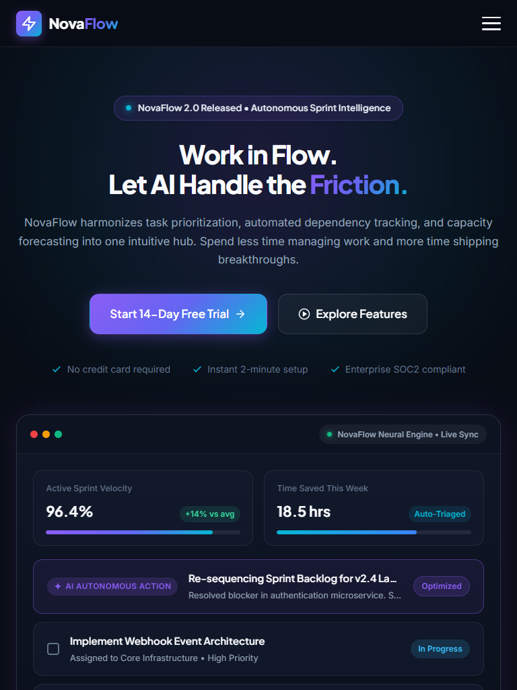
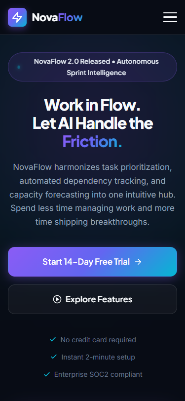
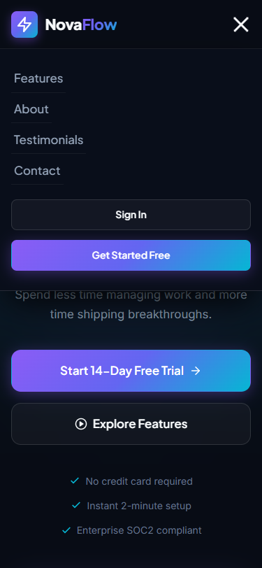

# NovaFlow — AI-Powered Task & Productivity Intelligence Platform

> **Oasis Infobyte Internship — Web Development & Designing (Level 1, Task 1)**  
> **Author:** Mudassir Ahmed  
> **Track:** Web Development (OIBSIP)  

---

## 📌 Project Overview

**NovaFlow** is a modern, high-conversion SaaS landing page engineered for a fictional AI-powered task and productivity platform. NovaFlow unifies task coordination, automated dependency triage, and capacity forecasting into one intuitive hub—freeing high-velocity engineering and product teams from daily operational friction.

The project was crafted strictly adhering to **modern frontend engineering principles** using **100% semantic HTML5 and vanilla CSS3**. No JavaScript, CSS frameworks (such as Bootstrap or Tailwind), or external script dependencies were used.

---

## 📸 Visual Previews & Screenshots

### Desktop Viewport (1440px)


### Tablet Viewport (768px)


### Mobile Viewport (375px) & Pure CSS Interactive Navigation
<p align="center">
  
  &nbsp; &nbsp;
  
</p>

---

## ✨ Features & Functional Highlights

1. **Sticky Glassmorphic Navigation Bar**:
   - Anchors smoothly (`scroll-behavior: smooth`) to `#features`, `#about`, `#testimonials`, and `#contact`.
   - Utilizes `backdrop-filter: blur(16px)` with semi-transparent background for modern SaaS polish.
   - Configured with `scroll-margin-top` so sticky headers never cover section titles on navigation.
2. **Accessible Pure CSS Mobile Drawer (Zero-JS)**:
   - Built using the CSS Checkbox Hack (`#nav-toggle:checked ~ .nav-menu`).
   - Smooth animated hamburger transformation into a close button (`X`) using CSS transforms.
   - Fully functional and responsive across mobile devices without a single line of JavaScript.
3. **Hero Section with SaaS Interactive Preview Mockup**:
   - Impactful headline, subtitle, primary and secondary call-to-action buttons with hover lifts and glow shadows.
   - Trust badge with CSS pulsing radar animation.
   - Custom-crafted semantic CSS dashboard UI preview showcasing live sprint velocity, AI autonomous action triage, and team tasks.
4. **Social Proof & Logo Cloud**:
   - Vector logos representing trust across 10,000+ modern tech companies (HyperScale, CloudPeak, PulseLogic, NextWave, Veloce AI).
5. **Core Capabilities (Features Grid)**:
   - 6 responsive feature cards arranged with CSS Grid (`repeat(3, 1fr)` transitioning down to 2 columns and 1 column).
   - Card hover lift effect (`translateY(-6px)`), luminous border glow, and interactive SVG icon transitions.
6. **About Section & Operational Impact**:
   - Narrative highlighting the "Zero-Context-Switch" philosophy.
   - Key principles with verified checkmarks.
   - Impact metrics panel (42% reduction in context switching, 3.8x faster turnaround, 99.98% uptime).
7. **Social Proof & Testimonials**:
   - 3 high-fidelity testimonial cards featuring authentic quotes, 5-star rating badges, and verified role designations from engineering leaders.
   - Featured card highlighting with custom badges.
8. **Contact & Pilot Request Form**:
   - Two-column split layout with direct channels (Email, Phone, HQ address) and an interactive request form.
   - Native HTML5 validation attributes (`required`, `type="email"`, select menus).
9. **Rich Semantic Footer**:
   - Multi-column link architecture, copyright notices, Oasis Infobyte attribution, and vector social media connection icons (Email, LinkedIn, GitHub, X).

---

## 🛠️ Technology Stack & Constraints

| Component | Technology | Rationale / Detail |
|---|---|---|
| **Markup** | HTML5 Semantic | `<header>`, `<nav>`, `<main>`, `<section>`, `<article>`, `<footer>` for SEO and screen-reader accessibility. |
| **Styling** | Vanilla CSS3 | Modular CSS architecture with CSS custom properties (`:root`), Flexbox, and CSS Grid. |
| **Typography** | Google Fonts | `Plus Jakarta Sans` (headings, UI) and `Inter` (body copy) — max 2 font families. |
| **Icons & Media** | SVG & Unsplash | Inline SVGs for zero latency and crisp rendering + Unsplash royalty-free imagery with descriptive `alt` tags. |
| **JavaScript** | None (0%) | 100% static pure CSS implementation meeting strict task criteria. |
| **Frameworks** | None | No Bootstrap, Tailwind, jQuery, or third-party CSS files. |

---

## 🎨 Design System & Color Palette

Defined cleanly in `:root` variables:

```css
:root {
  /* Canvas & Surfaces */
  --bg-primary: #080c15;              /* Deep obsidian navy */
  --bg-secondary: #0f1626;            /* Slate navy surface */
  --bg-card: rgba(18, 26, 44, 0.75);  /* Frosted glass surface */
  --bg-input: #0b111e;                /* Input background */

  /* Accents & Brand */
  --brand-violet: #8b5cf6;            /* Electric violet */
  --brand-cyan: #06b6d4;              /* Luminous cyan */
  --brand-indigo: #6366f1;            /* Deep indigo */
  --brand-gradient: linear-gradient(135deg, #8b5cf6 0%, #6366f1 50%, #06b6d4 100%);

  /* Typography */
  --text-main: #f8fafc;               /* High contrast headings */
  --text-secondary: #94a3b8;          /* Slate body text */
  --text-muted: #64748b;              /* Captions and subtext */

  /* Borders & Glows */
  --border-card: rgba(255, 255, 255, 0.12);
  --border-hover: rgba(139, 92, 246, 0.45);
  --shadow-glow: 0 0 40px -10px rgba(139, 92, 246, 0.3);
}
```

---

## 📁 Folder Structure

```text
OIBSIP/
└── WebDev-L1-LandingPage/
    ├── index.html            # Semantic HTML5 document
    ├── style.css             # Vanilla CSS3 stylesheet with design tokens
    ├── README.md             # Project documentation & submission report
    └── screenshots/          # High-resolution multi-device visual previews
        ├── desktop-preview.png
        ├── desktop-fullpage.png
        ├── tablet-preview.png
        ├── tablet-fullpage.png
        ├── mobile-preview.png
        ├── mobile-menu-open.png
        └── mobile-fullpage.png
```

---

## 🚀 How to Run the Project

This is a **pure static HTML/CSS project** with zero build tools or dependencies required.

### Method 1: Direct File Open
Simply double-click `index.html` or right-click `index.html` and choose **Open with > Google Chrome / Microsoft Edge / Mozilla Firefox**.

### Method 2: Local HTTP Server (Optional)
If you prefer running via a local web server:

```bash
# Using Python 3
python -m http.server 5500 --directory "OIBSIP/WebDev-L1-LandingPage"

# Or using Node.js / npx
npx serve OIBSIP/WebDev-L1-LandingPage
```
Then visit `http://localhost:5500` in your web browser.

---

## 📱 Responsive Testing Matrix

The layout was rigorously tested across multiple viewport widths:

| Viewport | Device Profile | Status | Notes |
|---|---|---|---|
| **1440px** | Desktop Large Screen | ✅ Passed | 3-column features, full desktop menu, ample whitespace, zero overflow. |
| **1024px** | Laptop / Small Desktop | ✅ Passed | Balanced typography, fluid containers. |
| **768px** | iPad / Tablet Portrait | ✅ Passed | 2-column features, adaptive metrics, touch-friendly spacing. |
| **375px** | iPhone 12/13/14 Mobile | ✅ Passed | Zero horizontal scroll, single-column flow, CSS hamburger drawer. |
| **320px** | Ultra-narrow Mobile (iPhone SE) | ✅ Passed | Content neatly adapts, `overflow-x: hidden`, no broken elements. |

---

## 💡 What I Learned During This Task

1. **Mastering Pure CSS Interactivity**:
   - Creating a zero-JavaScript mobile navigation drawer using the checkbox hack with smooth CSS cubic-bezier transitions and hamburger-to-close cross animations.
2. **Precision Scroll Management**:
   - Using CSS `scroll-margin-top` on anchor targets (`calc(var(--nav-height) + 1.75rem)`) to eliminate the common issue of sticky headers concealing section titles upon anchor clicks.
3. **Advanced CSS Grid & Flexbox Architectures**:
   - Structuring multi-card grids with fluid alignment, auto-fit columns, and resilient fallbacks without relying on heavy frameworks.
4. **SaaS Visual Design & Micro-polish**:
   - Implementing glassmorphism (`backdrop-filter`), tailored color gradients, ambient glow filters, and micro-hover states to achieve a premium commercial SaaS look.
5. **Accessibility & SEO Fundamentals**:
   - Utilizing semantic HTML5 tags (`<main>`, `<header>`, `<nav>`, `<section>`, `<article>`, `<footer>`), appropriate ARIA attributes (`aria-label`, `aria-hidden`), and high-contrast color ratios.

---

## 👨‍💻 Author & Submission Details

- **Student / Intern Name:** Mudassir Ahmed
- **Internship Program:** Oasis Infobyte (OIBSIP)
- **Domain:** Web Development & Designing
- **Level:** 1
- **Task:** 1 — Landing Page
- **Project Name:** NovaFlow AI Productivity Platform
