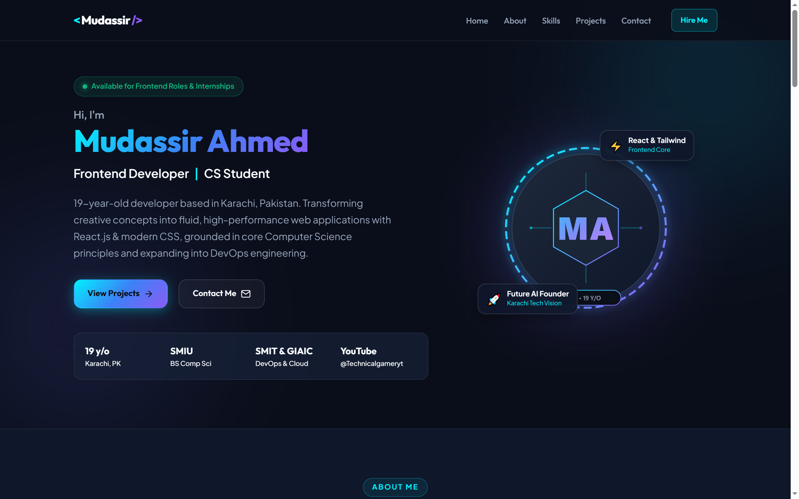
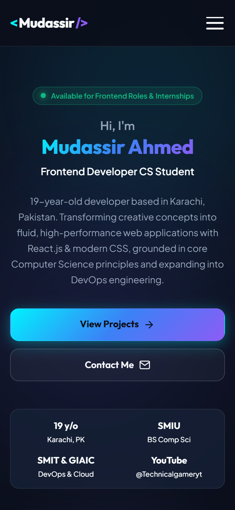
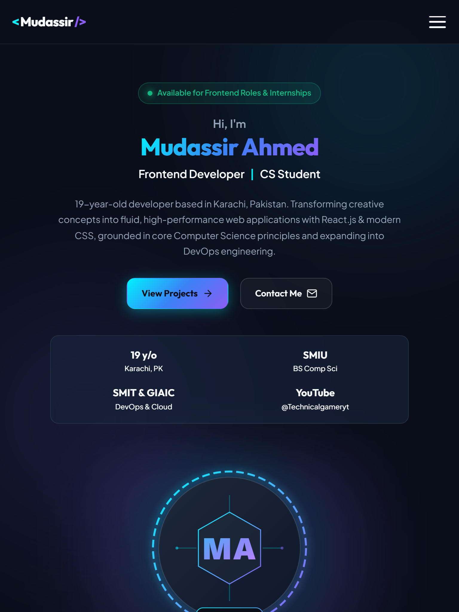
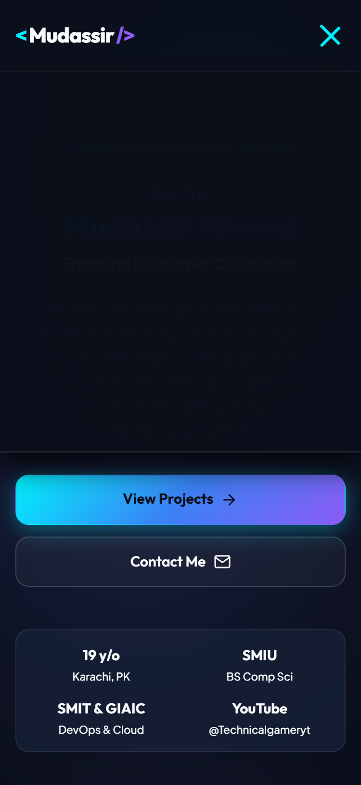
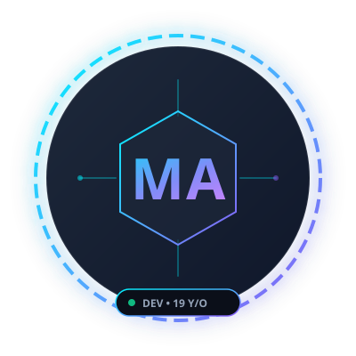

# 🚀 Mudassir Ahmed &mdash; Personal Developer Portfolio
### Oasis Infobyte Internship &bull; Web Development (Level 1, Task 2)

An ultra-modern, responsive developer portfolio engineered with **pure HTML5 and CSS3** (Zero JavaScript, no frameworks, no third-party libraries). Designed with an electric dark-neon aesthetic, fluid typography, glassmorphism card surfaces, and accessible semantic markup.

---

## 📸 Screenshots Showcase

### 🖥️ Desktop View (1440px Viewport)


### 📱 Mobile View (375px Viewport) & Tablet View (768px Viewport)
| Mobile View (375px) | Tablet View (768px) |
| :---: | :---: |
|  |  |

### 🛠️ Featured Projects Section Preview


---

## 👤 About the Portfolio Owner

- **Name:** Mudassir Ahmed
- **Age:** 19 years old
- **Location:** Karachi, Sindh, Pakistan
- **Role:** Frontend Developer | Computer Science Undergraduate
- **University:** Sindh Madressatul Islam University (SMIU), Karachi &mdash; BS Computer Science
- **Technical Specialization:** Self-taught Frontend Developer specializing in React.js (Vite) and Tailwind CSS, grounded in university coursework in C and C++ (Data Structures & OOP).
- **Continuous Learning:** DevOps Engineering at Saylani Mass IT Training (SMIT) and enrolled at Governor Sindh IT Initiative (GIAIC).
- **Content Creation:** Gaming & Tech YouTuber at [@TechnicalgamerytOffical](https://youtube.com/@TechnicalgamerytOffical).
- **Aspiration:** Becoming one of Karachi's leading software developers and founding a cutting-edge AI tech startup.

---

## ✨ Features & Architecture

1. **Pure CSS & Zero JavaScript Architecture:**
   - 100% compliant with strict internship constraints: zero external JS scripts, zero runtime libraries, and zero CSS frameworks.
2. **Accessible Sticky Navigation:**
   - Sticky header with frosted glass backdrop blur (`backdrop-filter: blur(16px)`).
   - Seamless smooth scrolling using `scroll-behavior: smooth`.
   - Precise `scroll-margin-top: 94px` on all section anchors to guarantee header never overlaps section titles.
3. **Pure CSS Mobile Drawer Navigation:**
   - Built using the CSS Checkbox Toggle pattern (`#nav-toggle:checked ~ .nav-menu`).
   - Smooth CSS transitions for the hamburger-to-X icon transform and dropdown expansion.
4. **Hero & Profile Showcase:**
   - Live pulsating availability indicator badge.
   - Dual action CTA buttons ("View Projects" & "Contact Me").
   - Geometric SVG avatar with initials "MA", neon gradient ring, and floating micro-badges.
   - CSS-only entrance animations (`@keyframes heroFadeSlideUp`, `@keyframes heroFadeZoomIn`).
5. **Comprehensive "About Me" Narrative:**
   - Structured narrative covering academic credentials, frontend mastery, DevOps training, and future startup ambitions.
   - 4 feature cards detailing SMIU academics, React craftsmanship, DevOps at SMIT/GIAIC, and YouTube creator journey.
6. **Visual Skills Grid & Proficiency Meters:**
   - Categorized into 4 pillars: Frontend Development, Programming & CS Core, DevOps & Infrastructure, and Content Creation.
   - Pure CSS progress bars with electric gradient fills and interactive tech pills.
7. **Featured Projects Cards (3 Core Builds):**
   - **NovaFlow SaaS Landing Page:** High-conversion modern SaaS layout with glassmorphic metrics and dark grid.
   - **Personal Developer Portfolio (This Site):** Oasis Task 2 submission showcasing zero-JS pure CSS engineering.
   - **Temperature Converter Suite:** Real-time multi-unit converter for Oasis Level 1 Task 3.
8. **Direct Contact Card & Social Hub:**
   - Interactive contact details (Location, Direct Email, SMIU University).
   - Inline SVG icons for GitHub, LinkedIn, and YouTube.
   - Pure CSS styled message form card with clear static demo notes.
9. **Responsive Across All Screens:**
   - Tested and verified at **320px**, **375px**, **768px**, and **1440px+**. Zero horizontal overflow (`scrollWidth === clientWidth`).

---

## 🛠️ Technology Stack

| Component | Technology | Description |
| :--- | :--- | :--- |
| **Structure** | Semantic HTML5 | `<header>`, `<nav>`, `<main>`, `<section>`, `<article>`, `<footer>` |
| **Styling** | Vanilla CSS3 | Modern Flexbox, CSS Grid, CSS Variables (`:root`), Glassmorphism |
| **Icons & Visuals** | SVG Graphics | Crisp inline SVGs and vector project cards |
| **Typography** | Google Fonts | `Outfit` (Headings) & `Plus Jakarta Sans` (Body text) |
| **Interactivity** | Pure CSS3 | Checkbox Hack, Transitions, Keyframe Animations, Pseudo-classes |

---

## 📂 Project Structure

```text
OIBSIP/WebDev-L1-Portfolio/
├── index.html                   # Main semantic HTML5 portfolio document
├── style.css                    # Pure CSS3 stylesheet with design system & queries
├── README.md                    # Project documentation, guides & screenshots
├── assets/                      # Vector illustrations & avatar graphics
│   ├── avatar.svg               # Vector avatar placeholder with "MA" monogram
│   ├── project-novaflow.svg     # NovaFlow SaaS landing page mockup
│   ├── project-portfolio.svg    # Developer portfolio code & device preview
│   └── project-tempconverter.svg# Temperature converter instrumentation preview
└── screenshots/                 # Captured responsive device testing previews
    ├── desktop.png              # Desktop viewport screenshot (1440px)
    ├── tablet.png               # Tablet viewport screenshot (768px)
    ├── mobile.png               # Mobile viewport screenshot (375px)
    ├── mobile-menu-open.png     # Pure CSS mobile hamburger drawer active
    └── projects-preview.png     # Projects section desktop preview
```

---

## 💻 How to Run & View

### Option 1: Direct File Launch
Simply double-click `index.html` or right-click &rarr; **Open with** &rarr; Chrome, Edge, Firefox, or Safari. No build steps, compilation, or web servers required!

### Option 2: Local HTTP Server (Recommended)
Using Python:
```bash
python -m http.server 3000 --directory OIBSIP/WebDev-L1-Portfolio
```
Then navigate to: `http://localhost:3000`

Using Node.js (`npx serve`):
```bash
npx serve OIBSIP/WebDev-L1-Portfolio
```

---

## 🎨 How to Customize

### 1. Swapping the Profile Photo
In `index.html`, locate the `hero-visual` section around line 125:
```html
<!-- REPLACE AVATAR: To use your own photo, replace the SVG with your image file: -->
<!--  -->

```
Simply place your image (e.g. `my-photo.jpg`) inside the `assets/` folder and update the `src` attribute.

### 2. Updating Email and Social Links
In `index.html`, locate the `contact-section` around lines 650-710:
- Replace `mailto:mudassir.ahmed.dev@example.com` with your active email address.
- Update the `href` values on the GitHub and LinkedIn anchor tags with your personal profile URLs:
  ```html
  <a href="https://github.com/your-username" target="_blank" class="social-btn">...</a>
  <a href="https://linkedin.com/in/your-username" target="_blank" class="social-btn">...</a>
  ```

### 3. Updating Project Links & Code Repositories
In each `<article class="project-card">`:
- Replace `href="#"` with your live GitHub repository links and deployment URLs.

### 4. Customizing the Color Palette
Open `style.css` and modify the `:root` variables at the top of the file:
```css
:root {
  --bg-primary: #0a0e1a;         /* Main background */
  --bg-secondary: #0f172a;       /* Section background */
  --accent-cyan: #00f2fe;        /* Primary neon highlight */
  --accent-violet: #8b5cf6;      /* Secondary accent */
  --accent-gradient: linear-gradient(135deg, #00f2fe 0%, #3b82f6 50%, #8b5cf6 100%);
}
```

---

## 🧠 Key Insights & What I Learned

1. **State Management Without JavaScript:**
   - Discovered the versatility of the CSS Checkbox Hack (`<input type="checkbox" id="nav-toggle">` paired with `<label for="nav-toggle">`). By targeting `:checked ~ .nav-menu`, complex interactive UI drawers can be created while maintaining 100% compliance with zero-JS requirements.
2. **Sticky Navigation Offsets:**
   - Solved the common issue of fixed/sticky headers obscuring section headings using `scroll-margin-top` on semantic `<section>` elements.
3. **Glassmorphism & Stacking Contexts:**
   - Learned how CSS `backdrop-filter: blur()` interacts with `position: fixed` and `z-index` across different browser engines, ensuring menus render on top of background visuals.
4. **Mobile-First Layout Strategy:**
   - Implemented `clamp()` typography, CSS Grid `repeat(auto-fit, ...)`, and responsive container padding to eliminate horizontal scroll down to 320px viewports.

---

## 👨‍💻 Author & Submission Details

- **Internship:** Oasis Infobyte (OIBSIP)
- **Domain:** Web Development
- **Level:** Level 1
- **Task:** Task 2 &mdash; Personal Portfolio Website
- **Developer:** Mudassir Ahmed (Karachi, Pakistan)
- **Date:** October 2026
