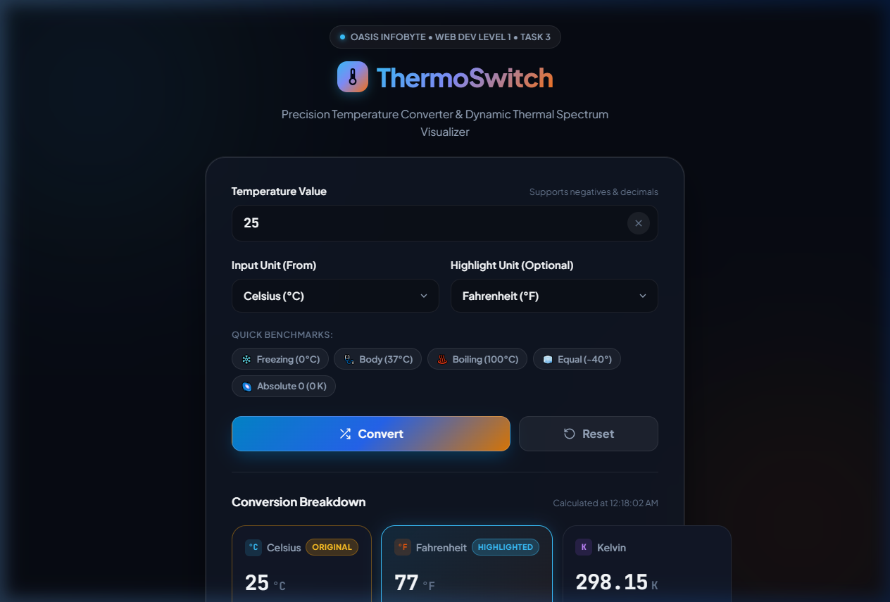
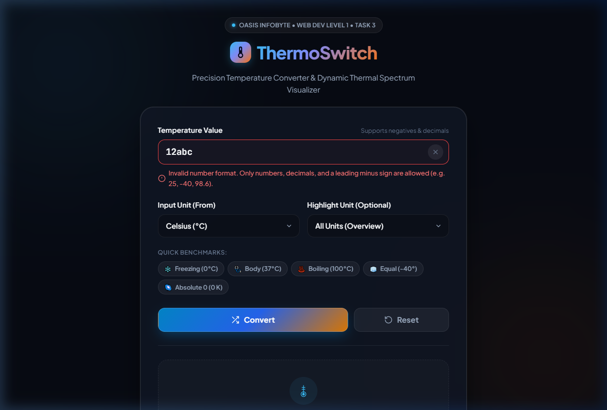
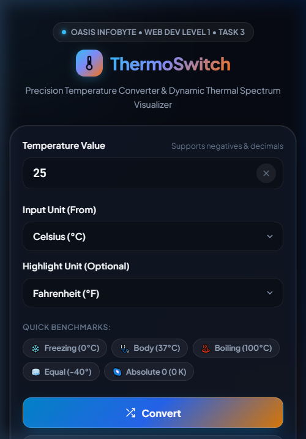
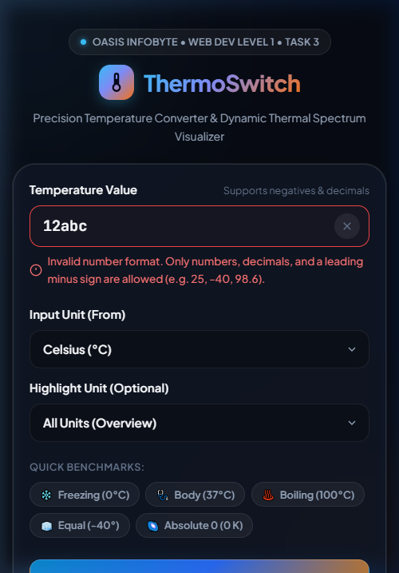

# ThermoSwitch — Precision Temperature Converter & Thermal Visualizer

> **Oasis Infobyte Internship — Web Development and Designing (Level 1, Task 3)**  
> **Author:** Mudassir Ahmed  
> **Submission Date:** October 2026  

---

## 🌟 Project Overview

**ThermoSwitch** is a modern, accessible, and responsive temperature conversion web application engineered as part of the Oasis Infobyte Web Development Internship (Level 1, Task 3). 

Designed with a sleek, dark-mode thermal aesthetic inspired by high-end developer dashboards, ThermoSwitch enables users to convert temperatures seamlessly between **Celsius (°C)**, **Fahrenheit (°F)**, and **Kelvin (K)**. The application simultaneously computes and renders all three temperature scales in dedicated interactive cards, features a dynamic **Thermal Sensation Gauge**, provides step-by-step mathematical derivations, and guarantees rigorous input validation with physical limits (such as Absolute Zero).

---

## 🚀 Key Features

1. **Precision Tri-Scale Output**:
   - Computes and displays **Celsius**, **Fahrenheit**, and **Kelvin** simultaneously in separate result cards upon conversion.
   - Highlights the original input unit with an `Original` badge.
   - Includes an optional **Highlight Unit** selector that spotlights any target unit card with an animated glowing gradient border and badge.

2. **Strict & Accessible Validation**:
   - Uses `type="text"` with `inputmode="decimal"` to prevent native browser keystroke suppression.
   - Rejects empty values, letters, special characters, and malformed strings (e.g., `12abc`, `1.2.3`, `--5`).
   - Smoothly accepts negative numbers (e.g., `-40`) and floating-point values (e.g., `36.6`).
   - Highlights errors with an instant red border and friendly error messages announced via ARIA live regions (`role="alert"`, `aria-live="polite"`).

3. **Absolute Zero & Physical Edge-Case Protection**:
   - Validates against the laws of thermodynamics:
     - **Celsius:** cannot be below **-273.15°C**
     - **Fahrenheit:** cannot be below **-459.67°F**
     - **Kelvin:** cannot be below **0 K**
   - Guards against non-finite values and astronomical numbers exceeding $10^{12}$.

4. **Dynamic Thermal Sensation Spectrum**:
   - Visual color-coded thermal gauge mapping temperatures from deep cryogenic freeze (`< -40°C`) to scorching heat (`> 60°C`).
   - Animated indicator pin that dynamically slides into place reflecting the thermal category (e.g., *Room Temperature*, *Boiling Point*, *Freezing*).

5. **Step-by-Step Educational Derivations**:
   - Dynamically details the exact arithmetic substitutions and conversion formulas utilized for the calculation.

6. **Quick Benchmark Presets**:
   - One-click benchmark chips for instant testing:
     - ❄️ **Freezing Point** ($0^\circ\text{C}$)
     - 🩺 **Human Body** ($37^\circ\text{C}$)
     - ♨️ **Boiling Point** ($100^\circ\text{C}$)
     - 🧊 **Scale Equal Point** ($-40^\circ\text{C} = -40^\circ\text{F}$)
     - 🌌 **Absolute Zero** ($0\text{ K}$)

7. **One-Click Clipboard Copy**:
   - Dedicated copy buttons on each card to copy formatted results directly to the clipboard with an interactive toast notification.

8. **Keyboard Accessibility & Controls**:
   - Full keyboard navigation support: trigger conversions by pressing <kbd>Enter</kbd> and clear inputs with <kbd>Esc</kbd>.
   - Dedicated **Reset/Clear** button to restore initial placeholder state.
   - In-field quick clear button ($\times$) that activates when typing.

---

## 🛠️ Technology Stack

- **HTML5**: Semantic document structure (`<header>`, `<main>`, `<section>`, `<article>`, `<footer>`, `<form>`, `<label>`).
- **CSS3**: Vanilla CSS with modern styling:
  - Global `box-sizing: border-box`.
  - CSS custom properties (`:root` tokens) for a curated dark thermal palette.
  - Flexbox and CSS Grid responsive layouts.
  - Glassmorphism backdrop filters and CSS micro-animations (`@keyframes fadeSlideUp`).
  - Google Fonts: `Plus Jakarta Sans` (UI typography) and `JetBrains Mono` (numerical readouts).
- **Vanilla JavaScript (ES6+)**:
  - No external libraries or frameworks (no jQuery, no Bootstrap, no React).
  - Pure functions for mathematical calculations with zero `eval()`.
  - Clean event binding via `addEventListener`.
  - Deep-link support via `URLSearchParams` (e.g., `?temp=25&unit=celsius&target=fahrenheit`).

---

## 📐 Conversion Formulas

ThermoSwitch utilizes **Celsius** as the central single source of truth for unified mathematical derivations:

| From | To | Formula | Example |
| :--- | :--- | :--- | :--- |
| **Celsius** | **Fahrenheit** | $F = (C \times \frac{9}{5}) + 32$ | $0^\circ\text{C} \rightarrow 32^\circ\text{F}$ |
| **Fahrenheit** | **Celsius** | $C = (F - 32) \times \frac{5}{9}$ | $212^\circ\text{F} \rightarrow 100^\circ\text{C}$ |
| **Celsius** | **Kelvin** | $K = C + 273.15$ | $0^\circ\text{C} \rightarrow 273.15\text{ K}$ |
| **Kelvin** | **Celsius** | $C = K - 273.15$ | $0\text{ K} \rightarrow -273.15^\circ\text{C}$ |
| **Fahrenheit** | **Kelvin** | $K = (F - 32) \times \frac{5}{9} + 273.15$ | $32^\circ\text{F} \rightarrow 273.15\text{ K}$ |
| **Kelvin** | **Fahrenheit** | $F = (K - 273.15) \times \frac{9}{5} + 32$ | $0\text{ K} \rightarrow -459.67^\circ\text{F}$ |

---

## 📁 Folder Structure

```text
Task 3 Oasis/
├── index.html                                # Root redirect to project folder
├── README.md                                 # Root documentation copy
└── OIBSIP/
    └── WebDev-L1-TemperatureConverter/
        ├── index.html                        # Semantic HTML5 application structure
        ├── style.css                         # Custom CSS3 styles, variables & responsiveness
        ├── script.js                         # Modular vanilla JavaScript logic & validation
        ├── README.md                         # Comprehensive internship project documentation
        └── screenshots/
            ├── desktop-success.png           # Desktop successful conversion state (1280px)
            ├── desktop-error.png             # Desktop validation error state (1280px)
            ├── mobile-success.png            # Mobile responsive conversion view (375px)
            └── mobile-error.png              # Mobile responsive error state (375px)
```

---

## 📸 Screenshots

### 1. Desktop — Successful Conversion


### 2. Desktop — Error State (Validation & Physical Limit)


### 3. Mobile — Successful Conversion & Responsive View


### 4. Mobile — Error State


---

## 🧪 Test Cases & Verification Matrix

All test cases specified in the project requirements were verified:

| Test Case | Input Value | Input Unit | Target Unit | Expected Results | Actual Results | Status |
| :---: | :---: | :---: | :---: | :--- | :--- | :---: |
| **1** | `0` | Celsius | All | $32^\circ\text{F}$, $273.15\text{ K}$ | $32^\circ\text{F}$, $273.15\text{ K}$ | ✅ **Passed** |
| **2** | `100` | Celsius | All | $212^\circ\text{F}$, $373.15\text{ K}$ | $212^\circ\text{F}$, $373.15\text{ K}$ | ✅ **Passed** |
| **3** | `32` | Fahrenheit | All | $0^\circ\text{C}$, $273.15\text{ K}$ | $0^\circ\text{C}$, $273.15\text{ K}$ | ✅ **Passed** |
| **4** | `0` | Kelvin | All | $-273.15^\circ\text{C}$, $-459.67^\circ\text{F}$ | $-273.15^\circ\text{C}$, $-459.67^\circ\text{F}$ | ✅ **Passed** |
| **5** | `-40` | Celsius | All | $-40^\circ\text{F}$, $233.15\text{ K}$ | $-40^\circ\text{F}$, $233.15\text{ K}$ | ✅ **Passed** |
| **6** | `36.6` | Celsius | All | $97.88^\circ\text{F}$, $309.75\text{ K}$ | $97.88^\circ\text{F}$, $309.75\text{ K}$ | ✅ **Passed** |
| **7** | `-300` | Celsius | All | Error: Below Absolute Zero ($-273.15^\circ\text{C}$) | Friendly error & red input border | ✅ **Passed** |
| **8** | `-500` | Fahrenheit | All | Error: Below Absolute Zero ($-459.67^\circ\text{F}$) | Friendly error & red input border | ✅ **Passed** |
| **9** | `-1` | Kelvin | All | Error: Below Absolute Zero ($0\text{ K}$) | Friendly error & red input border | ✅ **Passed** |
| **10** | `abc` | Any | All | Error: Invalid number format | Friendly error & red input border | ✅ **Passed** |
| **11** | `12abc` | Any | All | Error: Invalid number format | Friendly error & red input border | ✅ **Passed** |
| **12** | `1.2.3` | Any | All | Error: Invalid number format | Friendly error & red input border | ✅ **Passed** |
| **13** | ` ` (Empty) | Any | All | Error: Please enter a temperature value | Friendly error & red input border | ✅ **Passed** |
| **14** | Reset | N/A | N/A | Clear inputs, errors & restore placeholder | Resets to initial empty state | ✅ **Passed** |

---

## 💻 How to Run the Project

1. Clone or download this repository to your local computer.
2. Navigate to `OIBSIP/WebDev-L1-TemperatureConverter/`.
3. Double-click **`index.html`** or right-click and select **Open with Browser** (Google Chrome, Microsoft Edge, Firefox, or Safari).
4. No node modules, build steps, or local server installations are required!

*(Optional)* You can also run a local server:
```bash
python -m http.server 8080
```
Then visit: `http://localhost:8080/OIBSIP/WebDev-L1-TemperatureConverter/`

---

## 💡 What I Learned

During the implementation of Task 3 for the Oasis Infobyte Internship:
- **Architectural Separation of Concerns**: Structuring vanilla JavaScript into modular blocks (pure conversion functions, validation predicates, UI renderers, and event listeners) made the codebase maintainable, testable, and robust.
- **Client-Side Validation Mechanics**: Using `type="text"` with `inputmode="decimal"` coupled with strict regex parsing avoided browser-specific quirks while delivering friendly visual and screen-reader error announcements.
- **Precision in Floating-Point Math**: Managing floating-point rounding anomalies in JavaScript using `Number.EPSILON` and `toLocaleString` ensured calculations never displayed values like `32.00000000000001`.
- **Accessible Design (a11y)**: Integrating `aria-live="polite"`, `aria-invalid`, `aria-describedby`, semantic HTML `<article>` / `<form>` tags, and visible focus rings improved inclusivity and usability.
- **Responsive Modern UI**: Crafting responsive layouts across 320px, 768px, and 1440px using CSS custom properties, grid layouts, and glassmorphic aesthetics without heavy CSS frameworks.

---

## 👤 Author

- **Name:** Mudassir Ahmed
- **Internship:** Oasis Infobyte Web Development and Designing Internship (OIBSIP)
- **Role:** Web Development Intern
- **Task:** Level 1, Task 3 — Temperature Converter Website
