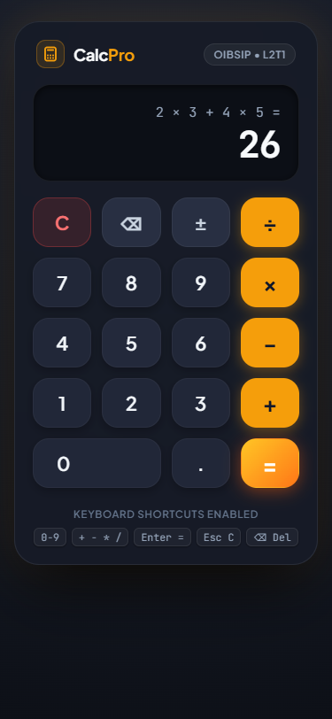

# CalcPro - Modern Precision Web Calculator

**Oasis Infobyte Internship — Web Development & Designing**  
**Level 2 — Task 1: Calculator Application**  
**Author:** Mudassir Ahmed  

---

## 📌 Project Overview

**CalcPro** is a clean, modern, and mathematically rigorous browser-based calculator engineered from the ground up using pure vanilla web technologies. Designed with tactile aesthetics and enterprise front-end best practices, CalcPro provides full operator precedence handling ($\times$ and $\div$ before $+$ and $-$), expression history chaining, intelligent input sanitization, and graceful division-by-zero protection—all implemented without relying on `eval()` or third-party libraries.

---

## 🖼️ Application Preview & Screenshots

| 🖥️ Desktop Interface (1440px) | 📱 Responsive Mobile (375px) |
| :---: | :---: |
|  |  |

| 🔗 Operator Chaining ($5 + 3 \times 2 = 11$) | ⚠️ Division-by-Zero Handling ($7 \div 0$) |
| :---: | :---: |
|  |  |

---

## ✨ Features Checklist

- [x] **Dual-Line Screen Display**:
  - Secondary line: displays the full expression history being assembled (e.g. `5 + 3 × 2 =`).
  - Primary line: displays current user input or evaluated result.
  - Automatic font down-scaling and smooth scroll protection to prevent overflow.
- [x] **Pure Arithmetic Evaluator (Zero `eval()`)**:
  - Implemented Dijkstra's **Shunting-Yard Algorithm** to parse infix tokens into Reverse Polish Notation (RPN).
  - Enforces standard mathematical operator precedence ($\times, \div$ evaluated before $+ , -$) with left-associative execution.
- [x] **Operator Chaining & Continuation**:
  - Seamlessly chains operations (e.g. `2 × 3 + 4 × 5 = 26`).
  - Pressing an operator immediately after an evaluation continues from the previous result (`15 + 4 = 19`).
  - Pressing a digit after an evaluation initiates a fresh calculation.
- [x] **Operator Replacement**:
  - Quickly tapping an operator after another replaces the operator without stacking (`5 +` then `×` becomes `5 ×`).
- [x] **Negative Number Support**:
  - Accepts leading minus numbers (e.g. `-5 + 3 = -2`).
  - Supports minus after multiplication or division (e.g. `5 × -2 = -10`).
  - Dedicated sign toggle key (`±`).
- [x] **Division-by-Zero Protection**:
  - Friendly `"Cannot divide by zero"` error notice instead of browser crashes, `Infinity`, or `NaN`.
  - Recovers cleanly on the very next keystroke or upon pressing `C`.
- [x] **Floating-Point Accuracy**:
  - Corrects IEEE 754 precision drift (e.g., `0.1 + 0.2` renders cleanly as `0.3`, not `0.30000000000000004`).
  - Strips trailing zeros and manages scientific notation for extreme quantities ($|x| \ge 10^{14}$ or $|x| < 10^{-6}$).
- [x] **Strict Input Sanitization**:
  - Prevents multiple decimal points per operand (`1.2.3` $\rightarrow$ `1.23`).
  - Eliminates redundant leading zeros (`007` $\rightarrow$ `7`).
- [x] **Complete Keyboard Accessibility**:
  - Full keyboard mapping for numbers, operators, calculation, and clearing.
  - Tactile visual feedback animation on keys corresponding to keyboard presses.
  - `preventDefault()` prevents unwanted browser shortcuts (e.g., Firefox `/` search).
- [x] **Accessible & Responsive Design**:
  - Built with CSS Grid (4-column layout).
  - Real semantic `<button type="button">` elements with descriptive `aria-label` tags.
  - Live region updates (`aria-live="polite"`).
  - Pixel-perfect responsiveness across 320px, 375px, 768px, and 1440px with zero horizontal scroll.

---

## 🛠️ Tech Stack & Constraints

- **Structure**: Semantic HTML5 (Custom landmarks, accessible buttons, live regions)
- **Styling**: Vanilla CSS3 (CSS Grid, Flexbox, CSS Custom Properties / `:root` tokens, Glassmorphism, Zero CSS libraries)
- **Logic**: Vanilla JavaScript (ES6+, Strict Mode, Event Delegation, Zero external dependencies)
- **Typography**: Google Fonts (*Plus Jakarta Sans* for UI, *JetBrains Mono* for tabular numeric display)
- **Security & Reliability**: Strictly **NO** `eval()` and **NO** `new Function()`

---

## 🧠 How the Evaluator Works

### Why `eval()` Was Avoided
1. **Security Vulnerability**: `eval()` executes arbitrary strings as JavaScript code, introducing cross-site scripting (XSS) and code injection vectors.
2. **Performance Penalty**: Modern JavaScript JIT compilers cannot optimize code that invokes `eval()` because it forces dynamic scope de-optimization.
3. **Flawed Precision & Edge Cases**: `eval()` evaluates `0.1 + 0.2` to `0.30000000000000004`, yields `Infinity` on division by zero, and accepts malformed expressions without structured recovery.

### The Shunting-Yard Algorithm & RPN Execution
CalcPro employs a two-phase mathematical engine:
1. **Tokenization & Normalization**: User inputs are tokenized and mapped to standard operators ($+, -, *, /$).
2. **Shunting-Yard Conversion (Infix $\rightarrow$ Postfix / RPN)**:
   - Numbers are pushed directly to an `outputQueue`.
   - Operators ($+, -, \times, \div$) are placed onto an `operatorStack` based on precedence:
     $$\text{Precedence}(\times, \div) = 2 \quad > \quad \text{Precedence}(+, -) = 1$$
   - Operators with greater or equal precedence on the stack are popped to the `outputQueue` before the current operator is pushed, preserving left-associativity.
3. **RPN Stack Evaluation**:
   - Operands are pushed onto an evaluation stack.
   - When an operator is encountered, the top two operands are popped ($a$ and $b$), the operation is performed ($a \text{ op } b$), and the result is pushed back.
   - Zero-divisor detection ($b == 0$ on division) triggers an immediate controlled error response (`"Cannot divide by zero"`).

---

## ⌨️ Keyboard Shortcuts Reference

| Keyboard Key | Calculator Action | Note |
| :--- | :--- | :--- |
| `0` – `9` | Digit Entry | Appends digit, sanitizes leading zeros |
| `.` | Decimal Point | Allows single decimal per operand |
| `+` | Addition | Chained operator |
| `-` | Subtraction / Negative | Context-aware: operator or negative prefix |
| `*` or `x` / `X` | Multiplication ($\times$) | High precedence operator |
| `/` | Division ($\div$) | High precedence operator, browser default prevented |
| `Enter` or `=` | Calculate Result | Evaluates complete expression |
| `Backspace` or `Delete` | ⌫ Backspace | Deletes last character, pops operators if input empty |
| `Escape` or `c` / `C` | C Clear All | Full state & display reset |
| `_` | $\pm$ Sign Toggle | Toggles positive/negative on current value |

---

## 🧪 Comprehensive Verification & Test Suite

| Test Scenario | Input Sequence | Expected Result | Verified Status |
| :--- | :--- | :--- | :---: |
| **Operator Precedence 1** | `5 + 3 × 2 =` | `11` | ✅ PASS |
| **Operator Precedence 2** | `10 − 4 ÷ 2 =` | `8` | ✅ PASS |
| **Complex Chaining** | `2 × 3 + 4 × 5 =` | `26` | ✅ PASS |
| **Division by Zero** | `7 ÷ 0 =` | `"Cannot divide by zero"` | ✅ PASS |
| **Recovery after Error** | Press `C` after error | `0` (clean recovery) | ✅ PASS |
| **Float Precision (IEEE 754)**| `0.1 + 0.2 =` | `0.3` (not `0.3000...04`) | ✅ PASS |
| **Decimal Fractions** | `1.5 + 2.25 =` | `3.75` | ✅ PASS |
| **Negative Result** | `9 − 12 =` | `-3` | ✅ PASS |
| **Negative Multiplier** | `5 × -2 =` | `-10` | ✅ PASS |
| **Multiple Decimals** | `1 . 2 . 3` | `1.23` (second `.` ignored) | ✅ PASS |
| **Leading Zeros** | `0 0 7` | `7` | ✅ PASS |
| **Operator Replacement** | `5 + × 3 =` | `15` ($+$ replaced by $\times$) | ✅ PASS |
| **Result Continuation** | After `15`, press `+ 4 =` | `19` | ✅ PASS |
| **Fresh Start on Digit** | After `19`, press `8` | `8` (resets previous expr) | ✅ PASS |
| **Sequential Backspace** | `123` $\rightarrow$ ⌫ $\rightarrow$ ⌫ $\rightarrow$ ⌫ | `12` $\rightarrow$ `1` $\rightarrow$ `0` | ✅ PASS |
| **Keyboard Input** | Keyboard `9 * 8 Enter` | `72` | ✅ PASS |
| **Zero Horizontal Scroll** | Viewports: 320px, 375px, 768px, 1440px | Zero overflow across all viewports | ✅ PASS |

---

## 📂 Project Directory Structure

```text
OIBSIP/WebDev-L2-Calculator/
├── index.html            # Semantic HTML5 markup, live regions, accessible buttons
├── style.css             # CSS3 tokens, CSS Grid keypad, display scaling, micro-animations
├── script.js             # Vanilla JS state machine, Shunting-Yard evaluator, event delegation
├── README.md             # Complete documentation and test reports
└── screenshots/          # High-resolution screenshots of key application states
    ├── desktop.png       # Desktop layout (1440px)
    ├── mobile.png        # Mobile layout (375px)
    ├── chained_calculation.png # Chained calculation (5 + 3 × 2 = 11)
    └── division_by_zero.png    # Division-by-zero error handling (7 ÷ 0)
```

---

## 🚀 How to Run Locally

No build tools, bundlers, or package installations are required:

1. Clone or download the project repository.
2. Navigate to `OIBSIP/WebDev-L2-Calculator/`.
3. Open `index.html` in any modern web browser (Google Chrome, Microsoft Edge, Mozilla Firefox, Apple Safari).
4. Alternatively, serve via any local static server:
   ```bash
   # Using Python
   python -m http.server 8000
   # Navigate to http://localhost:8000/OIBSIP/WebDev-L2-Calculator/index.html
   ```

---

## 💡 Key Learnings & Engineering Takeaways

1. **Parser & Compiler Fundamentals**: Implementing Dijkstra's Shunting-Yard algorithm from scratch provided practical insight into how compilers evaluate infix mathematical expressions without relying on risky dynamic execution (`eval()`).
2. **Robust State Architecture**: Managing dual-line displays, negative numbers, operator replacements, and error recoveries required structuring calculator state as an explicit state machine with predictable transitions.
3. **Web Accessibility in Web Apps**: Implementing ARIA live regions, semantic buttons, keyboard traps prevention, and visible focus rings demonstrated how accessible web development elevates overall user experience.
4. **Resilient Fluid Layouts**: Combining CSS Grid with container-friendly units and dynamic JavaScript font scaling ensures the calculator remains usable across any device size without broken overflowing layouts.
