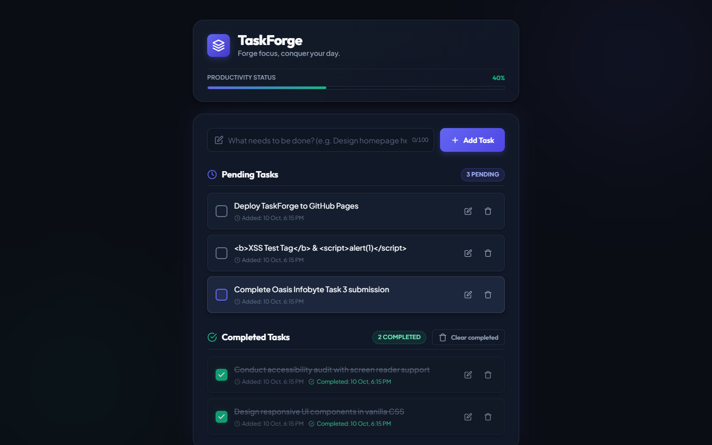
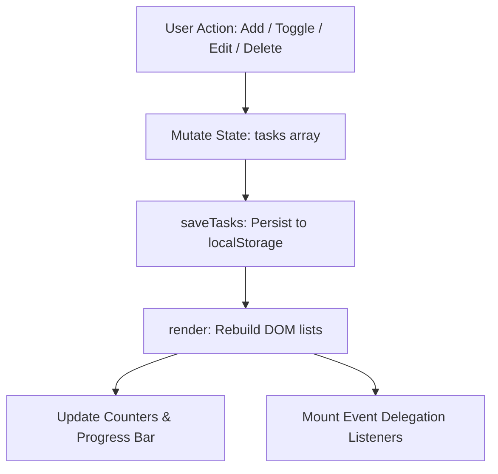
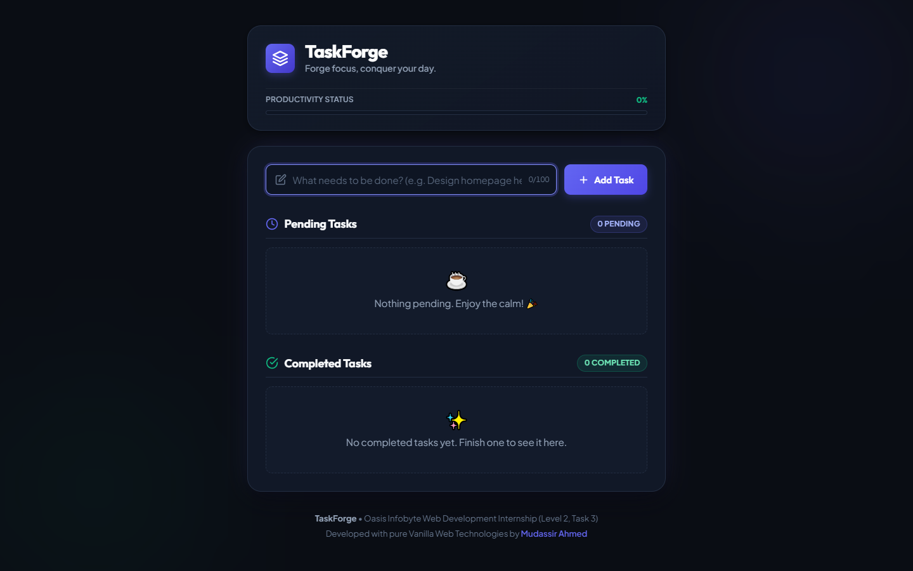
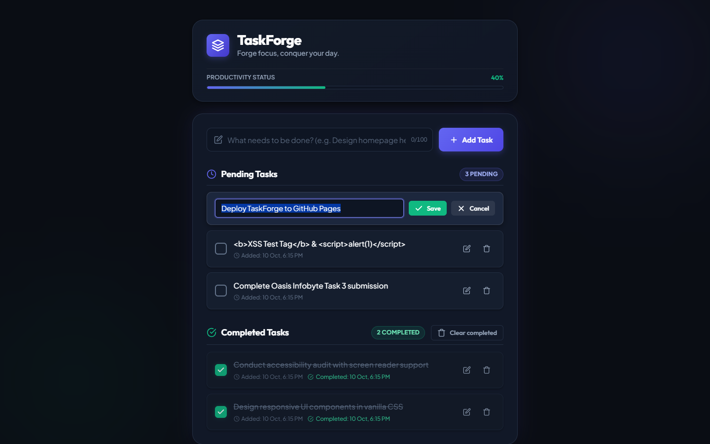
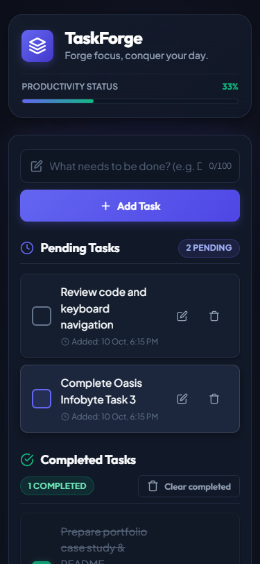

# TaskForge — Modern Interactive To-Do Web App

> **Oasis Infobyte Internship Project**  
> **Track:** Web Development and Designing  
> **Level:** 2 &bull; **Task:** 3 (To-Do Web App)  
> **Author:** Mudassir Ahmed  



---

## 📌 Project Overview

**TaskForge** is a modern, high-performance, and accessible To-Do web application engineered with strict vanilla web technologies. Designed with a sleek dark-slate and indigo aesthetic, TaskForge provides intuitive productivity workflows including live counters, inline in-place editing, safety-first deletion confirmation, dynamic progress tracking, and robust offline persistence.

---

## ✨ Features

### 🎯 Core Features
- **Task Creation & Input Validation:**
  - Create tasks with either the primary "Add Task" button or by pressing <kbd>Enter</kbd>.
  - Automatically trims whitespace and rejects empty or whitespace-only inputs with a polite, accessible inline error message (no disruptive `alert()` dialogs).
  - Character limit strictly capped at 100 characters with a live character countdown indicator (`0/100`).
  - Automatic focus management (autofocuses on load and refocuses after task creation).
- **Separated Task Lists:**
  - **Pending Tasks List:** Newly created tasks appear immediately at the top of the pending list.
  - **Completed Tasks List:** Completed tasks move smoothly to the completed section with an emerald check indicator and strikethrough styling.
- **Mark Complete / Incomplete Toggle:**
  - Custom accessible toggle on every task with ARIA checkbox roles (`role="checkbox"` and `aria-checked`).
  - Toggling an item instantly transitions it between Pending and Completed states.
- **Inline Task Editing (In-Place):**
  - Click the Edit button to transform the task title into an editable input field directly in place.
  - Keyboard shortcuts: Press <kbd>Enter</kbd> to save changes or <kbd>Escape</kbd> to cancel.
  - Empty edits are strictly rejected.
  - Strict single-task edit constraint: Only one task can be in edit mode at any given moment. Starting a second edit cleanly closes the previous one.
- **Safe Inline Task Deletion:**
  - Delete button available on every task in both lists.
  - Features an inline confirmation step (`"Delete task permanently? [Yes, Delete] [Cancel]"`), eliminating ugly browser `confirm()` popups.
- **Live Task Counters & Progress Tracking:**
  - Dynamic `"X pending"` and `"Y completed"` badges above each respective section, powered by `aria-live="polite"` for screen reader announcements.
  - Live **Productivity Status** progress bar that visualizes percentage of completed tasks.
- **Friendly Empty State Messaging:**
  - Delightful illustrations and messaging when lists are empty:
    - *Pending:* `"Nothing pending. Enjoy the calm! 🎉 ☕"`
    - *Completed:* `"No completed tasks yet. Finish one to see it here. ✨"`
- **Clear Completed Utility:**
  - A contextual "Clear completed" button that only appears when completed tasks exist, allowing bulk cleanup in a single click.

### 🌟 Bonus Features
- **[BONUS] Intelligent Timestamps:**
  - Every task records its exact creation timestamp (`createdAt`) and completion timestamp (`completedAt`).
  - Formatted into clean, human-readable strings (e.g. `Added: 10 Oct, 6:15 PM` and `Completed: 10 Oct, 6:15 PM`).
  - Timestamps are stored as standard ISO-8601 strings in the underlying state and formatted dynamically during rendering.
- **[BONUS] Fault-Tolerant `localStorage` Persistence:**
  - Tasks, completion statuses, and timestamps automatically survive browser reloads and session restarts.
  - Data updates trigger immediate synchronization to `localStorage`.
  - Robust error handling: `JSON.parse` is wrapped in defensive `try/catch` blocks. If storage contains invalid or corrupted JSON, TaskForge gracefully recovers and defaults to an empty list without crashing.

---

## 🛠️ Technology Stack & Constraints

| Technology | Purpose | Constraints Satisfied |
| :--- | :--- | :--- |
| **HTML5** | Semantic markup (`<header>`, `<main>`, `<section>`, `<ul>`, `<li>`, `<button type="button">`) | 100% Semantic, no obsolete tags |
| **CSS3** | Modern styling, CSS Custom Properties (`:root`), Flexbox, CSS Grid | No CSS frameworks, no Tailwind, no Bootstrap |
| **Vanilla JavaScript** | State management, event delegation, DOM manipulation | No JS frameworks, no libraries, no jQuery |
| **Google Fonts** | Typography pairing: **Outfit** (headings) & **Plus Jakarta Sans** (body) | Maximum 2 font families |
| **Security & Accessibility** | Zero `innerHTML` injection for user content; `textContent` & `createElement` only; WCAG contrast; `prefers-reduced-motion` | 100% XSS-Safe, fully keyboard navigable |

---

## 🏗️ Architecture: State Management & Rendering



### 1. Single Source of Truth
All task data is encapsulated in a single in-memory array of task objects:
```typescript
interface Task {
  id: string;               // Unique RFC4122 v4 UUID or fallback
  text: string;             // User task description (max 100 chars)
  completed: boolean;       // Completion status boolean
  createdAt: string;        // ISO-8601 timestamp string
  completedAt: string | null; // ISO-8601 completion timestamp or null
}
```

### 2. Pure Event Delegation
No inline `onclick` attributes exist anywhere in the application. Both `#pending-list` and `#completed-list` employ a single delegated `click` and `keydown` event listener that routes interactions via `data-action` and `data-id` attributes:
- `data-action="toggle"`
- `data-action="edit"`
- `data-action="save"`
- `data-action="cancel"`
- `data-action="delete"`
- `data-action="confirm-delete"`
- `data-action="cancel-delete"`

### 3. XSS Immunity
User input is strictly assigned through `element.textContent` or native text nodes created with `document.createTextNode()`. User strings never pass through `innerHTML`, neutralizing Cross-Site Scripting (XSS) vectors.

---

## 💾 LocalStorage Persistence & Resilience

TaskForge uses the dedicated key `taskforge_tasks_v1`. Storage operations are wrapped in safe abstractions:
- **`saveTasks()`**: Serializes the `tasks` array using `JSON.stringify()`.
- **`loadTasks()`**: Parses storage with a `try/catch` guard. If parsing fails (e.g. malformed JSON or manual DevTools tampering), a console warning is emitted and an empty array `[]` is returned safely.

---

## 📸 Screenshots

| View | Screenshot |
| :--- | :--- |
| **Desktop — Tasks in Both Lists** |  |
| **Desktop — Empty State** |  |
| **Desktop — Inline Edit Mode** |  |
| **Mobile View (375px)** |  |

---

## 🧪 Comprehensive Test Cases & Results

| Test ID | Test Scenario | Expected Outcome | Result |
| :---: | :--- | :--- | :---: |
| **TC-01** | Initial load with empty storage | Shows "0 pending", "0 completed", empty state cards, and hidden Clear button | **PASSED** |
| **TC-02** | Add task via "Add Task" button | Task added to top of Pending list, input cleared & refocused | **PASSED** |
| **TC-03** | Add task via <kbd>Enter</kbd> key | Task added to top of Pending list, input cleared & refocused | **PASSED** |
| **TC-04** | Empty or whitespace input | Rejected with friendly inline error message in `#input-error` (no `alert()`) | **PASSED** |
| **TC-05** | XSS attack test: `<b>XSS Test</b> & <script>alert(1)</script>` | Rendered strictly as escaped plain text; no script executed or HTML parsed | **PASSED** |
| **TC-06** | Task completion toggle | Moves task to Completed list, marks checkbox, adds `Completed:` timestamp | **PASSED** |
| **TC-07** | Task un-completion toggle | Moves task back to Pending list, removes `Completed:` timestamp | **PASSED** |
| **TC-08** | Inline Edit mode activation | Turns task text into input field in-place, auto-focuses with Save/Cancel buttons | **PASSED** |
| **TC-09** | Inline Edit: Cancel via <kbd>Escape</kbd> | Closes edit mode without modifying text | **PASSED** |
| **TC-10** | Inline Edit: Save via <kbd>Enter</kbd> | Updates task text, persists to localStorage, updates view | **PASSED** |
| **TC-11** | Inline Edit: Empty text rejection | Highlights input with danger border and rejects blank update | **PASSED** |
| **TC-12** | Inline Delete confirmation | Shows `"Delete this task permanently? [Yes, Delete] [Cancel]"` | **PASSED** |
| **TC-13** | Cancel deletion | Closes prompt without removing task | **PASSED** |
| **TC-14** | Confirm deletion | Permanently removes task and updates counters | **PASSED** |
| **TC-15** | Live counters synchronization | `#pending-count` and `#completed-count` update after every single operation | **PASSED** |
| **TC-16** | Clear completed button | Removes all completed items at once; hides button when count is 0 | **PASSED** |
| **TC-17** | Page refresh persistence | All tasks, statuses, and timestamps remain intact after reload | **PASSED** |
| **TC-18** | Corrupted localStorage recovery | Handles malformed JSON safely without throwing runtime crashes | **PASSED** |
| **TC-19** | Long text wrap (overflow test) | Very long word (100+ chars) wraps cleanly with zero horizontal scrollbar | **PASSED** |
| **TC-20** | Responsive layout (320px, 375px, 768px, 1440px) | Layout adapts fluidly; mobile touch targets exceed 44px standard | **PASSED** |

---

## 🚀 How to Run the Project

No build step, compilers, or package managers are required!

1. Clone or download this repository.
2. Navigate to the project directory:
   ```bash
   cd OIBSIP/WebDev-L2-TodoApp/
   ```
3. Open `index.html` in any modern web browser (Google Chrome, Mozilla Firefox, Microsoft Edge, Safari):
   - Simply double-click `index.html`, OR
   - Right-click `index.html` &rarr; *Open with* &rarr; *Choose your browser*, OR
   - Serve using any lightweight server (e.g. `python -m http.server 8000` or VS Code Live Server).

---

## 📂 Folder Structure

```text
OIBSIP/
└── WebDev-L2-TodoApp/
    ├── index.html              # Semantic HTML5 entrypoint
    ├── style.css               # Vanilla CSS3 stylesheet with design tokens
    ├── script.js               # Vanilla JavaScript application logic & storage
    ├── README.md               # Project documentation & test results
    └── screenshots/            # Automated test captures
        ├── desktop-empty.png   # Empty state preview
        ├── desktop-tasks.png   # Full view with pending & completed tasks
        ├── desktop-edit-mode.png # Inline edit mode demo
        └── mobile-view.png     # Responsive mobile layout (375px)
```

---

## 💡 What I Learned

During the development of **TaskForge** for the Oasis Infobyte internship, I deepened my frontend engineering foundations in several key areas:
1. **Architecting Single-Page State Without Frameworks:** Implementing an explicit unidirectional data flow (`Action -> State Mutation -> Storage Sync -> Re-render`) reinforced how modern frameworks operate under the hood.
2. **Defensive DOM Programming & XSS Prevention:** Avoiding shortcut methods like `innerHTML` and relying strictly on `document.createElement` and `textContent` to build bulletproof UIs.
3. **Advanced Event Delegation:** Harnessing event bubbling with a single listener on parent container elements using `event.target.closest('[data-action]')` to manage dynamic lists with high performance and zero memory leaks.
4. **Accessible Inline Interactions:** Replacing generic native dialogs (`alert`, `confirm`) with custom inline micro-interactions that preserve keyboard navigation (<kbd>Enter</kbd> to save, <kbd>Escape</kbd> to cancel, visible `:focus-visible` indicators).
5. **Robust Offline Storage Handling:** Building resilient storage wrappers that protect against JSON parsing errors and corrupted client data.

---

## 👨‍💻 Author

**Mudassir Ahmed**  
Web Development Intern &bull; Oasis Infobyte (Level 2, Task 3)
