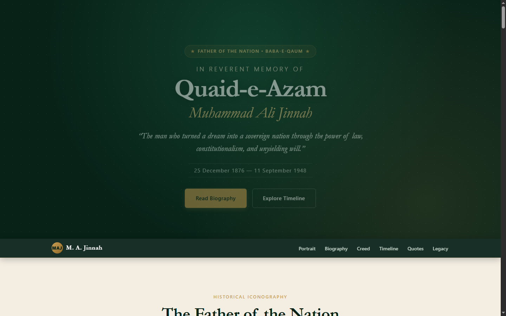
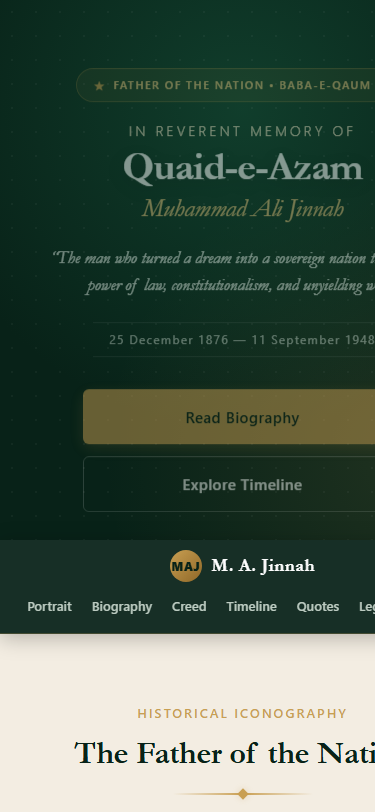

# Tribute Page: Quaid-e-Azam Muhammad Ali Jinnah

> **Oasis Infobyte Internship Program (OIBSIP)**  
> **Track:** Web Development & Designing  
> **Level:** 2 &mdash; **Task:** 2 (Tribute Page)  
> **Author:** Mudassir Ahmed  

---

## 1. Project Overview

This project is a dignified, museum-grade **Tribute Page** dedicated to **Quaid-e-Azam Muhammad Ali Jinnah** (25 December 1876 &ndash; 11 September 1948), the founding father and first Governor-General of Pakistan. Revered as *Baba-e-Qaum* ("Father of the Nation"), Jinnah accomplished one of the rarest feats in modern history: creating a sovereign nation-state through peaceful constitutionalism, parliamentary statecraft, and the power of law without ever mobilizing an army or resorting to political violence.

The page was built according to strict enterprise frontend standards: **100% pure semantic HTML5 and Vanilla CSS3**, completely free of external JavaScript or CSS frameworks.

- **Tagline:** *"The man who turned a dream into a sovereign nation through the power of law, constitutionalism, and unyielding will."*
- **Subject:** Quaid-e-Azam Muhammad Ali Jinnah (1876&ndash;1948)

---

## 2. Key Features

- **Hero & Header Section:**
  - High-impact visual entrance featuring an imperial heritage green palette (`#082218`), subtle radial illumination, and a gold crest badge (*"Father of the Nation &bull; Baba-e-Qaum"*).
  - Prominent typography pairing classical serif headings with a clean sans-serif body.
  - Action buttons (*"Read Biography"* and *"Explore Timeline"*) with smooth scrolling jump anchors.

- **Prominent Historical Portrait & Vitals Card:**
  - Iconic 1945 portrait of Quaid-e-Azam wearing his signature Karakul cap and formal attire, set within a double gold filigree frame with an inner vignette shadow.
  - Sourced directly from verified public domain historical archives on Wikimedia Commons.
  - Wrapped in semantic `<figure>` with detailed `<figcaption>` providing complete archival credit and licensing terms.
  - Built-in graceful fallback styling (background gradient frame with monogram emblem `MAJ`) if images are blocked or slow to load.
  - Accompanying historical vitals sidebar and high-resolution vector transcription of Jinnah's authentic personal signature.

- **Biographical Tribute Narrative (Original & Paraphrased):**
  - Four in-depth, original written chapters covering:
    1. *Early Life, Formative Education & Lincoln's Inn* (Karachi upbringing, qualifying as the youngest Indian barrister at age 19).
    2. *The Brilliant Barrister & Ambassador of Unity* (Bombay legal practice, constitutional ethics, 1916 Lucknow Pact).
    3. *Constitutional Divergence & The Pakistan Movement* (Fourteen Points, reorganizing the Muslim League, 1940 Lahore Resolution).
    4. *The Founding of Pakistan & An Immortal Legacy* (Independence on 14 August 1947, 11 August presidential speech on civic rights, guiding the nation through refugee crises, passing on 11 September 1948).
  - Highlighting his philosophy of constitutional resistance over demagoguery in a dedicated editorial callout.
  - Supporting archival photography of young Barrister Jinnah.

- **National Creed (The Three Pillars):**
  - Three heritage cards breaking down Jinnah's tripartite motto: **Unity (*Ittehad*)**, **Faith (*Yaqeen*)**, and **Discipline (*Tanzeem*)**.
  - Interactive hover elevation with gold accent highlights.

- **Chronological Milestones (Alternating Vertical Timeline):**
  - Nine verified milestones spanning from his birth in 1876 to his passing in 1948.
  - Desktop layout: Centered vertical gradient line with alternating left-and-right milestone cards and glowing golden markers.
  - Mobile layout: Gracefully collapses into a single-column timeline with the line and nodes on the left and cards aligned to the right.

- **Memorable Quotes & Global Tributes:**
  - Distinct midnight-emerald quote band featuring Stanley Wolpert's renowned opening tribute from *Jinnah of Pakistan* (Oxford University Press, 1984).
  - Historic excerpt from Jinnah's landmark 11 August 1947 address to the Constituent Assembly establishing complete freedom of religion and equal rights for all citizens.
  - Iconic quotes on decision-making, discipline, and devotion to duty.
  - Styled with oversized quotation marks, italic serif typography, and accent borders.

- **Enduring Legacy & Statistics:**
  - Key statistical impact cards highlighting his young age at the bar (19), public service span (42 years), and non-violent state creation (0 armies mobilized).
  - Closing gold-bordered heritage banner with Jinnah's famous declaration: *"There is no power on earth that can undo Pakistan."*

- **Pure CSS Sticky Navigation:**
  - Sticky glassmorphic navbar with gold brand monogram, smooth scrolling links, and section `scroll-margin-top` offsets.
  - Touch-friendly horizontal swipeable link list on mobile viewports.

---

## 3. Tech Stack & Constraints Compliance

| Requirement | Implementation Details |
| :--- | :--- |
| **Markup** | HTML5 Semantic Elements (`<header>`, `<nav>`, `<main>`, `<section>`, `<article>`, `<figure>`, `<figcaption>`, `<blockquote>`, `<cite>`, `<footer>`) |
| **Styling** | Vanilla CSS3 only (No Tailwind, No Bootstrap, No external UI libraries) |
| **JavaScript** | **Zero JavaScript** &mdash; All interactions (smooth scroll, sticky nav, mobile collapse, card hovers, animations) powered strictly by pure CSS |
| **Google Fonts** | Exactly two font families: <br>&bull; Heading: `Cormorant Garamond` (Classic Editorial Serif)<br>&bull; Body: `Inter` (Legible Modern Sans-Serif) |
| **Design Tokens** | CSS Custom Properties (`:root` variables) for all colors, spacing, borders, shadows, and fonts |
| **Global Reset** | Globally enforced `box-sizing: border-box` across `*`, `*::before`, and `*::after` |
| **Layout** | CSS Grid & Flexbox throughout; zero float layouts |
| **Multiple Backgrounds** | 6 distinct background color bands (Deep Heritage Green `#082218`, Warm Sandstone `#f3ede2`, Linen Cream `#faf7f0`, Gallery White `#ffffff`, Midnight Emerald `#051911`, Velvet Forest `#03120c`) |
| **Responsiveness** | Fluid responsive layouts fully tested and verified across **320px**, **375px**, **768px**, **1024px**, and **1440px+** without horizontal scrolling |

---

## 4. Image Credits & Licensing

All historical photographic assets are verified public domain works preserved in national archives and hosted via Wikimedia Commons:

1. **Lead Historical Portrait (1945):**
   - **File:** `jinnah.jpg`
   - **Subject:** Quaid-e-Azam Muhammad Ali Jinnah wearing Karakul cap and sherwani
   - **Source:** Matlubul Hassan Saiyid, *Muhammad Ali Jinnah: A Political Study* (Lahore: Shaikh Muhammad Ashraf, 1945), frontispiece.
   - **Licence:** Public Domain under Pakistan Copyright Law (copyright expired 1995; over 50 years post-publication).
   - **Commons Link:** [File:Jinnah.jpg on Wikimedia Commons](https://commons.wikimedia.org/wiki/File:Jinnah.jpg)

2. **Early Legal Career Photograph (c. 1910s):**
   - **File:** `jinnah-portrait.jpg`
   - **Subject:** Barrister M. A. Jinnah in Bombay
   - **Source:** Ministry of Information & Broadcasting, Government of Pakistan.
   - **Licence:** Public Domain (`PD-Pakistan`).
   - **Commons Link:** [File:Mohammad Ali Jinnah.jpg on Wikimedia Commons](https://commons.wikimedia.org/wiki/File:Mohammad_Ali_Jinnah.jpg)

3. **Authentic Signature:**
   - **File:** `jinnah-signature.svg`
   - **Source:** Vectorized transcription of Muhammad Ali Jinnah's historical signature.
   - **Licence:** Public Domain (`PD-ineligible` / historical signature).
   - **Commons Link:** [File:Jinnah signature.svg on Wikimedia Commons](https://commons.wikimedia.org/wiki/File:Jinnah_signature.svg)

---

## 5. Research Sources (Paraphrased & Original Narrative)

The biographical prose and milestone descriptions on this page are completely original compositions written for this tribute, carefully researched and paraphrased from authoritative scholarly sources:
- **Wolpert, Stanley (1984).** *Jinnah of Pakistan*. Oxford University Press.
- **Bolitho, Hector (1954).** *Jinnah: Creator of Pakistan*. John Murray, London.
- **Encyclopaedia Britannica.** *Muhammad Ali Jinnah (Founder of Pakistan)*.
- **National Archives of Pakistan & Ministry of Information and Broadcasting.** *Quaid-e-Azam Muhammad Ali Jinnah: Speeches and Statements (1947–1948)*.
- **Ahmed, Akbar S. (1997).** *Jinnah, Pakistan and Islamic Identity: The Search for Saladin*. Routledge.

---

## 6. Project Folder Structure

```
OIBSIP/
└── WebDev-L2-TributePage/
    ├── index.html              # Main semantic HTML5 document
    ├── style.css               # Comprehensive vanilla CSS3 stylesheet
    ├── README.md               # Internship documentation and overview
    ├── assets/                 # Archival photographic media & vector assets
    │   ├── jinnah.jpg          # 1945 Iconic portrait with Karakul cap (Public Domain)
    │   ├── jinnah-portrait.jpg # Early Barrister portrait (Public Domain)
    │   └── jinnah-signature.svg# Vector transcription of Jinnah's signature
    └── screenshots/            # Visual proof across desktop & mobile viewports
        ├── desktop.png         # Desktop viewport capture (1440x900)
        ├── desktop-full.png    # Complete page desktop layout
        ├── mobile.png          # Mobile viewport capture (375x812)
        └── mobile-full.png     # Complete page mobile layout
```

---

## 7. How to Run the Project

No build step, Node server, or external package manager is required.

1. **Direct Browser Execution:**
   - Navigate to `OIBSIP/WebDev-L2-TributePage/`
   - Double-click `index.html` (or right-click &rarr; *Open with Google Chrome / Microsoft Edge / Mozilla Firefox*).
2. **Local Static Server (Optional):**
   ```bash
   # Using Python 3:
   cd OIBSIP/WebDev-L2-TributePage
   python -m http.server 8000

   # Using Node (npx):
   npx serve .
   ```
   Then open `http://localhost:8000` in your web browser.

---

## 8. Visual Proof & Screenshots

### Desktop View (1440px Viewport)


### Mobile View (375px Viewport)


---

## 9. What I Learned

During the completion of this Level 2 Task for Oasis Infobyte, I strengthened several key front-end proficiencies:
1. **Semantic HTML5 Mastery:** Structuring an editorial web document using `<article>`, `<section>`, `<aside>`, `<figure>`, `<figcaption>`, and `<blockquote>` for high accessibility and SEO optimization.
2. **CSS Custom Properties Design System:** Architecting a cohesive design token system in `:root` that standardizes typography, spacing, elevations, and a dignified heritage color scheme.
3. **Pure CSS Responsive Architecture:** Building a responsive vertical timeline that switches from a centered dual-sided desktop layout to a left-aligned single-column mobile layout purely through media queries and flexbox/grid positioning without any JavaScript.
4. **Fluid Typography:** Implementing `clamp()` calculations for headers and body copy that scale dynamically from narrow 320px mobile viewports up to 4K displays.
5. **Accessible Contrast & Visual Hierarchy:** Ensuring WCAG AA compliance across multiple background bands (dark greens, cream, white, and obsidian) while maintaining museum-grade aesthetic beauty.

---

## 10. Author & Submission Information

- **Intern:** Mudassir Ahmed
- **Company:** Oasis Infobyte (OIBSIP)
- **Role:** Web Development and Designing Intern
- **Project:** Level 2 &mdash; Task 2: Tribute Page
- **Submission Date:** October 2026
