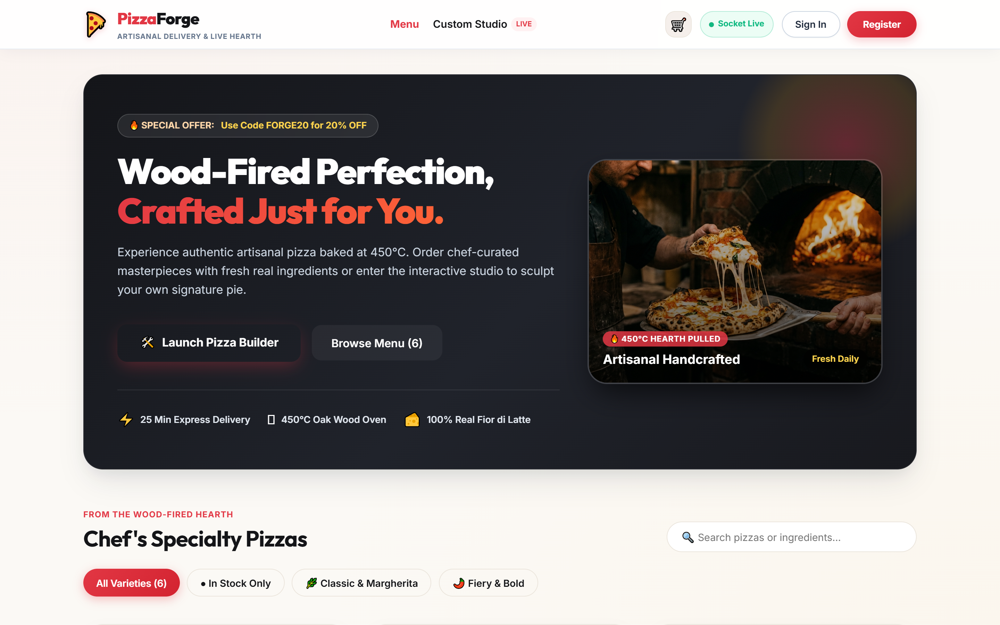
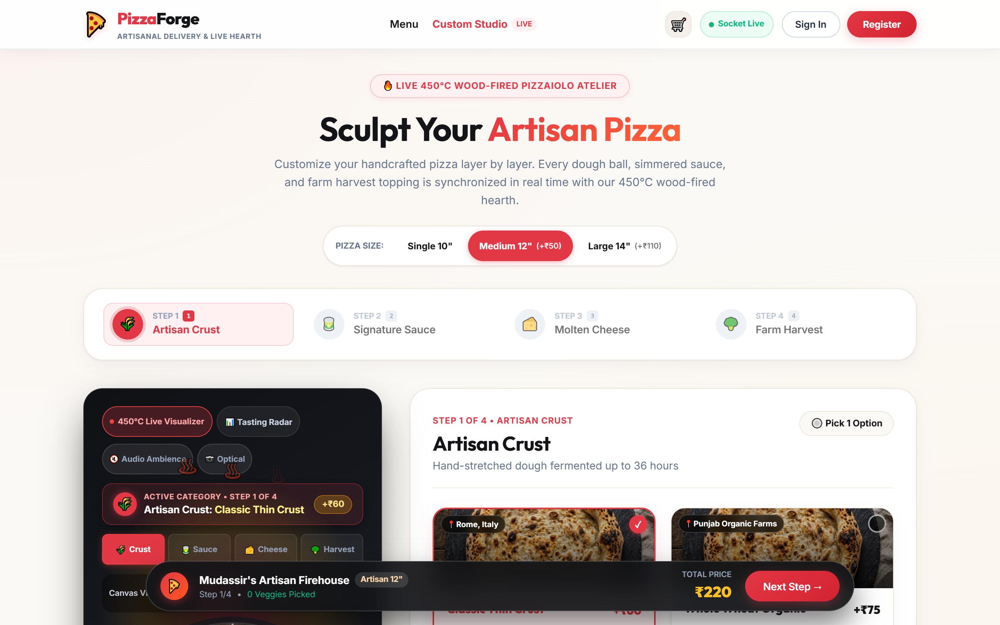
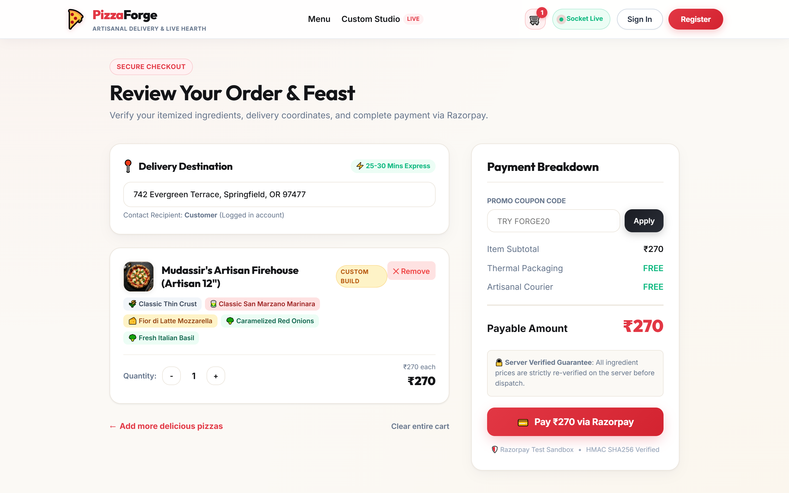
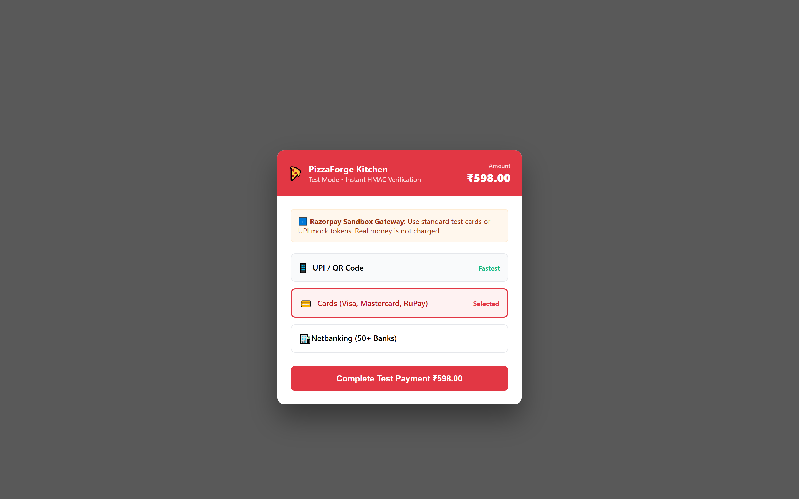
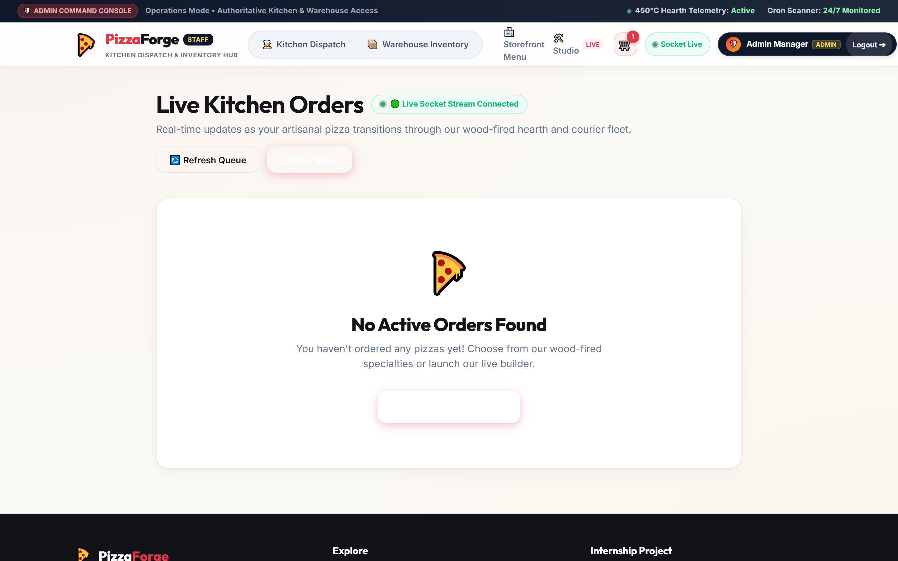
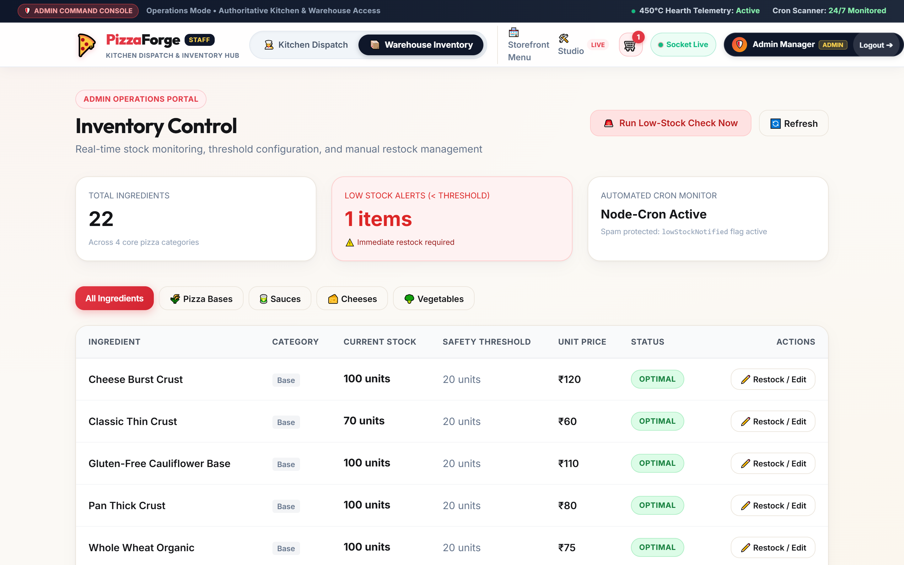
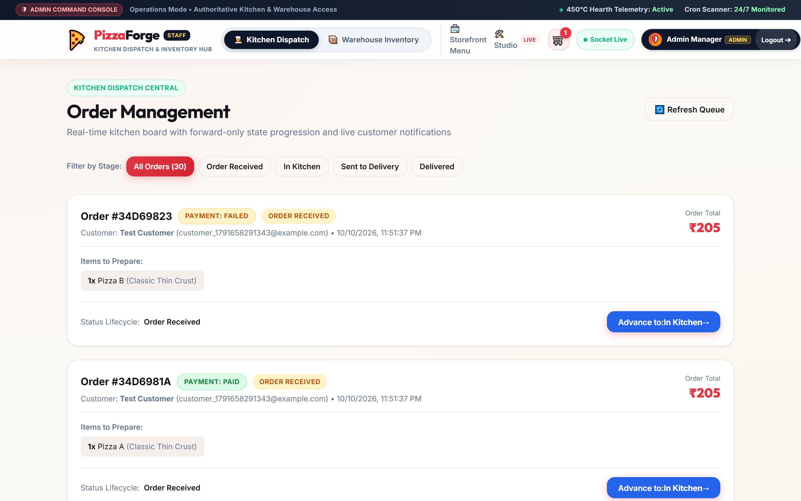
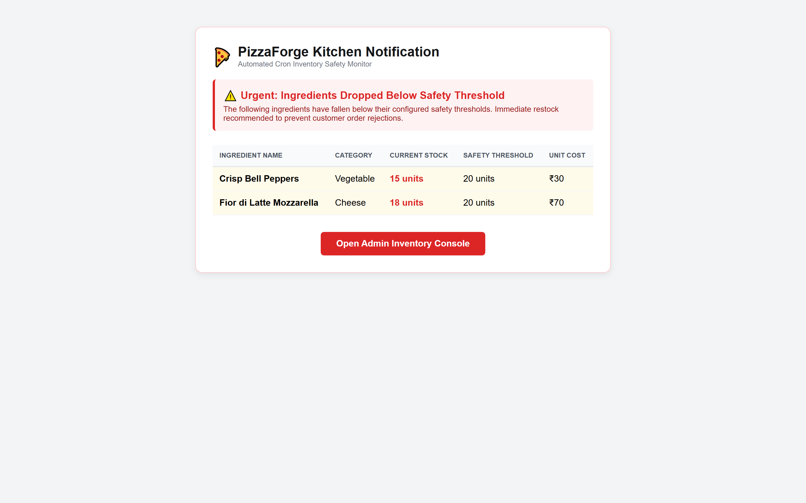

# 🍕 PizzaForge | Artisanal Pizza Delivery & Real-Time Inventory Platform

> **Oasis Infobyte Internship Submission**  
> **Track:** Web Development  
> **Level:** Level 3, Task 1  
> **Developer / Author:** Mudassir Ahmed  
> **Project Code:** `OIBSIP/WebDev-L3-PizzaDelivery`

---

## 📌 Project Overview
**PizzaForge** is a production-grade, full-stack web platform built for high-throughput artisanal pizza ordering, real-time wood-fired kitchen queue management, and automated warehouse inventory control. Designed with strict security policies, atomic database concurrency controls, server-side price recalculation, and live WebSocket telemetry, the platform guarantees that stock never oversells, customer payments are cryptographically verified, and inventory levels are proactively monitored 24/7.

---

## 📸 Application Screenshots

| Customer Storefront | Custom Pizza Builder |
| :---: | :---: |
|  |  |

| Order Summary & Price Recalculation | Razorpay Test Checkout |
| :---: | :---: |
|  |  |

| Live Stepper & Real-Time Kitchen Tracking | Admin Warehouse & Low-Stock Alerts |
| :---: | :---: |
|  |  |

| Admin Kitchen Dispatch Queue | Automated Low-Stock Email Alert |
| :---: | :---: |
|  |  |

---

## 🚀 Key Feature Matrix

### 👤 Customer Experience
1. **Secure Registration with Email Activation:**
   - Accounts start unverified.
   - Generates random, SHA-256 hashed, expiring activation tokens (24h lifespan).
   - Login is strictly blocked until verified, with an in-app *"Resend Verification Link"* action.
2. **JWT Authentication & Session Management:**
   - Safe profiles returned (passwords and internal tokens are never serialized).
   - Centralized Axios request & response interceptors with automatic session renewal or redirection on expiry.
3. **Account Enumeration Protection (Forgot Password):**
   - Timing and response-neutral password reset requests prevent user database enumeration.
   - Cryptographically hashed 15-minute expiring reset tokens.
4. **Artisanal Menu Dashboard:**
   - Displays 6 chef-crafted pizzas with dynamic CSS gradients, ingredient chips, and prices.
   - Real-time stock audit: any variety with unavailable ingredients is automatically flagged as *"Out of Stock"* and order button disabled.
5. **Interactive 4-Step Custom Pizza Studio:**
   - **Step 1:** Choose Crust (Classic Thin, Pan Thick, Cheese Burst, Whole Wheat, Gluten-Free).
   - **Step 2:** Choose Sauce (San Marzano Marinara, Peri-Peri, Garlic Alfredo, Chipotle BBQ, Basil Pesto).
   - **Step 3:** Choose Cheese (Mozzarella, Cheddar Blend, Smoked Gouda, Plant-Based Vegan).
   - **Step 4:** Choose Farm Veggies (Multi-select from 8 fresh farm vegetables).
   - Live running price tag recalculation.
   - Automatic step-order enforcement and instant disabling of depleted warehouse ingredients.
6. **Order Summary with Server-Side Price Auditing:**
   - Itemized recipe breakdown with quantity increment/decrement controls.
   - **Zero Client Trust:** Total amount is recomputed entirely on the server using authoritative DB prices.
7. **Razorpay Test Checkout & HMAC Signature Verification:**
   - Dynamic injection of Razorpay SDK (`checkout.js`) only upon payment request.
   - Server creates Razorpay Order in paise.
   - On payment completion, the server cryptographically verifies the SHA-256 HMAC signature before capturing payment and decrementing stock.
   - Popup dismissal and payment failures are handled gracefully (order remains pending for retry).
8. **Real-Time Visual Order Stepper:**
   - Visual 4-step progress bar: `Order Received` → `In Kitchen` → `Sent to Delivery` → `Delivered`.
   - Dynamic WebSocket reflection via Socket.IO room subscriptions (`user_${userId}`).
   - Automatic 5-second polling fallback if WebSocket disconnects.

---

### 🛡️ Administrative & Kitchen Operations
1. **Dedicated Administrator Entrance (`/admin/login`):**
   - Public registration cannot create admin accounts (strictly ignores `role` payload).
   - Admin accounts are provisioned exclusively via the idempotent seed script.
   - Server-side middleware returns `403 Forbidden` if unauthorized customers attempt admin operations.
2. **Real-Time Warehouse Inventory Dashboard:**
   - Categorized views of bases, sauces, cheeses, and vegetables.
   - Low-stock ingredients (`stock < threshold`) are highlighted in warning red.
3. **Atomic Stock Decrement & Concurrency Rollback:**
   - Uses atomic MongoDB updates: `findOneAndUpdate({ _id, stock: { $gte: qty } }, { $inc: { stock: -qty } })`.
   - If concurrent orders contend for the last unit of an ingredient, exactly one succeeds; the other rolls back cleanly. Stock never goes negative.
   - Idempotency guard prevents duplicate payment callbacks from double-decrementing stock.
4. **Manual Restock & Dynamic Safety Thresholds:**
   - Restock ingredients by adding units (`+25`) or setting exact counts.
   - Adjust threshold per ingredient (validates non-negative integers).
   - Restocking an item above its threshold automatically resets the `lowStockNotified` flag.
5. **Automated Scheduled Low-Stock Monitor (`node-cron`):**
   - Runs on a cron schedule (`CRON_SCHEDULE="0 * * * *"` by default, configurable to `* * * * *` for 1-minute demos).
   - Scans for items below threshold and emails an HTML summary table to the admin.
   - Uses `lowStockNotified` anti-spam flag to prevent repeated duplicate emails.
   - Includes immediate post-order threshold detection and an admin *"Run Low-Stock Check Now"* button.
6. **Kitchen Dispatch Queue & Forward-Only Lifecycle:**
   - Chronological list of orders (newest first) with customer info, items, and status filter.
   - Strict forward-only state progression: prevents kitchen operators from reverting delivered orders backwards.
   - Real-time `new_order_placed` audio/visual toast notifications when orders arrive.

---

## 🛠️ Technology Stack

| Layer | Technologies |
| :--- | :--- |
| **Frontend** | React 18 (Vite), React Router v6, Axios, Socket.IO Client, Pure CSS Modules / Design System |
| **Backend** | Node.js, Express.js |
| **Database** | MongoDB with Mongoose ODM (Atlas & Local with built-in in-memory fallback) |
| **Authentication** | JWT (JSON Web Tokens), bcryptjs (salt cost 12), SHA-256 token hashing |
| **Payments** | Razorpay (Test Mode) with server-side HMAC SHA-256 signature verification |
| **Real-Time** | Socket.IO (room-based user & admin broadcasts) + 5s polling fallback |
| **Email Service** | Nodemailer (SMTP, Ethereal test account generator, & safe console fallback) |
| **Task Scheduling** | node-cron (automated inventory threshold scanner) |
| **Security** | Helmet, CORS, Express-Rate-Limit, Express-Mongo-Sanitize, Input Validation |

---

## 🏗️ System Architecture & Payment Lifecycle

```
[ Customer Browser ]                 [ PizzaForge Backend ]               [ Razorpay Gateway ]
        |                                      |                                    |
        |---- 1. POST /api/orders/checkout --->|                                    |
        |     (Cart Items payload)             |-- Recomputes prices on server      |
        |                                      |-- Checks stock availability        |
        |                                      |---- 2. Create Order in paise ----->|
        |                                      |<--- 3. Returns razorpay_order_id --|
        |<--- 4. Order ID & Key ID ------------|                                    |
        |                                                                           |
        |---- 5. Opens Checkout Popup --------------------------------------------->|
        |<--- 6. Customer Completes Test Payment (Card / UPI) ----------------------|
        |        (Returns payment_id, order_id, signature)                          |
        |                                      |                                    |
        |---- 7. POST /api/orders/verify-payment ---------------------------------->|
        |        (orderId, paymentId, signature)                                    |
        |                                      |-- Computes expected HMAC SHA-256   |
        |                                      |-- If Signature valid:              |
        |                                      |    * Atomic stock decrement        |
        |                                      |    * Rolls back if scarce          |
        |                                      |    * Status -> 'Order Received'    |
        |                                      |    * Emits Socket.IO live event    |
        |<--- 8. 200 OK Order Confirmed -------|                                    |
        |                                      |                                    |
        |                                      |===== Socket.IO: 'new_order_placed' =====> [ Admin Queue ]
```

---

## 📁 Repository Structure

```
OIBSIP/WebDev-L3-PizzaDelivery/
├── client/                          # React + Vite Frontend
│   ├── src/
│   │   ├── components/              # Navbar, Footer, OrderStepper, PizzaCard, ProtectedRoute, AdminRoute
│   │   ├── context/                 # AuthContext, CartContext, SocketContext, ToastContext
│   │   ├── pages/                   # Dashboard, PizzaBuilder, OrderSummary, MyOrders, Login, Register, VerifyEmail, ForgotPassword, ResetPassword, AdminLogin, InventoryDashboard, OrderManagement
│   │   ├── services/                # api.js (Axios with auth interceptors), razorpay.js (dynamic script loader)
│   │   ├── styles/                  # index.css (Design tokens, responsive utilities)
│   │   ├── App.jsx                  # Main router tree
│   │   └── main.jsx                 # Client entrypoint
│   ├── .env.example                 # Client environment template
│   ├── index.html                   # HTML5 shell with Google Fonts
│   ├── package.json                 # Client dependencies & Vite scripts
│   └── vite.config.js               # Vite build configuration
├── server/                          # Node.js + Express Backend
│   ├── config/                      # env.js (env validator), db.js (Atlas, local & in-memory runner)
│   ├── controllers/                 # authController, catalogueController, orderController, adminController
│   ├── middleware/                  # authMiddleware, adminMiddleware, rateLimiter, errorMiddleware, validateMiddleware
│   ├── models/                      # User.js, InventoryItem.js, Pizza.js, Order.js
│   ├── routes/                      # authRoutes, catalogueRoutes, orderRoutes, adminRoutes
│   ├── seed/                        # seed.js (Idempotent warehouse and admin initializer)
│   ├── services/                    # emailService, razorpayService, inventoryService, cronService
│   ├── sockets/                     # socketHandler.js (Socket.IO engine & rooms)
│   ├── tests/                       # runAllTests.js (23 automated test suites), captureScreenshots.js
│   ├── utils/                       # tokenUtils.js, priceCalculator.js
│   ├── .env.example                 # Server environment template
│   ├── package.json                 # Backend dependencies & scripts
│   └── server.js                    # Express app & HTTP listener
├── screenshots/                     # 10 High-resolution UI captures
├── .gitignore                       # Git ignore rules (.env, node_modules, build outputs)
├── package.json                     # Monorepo runner scripts
└── README.md                        # Documentation & setup guide
```

---

## ⚙️ Setup & Installation Guide

### Prerequisites
- **Node.js:** v18.0.0 or later (v20+ / v24+ supported)
- **npm:** v9.0.0 or later
- **MongoDB:** MongoDB Atlas connection string OR local `mongodb://localhost:27017` *(If not provided, the server automatically starts an in-memory MongoDB instance for seamless instant zero-config evaluation)*.

### 1. Clone & Install Dependencies
From the repository root:
```bash
# Navigate to the project folder
cd OIBSIP/WebDev-L3-PizzaDelivery

# Install all backend and frontend dependencies
npm run install:all
```

*(Alternatively, run `npm install` inside `/server` and `npm install` inside `/client`)*.

---

### 2. Environment Variables Configuration

Create `/server/.env` and `/client/.env` based on their respective `.env.example` templates:

#### `/server/.env`
```ini
PORT=5000
NODE_ENV=development
CLIENT_URL=http://localhost:5173

# MongoDB Atlas or Local URI (Leave blank to use embedded memory DB)
MONGO_URI=mongodb://localhost:27017/pizzaforge

# JWT Authentication
JWT_SECRET=super_secret_pizzaforge_jwt_key_32_chars_minimum_here!
JWT_EXPIRES_IN=1d

# Seed Script Admin Credentials
ADMIN_NAME=Admin Manager
ADMIN_EMAIL=admin@pizzaforge.com
ADMIN_PASSWORD=Admin@123456

# Razorpay Test Mode Credentials (https://dashboard.razorpay.com/)
RAZORPAY_KEY_ID=rzp_test_sample_key_id
RAZORPAY_KEY_SECRET=sample_key_secret_for_test

# Nodemailer SMTP (Leave blank to auto-generate Ethereal preview links)
SMTP_HOST=smtp.ethereal.email
SMTP_PORT=587
SMTP_USER=
SMTP_PASS=
SMTP_FROM="PizzaForge Kitchen" <noreply@pizzaforge.com>

# Low Stock Cron Schedule (Default: hourly "0 * * * *". For 1-min demo use "* * * * *")
CRON_SCHEDULE=0 * * * *
```

#### `/client/.env`
```ini
VITE_API_BASE_URL=http://localhost:5000/api
VITE_SOCKET_URL=http://localhost:5000
VITE_RAZORPAY_KEY_ID=rzp_test_sample_key_id
```

---

### 3. Seed Database & Start Applications
```bash
# Step 1: Seed initial warehouse inventory, predefined pizzas, and admin account
npm run seed

# Step 2: Start both Server and Client concurrently
npm run dev
```

- **Frontend Client:** http://localhost:5173
- **Backend API:** http://localhost:5000
- **Health Check:** http://localhost:5000/api/health
- **Default Admin Login:**
  - **Portal:** http://localhost:5173/admin/login
  - **Email:** `admin@pizzaforge.com`
  - **Password:** `Admin@123456`

---

## 🧪 Comprehensive Automated Test Suite

Run the full end-to-end automated test suite:
```bash
npm run test:suite
```

### Verified Test Assertions Matrix
| # | Test Scenario | Verified Condition | Status |
| :---: | :--- | :--- | :---: |
| 1 | Health Check | `GET /api/health` returns `healthy` | ✅ PASS |
| 2 | Catalogue API | `GET /api/pizzas` returns all 6 predefined pizzas | ✅ PASS |
| 3 | Public Safe Options | `GET /api/inventory/options` returns bases, sauces, cheeses, veggies | ✅ PASS |
| 4 | Registration Role Guard | Register payload with `role: "admin"` is forced to `"user"` | ✅ PASS |
| 5 | Login Verification Block | Unverified user attempting login receives `403 isUnverified: true` | ✅ PASS |
| 6 | Verification Dispatch | Random hashed token generated and dispatched via email service | ✅ PASS |
| 7 | Email Activation | `GET /api/auth/verify/:token` marks account `isVerified: true` | ✅ PASS |
| 8 | Safe Profile JWT Login | Login returns signed JWT and safe user object (no passwordHash) | ✅ PASS |
| 9 | Authentication Obfuscation | Invalid passwords return generic 401 without leaking user state | ✅ PASS |
| 10 | Route Role Protection | Customer JWT hitting `/api/admin/*` receives `403 Forbidden` | ✅ PASS |
| 11 | Admin Authentication | Seeded credentials authenticate `/api/auth/admin-login` with `admin` role | ✅ PASS |
| 12 | Admin Inventory Access | Admin retrieves full stock quantities and safety threshold metrics | ✅ PASS |
| 13 | Anti-Enumeration Test | Forgot password returns identical response for known and unknown emails | ✅ PASS |
| 14 | Price Tampering Guard | Checkout with tampered client unitPrice (`₹1`) recalculates server price (`₹598`) | ✅ PASS |
| 15 | Signature Forgery Guard | Forged Razorpay HMAC SHA-256 signature rejected with 400 | ✅ PASS |
| 16 | Valid Payment Verification | Valid signature marks order paid and status `'Order Received'` | ✅ PASS |
| 17 | Atomic Stock Decrement | Base stock decremented atomically by order quantity (`100 -> 98`) | ✅ PASS |
| 18 | Idempotent Verification | Duplicate payment callback returns early without decrementing twice | ✅ PASS |
| 19 | Forward Status Advance | Admin advances order from `'Order Received'` to `'In Kitchen'` | ✅ PASS |
| 20 | Backward Revert Guard | Admin cannot revert status backwards (`'In Kitchen' -> 'Order Received'`) | ✅ PASS |
| 21 | Manual Stock Adjustment | Admin updates stock to 15 (below threshold 20) | ✅ PASS |
| 22 | Low-Stock Email Alert | Immediate check detects item below threshold and dispatches email | ✅ PASS |
| 23 | Concurrency Race Test | Two simultaneous orders for 1 remaining unit: exactly 1 succeeds, stock never negative | ✅ PASS |

---

## 🔒 Security & Defensive Engineering Standards
- **Zero Client Trust:** Prices, ingredients, and roles sent by client requests are discarded and recomputed strictly from the database.
- **Atomic Concurrency:** Stock allocation uses atomic `findOneAndUpdate` queries with rollback logic.
- **Idempotency:** Payment verification endpoints are idempotent to withstand duplicate webhook/network retries.
- **Rate Limiting:** IP rate limits on auth routes prevent brute-force credential stuffing.
- **NoSQL Injection Sanitization:** `express-mongo-sanitize` strips out `$` operators.
- **Safe Serialization:** User models explicitly strip `passwordHash` and reset tokens during JSON serialization.
- **Hardened HTTP Headers:** `helmet` sets CSP, X-Frame-Options, and referrer policies.

---

## 💡 What I Learned
Building PizzaForge provided practical engineering insights into:
1. Handling database race conditions in high-concurrency e-commerce setups using atomic queries and rollback compensation.
2. Integrating payment gateways cleanly with server-side HMAC cryptographic verification rather than relying on client callbacks.
3. Architecting real-time WebSocket state distribution with fallback polling to maintain high availability across unreliable connections.
4. Structuring clean monorepos with separation of concerns across controllers, services, middleware, and domain models.

---

## 👨‍💻 Submission Details
- **Project:** PizzaForge - Level 3, Task 1
- **Internship Program:** Oasis Infobyte (OIBSIP)
- **Author:** Mudassir Ahmed
- **Date:** October 2026
